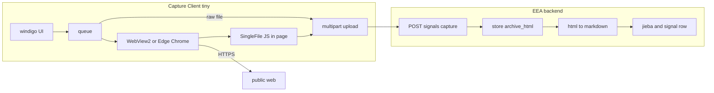
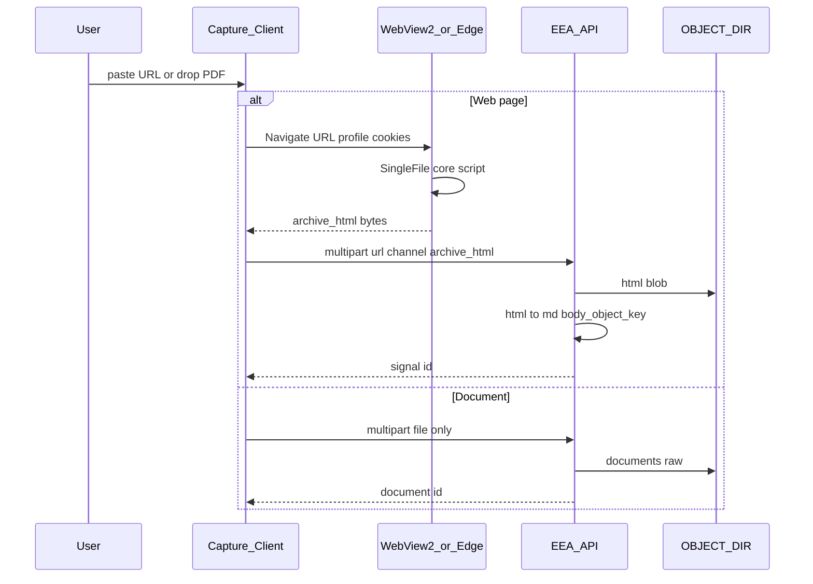

# Capture Client — implementation plan

状态：2026-10-28。对照 WBS W2（[`docs/wbs/EEA-WBS-工作清单.xlsx`](../docs/wbs/EEA-WBS-工作清单.xlsx)）、[`docs/platform-implementation-plan.md`](../docs/platform-implementation-plan.md) §7。**Capture Client 计划见本文件**；服务端 API 见 [`../backend/TODO.md`](../backend/TODO.md)（已对齐）。

## 待办 checklist

### Backend（W2 ingest — 已在 [`../backend/TODO.md`](../backend/TODO.md) 落地）

- [x] `objectstore`: `save_bytes` / `load_bytes`（[`../backend/app/services/objectstore.py`](../backend/app/services/objectstore.py)）
- [x] Alembic：`snapshot_html_object_key`（`0003`）；`eea_document` 表替代可选 `ingest_document_key`
- [x] `POST /api/v1/signals/capture` — multipart：`url` + `archive_html`（**无** `body_md`）
- [x] `app/services/html_snapshot.py`：HTML → Markdown/正文 → `save_body`；从 HTML 抽 title / publisher / published_at
- [x] `GET /api/v1/signals/{id}/archive`（text/html）
- [x] `POST /api/v1/documents/raw` — 原文件 only（W4 再 MarkItDown；MinerU 已排除）
- [x] pytest：fixture `.html` 上传 → body 非空、archive 可回放（[`../backend/tests/test_capture.py`](../backend/tests/test_capture.py)）

### Capture Client（本目录）

- [x] `go.mod` + `cmd/capture/main.go`（默认 GUI，`capture upload` CLI）
- [x] `internal/config` + `config.example.json`
- [x] `internal/platform` — multipart 上传（仅 url + archive_html 或 raw file）
- [x] `scripts/vendor-singlefile.sh` + embed SingleFile core
- [x] `internal/capture` — **Edge/Chrome + CDP 主路径**（替代原计划 WebView2；见下）
- [x] `internal/ui` — windigo 小窗：粘贴/拖放合一，设置面板收在「设置」里（对齐 buddy 视觉）
- [x] `internal/queue` — 并发与失败重试
- [x] 内网自动寻址：`internal/netinfo` 跳过 VMware/Hyper-V，绑定物理网卡；`auto_api` + `doctor` 显示 LAN IP
- [x] 120 MiB 上限与独立上传超时（`upload_timeout_sec=900`）；121 MiB 客户端直接拒绝
- [x] 已保存网页入库：`upload --html F [--html-url U]`、GUI 拖入 `.html`（URL 从 canonical/og:url 推断）
- [x] `README.md` — 构建、profile 登录、配置说明

已完成并验证（2026-10-28）：真 Edge 抓取本地页与 `baidu.com`（6.8 MB 自包含）、GUI 端到端到桩服务端、`go test ./...` 含真浏览器用例。

**抓取引擎偏差**：原计划 WebView2 为 1 号路径、Rod+Edge 回退。落地时改为直接用本机 Edge/Chrome + 自写 CDP 客户端（stdlib websocket），原因：企网无法拉 Go 依赖（`go-rod` / WebView2 绑定均取不到），windigo 无浏览器宿主；CDP 同样满足「系统浏览器、独立 profile、可见登录」，且不引入 Chromium 下载。`capture_engine` 仍保留 `edge|chrome`。

**联调后端（2026-10-28）**：上述端点已在 backend 实现。本地验收：`scripts/start_api.py` 后 `capture doctor` → `capture upload --url …` / `--html`；前端 `newSignal` 亦接同一 capture / `documents/raw` 契约。

**离线归档（2026-10-28 已交付）**：`--html` / GUI 拖入 `.html` 走同一条 capture 契约，URL 推断顺序 canonical → `og:url` → `twitter:url`，可用 `--html-url` 覆盖；无来源则拒传。CLI 与 GUI 已对 live API 验证（`text/html` + 原文件名 + 推断 URL）。

---

## 设计原则：瘦客户端、胖服务端

| 层 | 职责 |
|----|------|
| **Capture Client**（`client/`） | 公网抓取；SingleFile 式**自包含 HTML**；上传 **URL + HTML** 或**原始文档**；可从 URL 推断 `channel_code`（如 `mp.weixin.qq.com` → `wechat_mp`）。**不做** HTML→MD、**不做** MarkItDown/MinerU、**不打包** Chromium。 |
| **EEA backend** | 收 HTML → **转 Markdown** 写入 `body_object_key`；从 HTML 抽元数据；jieba 预标与归集；文档 blob 存盘，W4 服务端解析。 |





---

## 命名

| 项 | 值 |
|----|-----|
| 产品名 | **Capture Client** |
| 目录 | `client/` |
| 二进制 | `capture.exe` / `capture` |
| 入口 | `client/cmd/capture/main.go` |

---

## 依赖（Go 尽量小）

### 页面抓取（`config.capture_engine`）

| 优先级 | 引擎 | Go 依赖 | 说明 |
|--------|------|---------|------|
| 1 默认 | **WebView2** | 如 `github.com/wailsapp/go-webview2` | 系统 Edge WebView2 Runtime，exe 不内嵌 Chromium；Navigate + ExecuteScript 跑 SingleFile |
| 2 回退 | **本机 Edge/Chrome + Rod** | `go-rod/rod` + `launcher` | 仅 `Bin(path).UserDataDir(profile)`，禁止 Rod 默认下载浏览器 |
| 3 | chromedp | 与 Rod **二选一** | 同样只用系统浏览器路径 |

配置：`capture_engine` = `webview2` | `edge` | `chrome`；`browser_path`；`user_data_dir`。

### UI（Windows v1）

- **windigo**（参考 buddy 仓库 Win32 小窗 + 可选托盘）
- 文件：选文件按钮 + 可选 Shell 拖放（实现阶段）

### 客户端包含

- Vendored **single-file-core**（[SingleFile releases](https://github.com/gildas-lormeau/SingleFile/releases)）→ `go:embed`；**AGPL**，内部分发需法务确认
- **stdlib** + `net/http` multipart

### 客户端明确不做

- html-to-markdown、MarkItDown、MinerU、Fyne、内置 Chromium、Rod 自动下载浏览器、LLM

---

## 服务端：`POST /api/v1/signals/capture`

1. 存 `archive_html` → `snapshot_html_object_key`
2. HTML → MD/正文（`html_snapshot.py`：`markdownify` / `html2text` 或 MarkItDown，可后续换实现不改客户端）
3. `save_body` → jieba / 归集（沿用现有 [`signals.py`](../backend/app/api/v1/signals.py) 创建流）
4. 服务端从 HTML 抽 title、publisher、published_at

| 字段 | 客户端 | 服务端 |
|------|--------|--------|
| `url` | 必填 | 必填 |
| `channel_code` | 可选（URL 推断） | 归一化词表 |
| `archive_html` | 必填（文件 part） | 存盘 + 转换 |
| `body_md` | **不发送** | 服务端生成 |

文档：`POST /api/v1/documents/raw`，客户端只传原文件。

---

## 目录结构（规划）

| 路径 | 作用 |
|------|------|
| `cmd/capture/main.go` | 默认 GUI；CLI 子命令 |
| `internal/cli` | `upload --url` / `--file`、`version` |
| `internal/config` | `api_base`、`capture_engine`、`browser_path`、`user_data_dir`、`max_parallel`、`max_upload_mb` |
| `internal/ui` | windigo UI |
| `internal/queue` | worker pool |
| `internal/capture` | `CaptureURL(ctx, url) ([]byte, error)` |
| `internal/singlefile` | embed JS |
| `internal/platform` | HTTP multipart |
| `scripts/vendor-singlefile.sh` | 固定 SingleFile 版本 |

---

## `config.json` 示例

```json
{
  "api_base": "http://127.0.0.1:8000",
  "capture_engine": "webview2",
  "browser_path": "",
  "user_data_dir": "data/browser-profile",
  "max_parallel": 2,
  "max_upload_mb": 120
}
```

`browser_path` 为空时，回退引擎解析 Edge / Chrome 常见安装路径。

---

## 实施顺序

1. ~~Backend：capture + html→md + 测试~~ ✅（见 backend/TODO B1–B6）
2. ~~Client CLI：fixture `.html` 上传~~ ✅
3. ~~SingleFile + 真 URL 冒烟~~ ✅（CDP + Edge，非 WebView2）
4. ~~windigo GUI~~ ✅
5. W2 二十条链接验收表（业务提供 URL；模板见 backend/TODO B7 `client/fixtures/acceptance-links.md` 可选新建）

## 风险

| 风险 | 应对 |
|------|------|
| 未装 WebView2 Runtime | README 安装说明；`capture_engine=edge` |
| SingleFile 在 WebView2 内行为 | 尽早原型；回退 Rod+Edge |
| 微信登录 | 可见 profile；平台 REQ-SIG-11 粘贴补救 |
| HTML 过大 | `max_upload_mb` |
| MD 质量 | 仅改服务端转换库，客户端不变 |

---

## 约束

- 生产 API **无公网**；仅 Capture Client 访问公网。  
- 不新增第六种证据状态（REQ-SIG-10）。  
- 抓取失败仍保留 URL；禁止无正文却标「已留存」。
