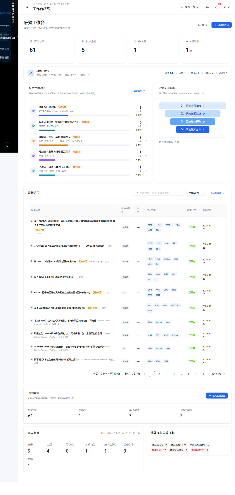
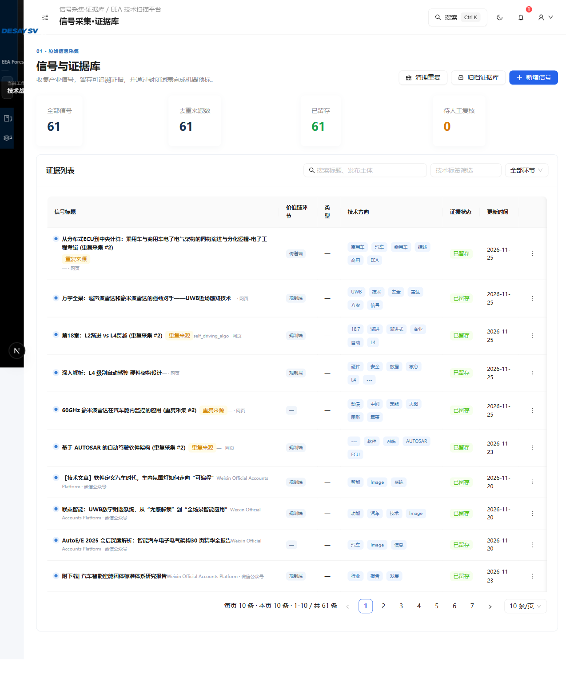
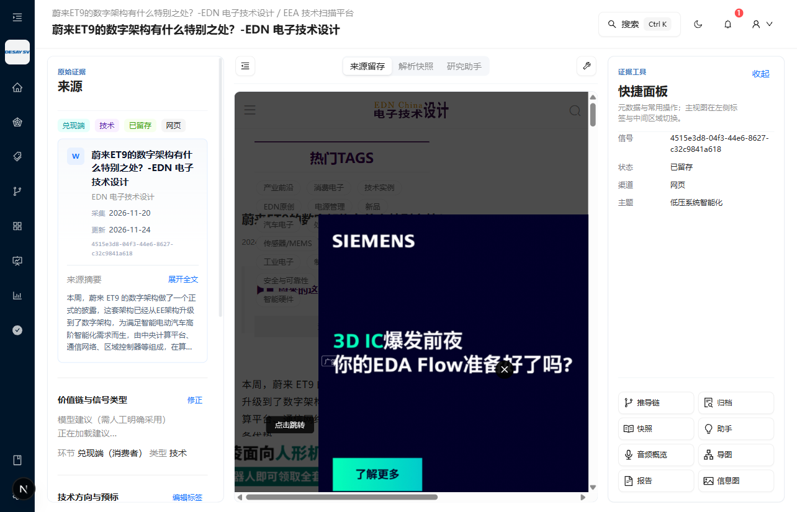
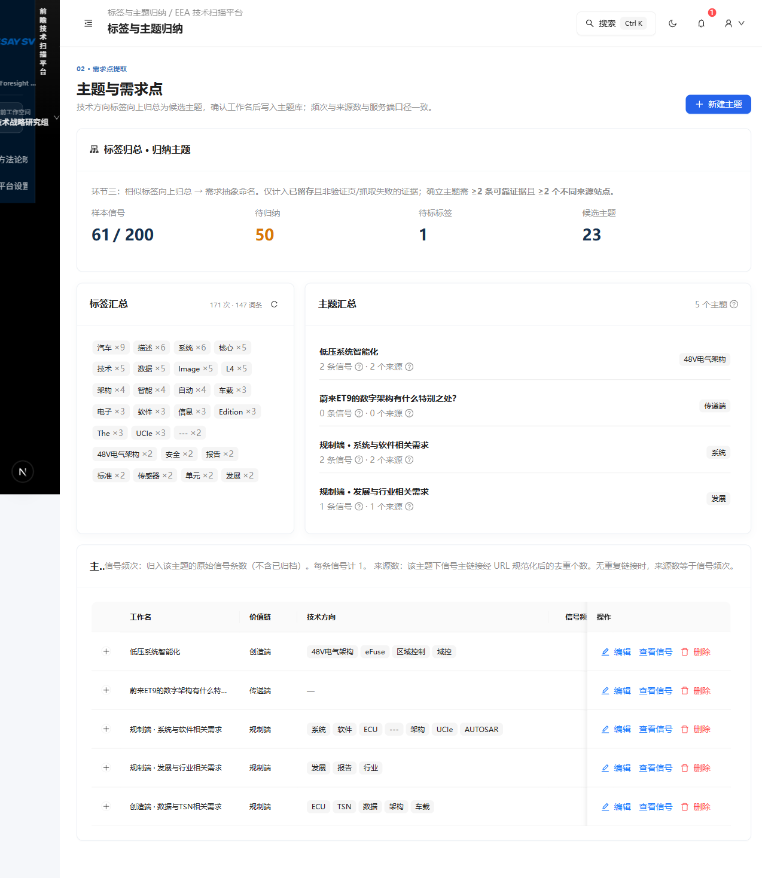
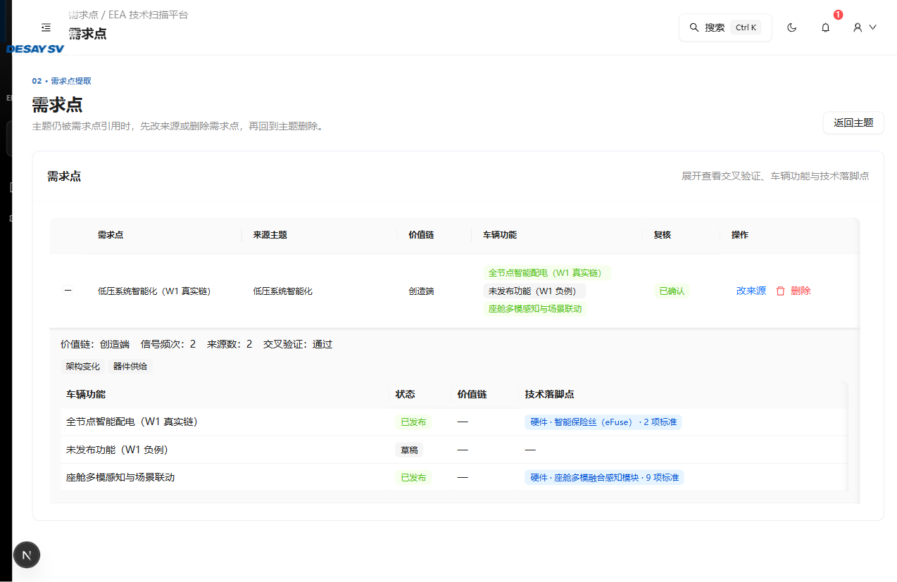
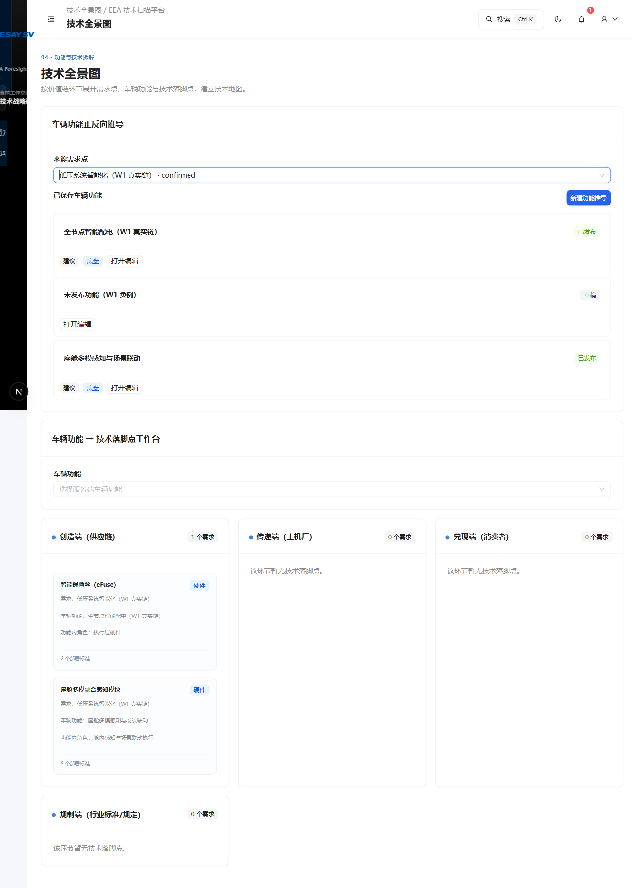
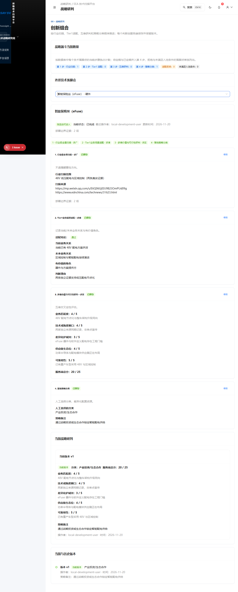
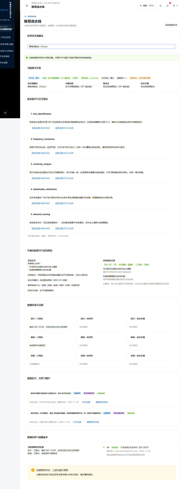
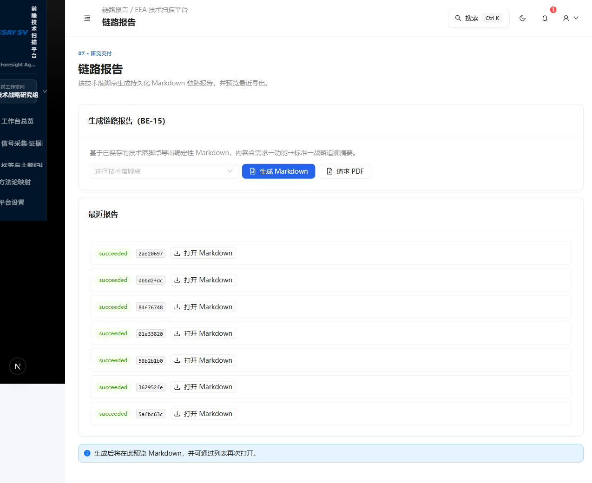
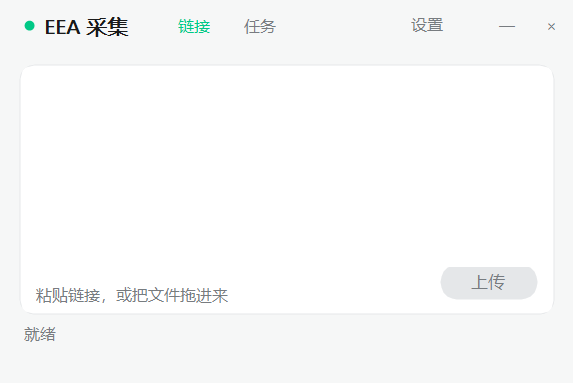

# EEA 前瞻技术扫描平台 · 项目报告

> **更新 2026-11-26** · 快照：提交 `3d80f30` · 迁移头 `0025_capture_client_claim_worker`
> 本文是项目报告，**不是验收签收**：业务签字（WBS 1.5.8）、Linux 预生产、干净 Windows 业务机证据仍未完成。

**目录**

1. 平台是什么
2. 功能全景
3. 事实快照
4. 设计文档
5. 快速开始
6. 全流程走查（带截图）
7. 进度与风险
8. 未证明清单
9. 附录

---

## 1. 平台是什么

把“从原始资料到产业结论”的七环节推导搬到平台上：**每一步都有记录、可追溯、可复核**。

- **主链路**：原始信号 → 需求点 → 车辆功能 → 技术落脚点 → 部署标准 → 战略研判
- **三条支线**：文档研究（Word/PDF/PPTX 图块与章节）、研究助手（检索 / 提案 / 确认写回）、链路报告（Markdown + PDF）
- **形态**：FastAPI + PostgreSQL 后端 · Next.js + antd 前端 · Go Windows 采集端（Edge/Chrome）
- **生产**：Linux 内网单主机 Docker Compose，已在 `10.215.35.10:8090` 运行

> 💡 **设计原则**：服务端决定一切。前端禁用按钮、非空 JSON、截图常量都不算业务证明；删除、归档、发布、确认等不可逆动作都由服务端门控并写审计。

---

## 2. 功能全景

### 2.1 证据采集与留存（环节一）

| 功能 | 说明 | 入口 |
| --- | --- | --- |
| 网页 / 微信采集 | Windows 客户端用 Edge/Chrome + SingleFile 存自包含 HTML；验证壳、错误页、空正文拒绝入库 | `capture.exe` GUI / CLI |
| 文档上传 | Word / PDF / PPTX / XLSX 上传并解析；扫描 PDF 无文本层时明确失败并保留原件 | 导入页、`POST /capture/jobs` |
| 粘贴补正文 | 微信等抓取失败时保留 URL 粘贴正文（补救，不计自动采集成功） | 证据抽屉 |
| 持久任务队列 | 幂等 `submission_id`、`SKIP LOCKED` 领取、租约心跳、协作式取消、进程中断后续跑 | `GET /capture/jobs/{id}` |
| 证据生命周期 | 抓取中 / 抓取失败 / 已留存 / 待复核 / 已归档 五态；无归档不得标“已留存” | `PATCH /signals/{id}` |
| 归档回放 | 隔离 iframe + 受限响应策略回放原始页面 | 证据抽屉 |
| 重复信号清理 | 按文章 URL（保留内容型参数、按 host 剔除追踪参数）与正文哈希分组；相同直接删，不同逐字段比对由人裁决 | 证据库「清理重复」 |

### 2.2 标签化与主题（环节二、三）

| 功能 | 说明 |
| --- | --- |
| 三项机器初判 | 价值链环节 / 信号类型 / 技术标签由规则 + 语义模型建议，人工下拉修正，修正留原值/新值/人员/时间 |
| 封闭词表 | 四环节、五信号类型、两演进节点、五状态、两渠道由服务端校验，界面不可自创 |
| 主题归集 | 技术对象 / 底层能力 / 变化方向三要素解释；每信号至多一主题；不自动合并需求、不排序 |
| 两套口径 | 活跃成员数（未归档）与去重来源 URL 数（含归档）并列显示 |
| 业务 skills 包 | 声明式、版本化、带校验和；优先级 批准规则 > 语义模型 > 词频；缺包时显示基线模式 |

### 2.3 需求与功能推导（环节三、四）

| 功能 | 说明 |
| --- | --- |
| 需求五步 | 事实识别 → 频率共识 → 相似性 → 利益相关方归因 → 系统级命名，每步必须引用已留存信号 |
| 交叉验证 | ≥2 条独立来源（不同 URL、发布主体、渠道、技术标签组合），记录视角与反证 |
| 人工确认 | 仅方法论/平台管理员可确认；修改已确认需求会退回复核并撤销下游发布资格 |
| 低频强信号 | 人工标记 + 理由，不转化为排名 |
| 功能正向五步 | 核心诉求 → 能力缺口 → 车端关键流 → 系统行为 → 车辆功能 |
| 功能反向验证 | 必要性 + 逐核心诉求覆盖 + 冲突检查；正反一致且人工确认才可发布 |
| 功能卡 | 推荐等级、L0–L5 多选、L2/L4 差异、目标域、推荐原因，词表由管理员维护 |

### 2.4 技术落脚点与标准（环节五、六）

| 功能 | 说明 |
| --- | --- |
| 五域落脚点 | 软件 / 硬件 / 通信 / 电源与能源管理 / 工具；仅已发布功能可建点 |
| 技术全景 | 按价值链环节展开需求 → 功能 → 落脚点，空环节如实显示“暂无” |
| 部署标准九宫格 | 设计 / 制造 / 运营 × 工程化 / 经济性 / 安全合规；**无行 / 明确留空 / 实质条款**三态分别保存，系统不补写 |
| 标准计数 | 只计实质条款（eFuse：2 条，运营格留空） |

### 2.5 战略研判（环节七）

| 功能 | 说明 |
| --- | --- |
| 四步漏斗 | 求广（行业扫描）→ 求准（Tier1 适配）→ 求实（五维评分）→ 分类；前一步未过不可进入下一步 |
| 五维评分 | 各 1–5 整数 + 每维理由，服务端汇总（eFuse 4/4/3/4/5 = 20） |
| 三类分类 | 人工选择 + 策略备注，不按分数自动分类 |
| 不可变版本 | 完成 / 改判追加新版本，旧版本保留，每落点仅一个当前版本 |
| 依据新鲜度 | 上游证据变动后标记 `stale`，由人重新确认，不静默清除 |

### 2.6 文档研究（支线 A）

| 功能 | 说明 |
| --- | --- |
| 图块识别 | OOXML 按实际引用顺序映射（真实 Word 7 图 / 8 次插入全部成注），PPT 区分正文与母版装饰 |
| 单图重试 | `POST /documents/{id}/figures/{n}/recaption`，失败保留正文并标 `needs_review` |
| 章节分块 | 标题路径 chunk + 关键词层级 / 分数 / 引用；图块并入所属章节 |
| 研究面板 | 章节树、正文、关键词跳转、图块图片与状态；PPTX 胶片条预览 |

### 2.7 研究助手（支线 B）

| 功能 | 说明 |
| --- | --- |
| 多会话 + SSE | 持久会话、流式增量、推理与工具调用实时展示、心跳、取消、断线重放 |
| 只读检索 | `search_evidence` / `search_rag`（关键词优先，embedding + cosine + rerank 兜底） |
| 可核验引用 | 引用必须指向真实信号 / 文档 chunk，伪造引用被拒 |
| 变更单 | 保存基准版本与字段差异；确认只应用一次（重复 409），过期需重生成，拒绝不写 |
| 记忆隔离 | 按用户 / 项目存储，可查看、删除 |
| 回复脚注 | 显示实际应答模型 `served_model` |

### 2.8 链路报告与追溯（支线 C）

| 功能 | 说明 |
| --- | --- |
| 全链追溯 | 落脚点 → 功能 → 需求 → 主题 → 信号 / 文档图块，带验证状态、归档标记、版本时间线 |
| 真实总览 | UTC 周新增、去重来源、待复核 / 失败任务、实质标准数、四步漏斗独占计数 |
| 链路报告 | Markdown + PDF（CJK 可提取），含原始证据、方法推导、审查结论、空标准格、战略版本与局限 |

### 2.9 运维与身份

| 功能 | 说明 |
| --- | --- |
| 采集凭据 | 服务端签发 / 撤销 token（仅存 SHA-256），客户端存 Windows Credential Manager |
| 操作者审计 | 主题、标签、需求、功能、标准、战略、删除均记录原值 / 新值 / 人员 / 时间 |
| 孤立对象维护 | dry-run / apply 两模式 + 审计；绝不删除仍被引用的对象 |
| 一键部署 | `bash deploy/build.sh [proxy]`；`backup.sh` / `restore.sh` 在镜像内运行 |

---

## 3. 事实快照

> 📅 **2026-11-26 11:01**，开发机只读快照。开发库会被并行会话改动，这是时点数据，不是稳定基线。

| 项 | 值 |
| --- | --- |
| 仓库提交 / 迁移头 | `3d80f30` / `0025_capture_client_claim_worker` |
| 数据库 | 31 张 `eea_*` 表 + 2 视图；25 个加法迁移 |
| 接口面 | 94 条路径（signals 18 · documents 13 · capture 12 · agent 12 …） |
| 代码规模 | 后端 66 个服务模块 · 74 个测试文件 |
| 开发库数据 | 信号 61 · 主题 5 · 需求 1 · 功能 3 · 落脚点 2 · 标准格 12 · 漏斗 1 · 研判 1 · 报告 7 · 文档 13 |
| 服务健康 | `/healthz` ok；`/readyz` ready（database / object_dir / semantic_gateway） |
| 模型网关 | attempt_budget 30 · hedge 4.0 s / 4 路 |
| 最近绿灯 | dedup+demands+functions 70 passed · schema+dedup 27 passed · lint-imports 3 kept |
| 生产部署 | `10.215.35.10:8090` Compose 六服务，健康检查全绿（2026-11-23） |

> ⚠️ **生产仍缺**：TLS / 可信身份、模型网关凭据、备份恢复演练。

---

## 4. 设计文档

### 4.1 分层与依赖方向

```
Backend   app/platform（配置 / DB / LLM 网关）
             ↓  app/domains/<ctx>（用例）  →  app/api（编排与 DTO）
          遗留 app/services、app/schemas 逐步下沉
Frontend  features/<domain>（api / queries / columns） → views/<route> → workspace.tsx（仅壳）
Client    internal/httpx → retry → platform → capture / queue
```

**三条硬契约**（`uv run lint-imports`）：platform 不依赖 domains/api · services 不依赖 api · domains 不依赖 api。前端业务代码禁止直接 `fetch`，须经 `lib/api/client.ts`。运行时契约以 `GET /openapi.json` 与 Alembic 迁移为准，路径快照测试守住接口面。

### 4.2 数据模型要点

| 实体 | 关键约束 |
| --- | --- |
| `eea_signal` | 原始 URL + 归一化 URL + 归档对象键；五态；`capture_submission_id` 唯一 |
| `eea_demand_point` | 五步 JSON + 交叉验证 JSON + 复核状态；确认前服务端复核证据仍有效 |
| `eea_vehicle_function` | 正向五步 + 反向覆盖；两者同时通过并人工确认才可发布 |
| `eea_deployment_standard` | 3×3 三态分别保存，按格事务锁串行化并发 upsert |
| `eea_strategic_assessment` | 不可变版本；部分唯一索引保证每落点仅一个 `is_current` |
| `eea_correction_audit` | 与业务写入同事务 |
| `eea_capture_job` / `eea_capture_token` | 持久队列 + 租约；token 仅存摘要 |

### 4.3 门控（服务端强制）

| 门控 | 实测行为 |
| --- | --- |
| 移出被确认需求引用的证据信号 | **409**，消息点名需求 |
| 需求引用不存在的证据 | **422**（REQ-DEM-03） |
| 功能缺正向步骤仍发布 | **422**，点名缺项，无部分写入 |
| 重复清理删空一组 / 删被引用或待确认变更的信号 | 跳过并给出原因 |
| `url_suspect` 重复组 | 恒 `identical=false`，永不自动删除 |

### 4.4 模型网关韧性

对话模型按网关候选与实测 TPS 排序（进程内 Pydantic 榜单，EWMA + TTL），首 token 竞速（2 s 对冲、最多 4 路），尝试预算 `max(30, 候选数)`；失败 / 空响应只降级不记速度；回复脚注显示实际应答模型。视觉链按 `VISION_MODEL` 顺序重试。

> ⚠️ 走查当天网关两次 504 —— 韧性机制不能替代网关本身的可用性。

### 4.5 部署拓扑

单主机 Compose：`postgres` → `migrate`（一次性）→ `api` / `worker` / `web` → `nginx`（同源入口，重启以刷新 upstream）。生产库仅装基础词表，示例与 eFuse 数据放隔离验收库。

---

## 5. 快速开始

### 5.1 前置

Python 3.12（uv）· PostgreSQL 16+ · pnpm 12.3.4 · Go 1.26（仅客户端）· Edge 或 Chrome（仅客户端）

### 5.2 后端

```powershell
cd backend
copy .env.example .env            # 填 DB_*；需要模型能力时填 CHAT_* / EMBEDDING_* / RERANK_*
uv sync --locked
uv run python scripts\bootstrap.py
uv run python scripts\dev.py      # API :8000，内嵌 capture worker
```

### 5.3 前端

```powershell
cd frontend
pnpm install
pnpm dev                          # http://localhost:3000
```

### 5.4 采集客户端（Windows）

```powershell
cd client
go build -trimpath -ldflags "-s -w -H=windowsgui" -o dist\capture.exe .\cmd\capture
cd dist; copy ..\config.example.json config.json
.\capture.exe doctor             # backend / capture / auth 三项应为 ok
.\capture.exe                    # GUI：粘贴 URL → 采集并上传
```

### 5.5 验证命令

```text
uv run pytest -q                       # 全量（独占 eea_test）
uv run pytest -m no_db -q              # 快检，可与集成会话并行
uv run lint-imports                    # 三条分层契约
uv run pytest tests/test_db_schema.py  # 31 表 + 2 视图精确断言
pnpm build && pnpm antd:lint           # 前端
go test -short ./...                   # 客户端
```

### 5.6 常见故障

| 现象 | 处理 |
| --- | --- |
| pytest 退出码 1/2，`eea_test` 占用 | 另一 pytest 会话持锁；等它结束或用 `-m no_db` |
| psycopg `cannot use the ProactorEventLoop` | Windows 直接跑异步脚本需先设 `WindowsSelectorEventLoopPolicy`（O-8） |
| Agent 回复 504 | 上游网关超时；看 `/llm/status`，不记为应用缺陷 |
| 重复采集后清理找不到组 | 未知追踪参数走 `url_suspect` 人工裁决；标题后缀被改则有意不合并 |
| 采集端 `auto_api` 选到 LAN 地址 | 多网卡推断；`config.json` 显式 `api_base` |

---

## 6. 全流程走查（带截图）

> 📷 截图：ego-browser 全页 1280 宽 + cua-driver，2026-11-26。字段级判定与缺陷编号见[走查记录](acceptance-records/2026-11-25-seven-step-walkthrough.md)。

### 6.1 工作台总览



真实计数：信号 61、主题 5、需求 1、研判 1；四步漏斗独占计数；证据库 10 页。

### 6.2 环节一 · 采集与证据留存



证据库列表：61 条、去重来源 61、待复核 0；重复采集带「重复来源」标记。



证据抽屉：来源 / 发布主体 / 时间、三项分类、归档回放（隔离 iframe）、研究助手。

> ✅ **门控实测**：两条链信号归档 13.3 MB / 2.78 MB 可读；重复清理按组删除并审计，不删空组。

### 6.3 环节二、三 · 标签化 → 主题与需求



主题卡：活跃成员与去重来源两套口径并列。



需求「低压系统智能化（W1 真实链）」：五步逐项引用两条独立来源，交叉验证通过，已确认；下游三个功能状态一目了然。

> ✅ **门控实测**：移出被引用信号 **409**；伪造证据 ID **422**。

### 6.4 环节四、五 · 车辆功能 → 技术落脚点



按价值链环节展开：创造端 1 需求 → 全节点智能配电（已发布）→ 智能保险丝（eFuse · 硬件 · 执行层硬件 · 2 项标准）；其余三环节如实显示“暂无”。

> ✅ **门控实测**：缺步发布 **422** 且无部分写入。

### 6.5 环节六、七 · 部署标准 → 战略四步



四步均已保存；五维 4/4/3/4/5 = **20/25**；分类 **产业投资/生态合作**。



追溯页：信号 → 主题 → 需求五步 → 功能正反向 → 九宫格三态（尚未填写 / 已明确留空 / 实质条款）→ 版本 v1；顶部黄色横幅 **“上游证据已更新”** 即 `basis_freshness=stale`，等待业务重新确认。

### 6.6 链路报告



7 份 `succeeded` 报告（MD / PDF），含走查生成的 `2ae20697`（PDF，3 页）与 `dbbd2fdc`（MD）；PDF 中文可提取。

### 6.7 采集客户端（Windows）



GUI 主窗口：粘贴 URL → 采集并上传；状态「就绪」。`capture.exe doctor`：backend ok / capture ok / auth ok（local-development-user · researcher），Edge + SingleFile 已识别。

### 6.8 走查判定汇总

| 步骤 | 判定 | 未证明项 |
| --- | --- | --- |
| S1 采集与留存 | 通过 | 真实采集当天未重做 |
| S2 重复扫描与清理 | 通过 | — |
| S3 标签化 | 通过 | — |
| S4 主题→需求 | 通过 | — |
| S5 车辆功能 | 通过 | — |
| S6 技术落脚点 | 通过 | 「未发布功能拒绝建点」未运行 |
| S7 标准九宫格 | 通过 | — |
| S8 战略四步 | 门控通过 | stale 依据的业务复核未运行 |
| S9 链路报告 | 通过 | 可否对外汇报需工程师确认 |
| B1 文档研究 | 技术通过 | 图注语义需人工核对；无截图 |
| B2 研究助手 | **失败**（上游 504） | 引用核验未运行 |
| 客户端 GUI | 已截主窗口 | 设置页以 doctor 文本代替 |

---

## 7. 进度与风险

### 7.1 WBS 工作簿同步（2026-11-26）

`docs/wbs/EEA-WBS-工作清单.xlsx` 更新 21 个任务行；汇总行仍为公式。

| 状态 | 同步前 | 同步后 |
| --- | --- | --- |
| 已完成 | 13 | **26** |
| 进行中 | 8 | 8 |
| 未开始 | 20 | **7** |

关键行：1.2.5 实测链接 0.75 · 1.3.6 eFuse 两条信号 1.0 · 1.4.1–1.4.7 全部 1.0 · 1.5.1–1.5.5 全部 1.0 · 1.5.6 助手 0.7 · 1.5.8 **签署验收 0（未开始，业务签字）** · 1.6.1 打包 0.7。

> 📌 Markdown 版 WBS（v1.0）未同步，两份 WBS 以工作簿为准。

### 7.2 缺陷与观察

- **O-1** 依据过期未被业务复核：eFuse 链依据在 11-23/24 被改动，研判仍为 11-20 v1
- **O-5** 图注语义与章节不符（技术成功 ≠ 语义正确）
- **O-6** 模型网关走查当天不可用（两次 504）；2026-11-27 复核 chat 模型仍不可用（`degraded_reason` 非空、source=embedding-rerank），降级路径已实跑通过（页面原样显示理由、人工修正仍可保存），引用核验仍待在网关注入后复验
- **O-7** ~~落脚点无删除接口~~ → **已修复 2026-11-26**：新增 `DELETE /landing-points/{id}`（204），删除前写 `deleted` 审计快照并级联标准/评估（`backend/TODO.md` BE-08）
- **O-8** ~~维护命令在 Windows 默认事件循环下不可用~~ → **已修复 2026-11-26**：入口在 win32 自行设置 selector 事件循环；维护命令默认 dry-run、`--apply` 才删除并写 `eea_maintenance_run`（`backend/TODO.md` BE-01，2026-11-27 在 head 0028 复验）

### 7.3 外部缺口（DOC-02）

20 条标注信号 · 业务 skills · 主题 8/16 真实来源 · 功能卡词表具体词项 · Tier1 适配与评分依据 · 扩展源码 · Linux 基础设施资料 · 用户与运维责任映射

---

## 8. 未证明清单

> 🚫 以下各项**没有**通过证据，不能从本报告推断：

- Linux 预生产 / 生产的服务行为、迁移、恢复
- 干净 Windows 业务机的采集与 GUI
- 业务签字（WBS 1.5.8）与报告可汇报性
- 主题 8 条成员 / 16 来源的真实复现
- 20 条标注样本的分类准确率（≥70% 基线）
- 万条数据分页 ≤1 s / 详情 ≤0.8 s
- 备份恢复演练（生产；本地备份/恢复与对象目录演练已于 2026-11-27 通过，见交付记录）、TLS 与可信身份
- 研究助手的引用核验与伪造引用拒绝

---

## 9. 附录

- 走查记录（字段级证据）：`docs/acceptance-records/2026-11-25-seven-step-walkthrough.md`
- 交付记录：`docs/DELIVERY-RECORD.md`
- 分层与契约：`docs/ARCHITECTURE-LAYERS.md` · 需求追溯：`docs/REQUIREMENTS-TRACEABILITY.md`
- 链内标识
  - 需求 `5f2f967f-2eef-4b56-9def-a21a366c273a`
  - 功能 `866b5aca-6683-4f8f-929b-5420e80d3e58`
  - 落脚点 `695dac19-29bf-49b8-a021-00fa56f1318c`
  - 信号 `64d539c6…`（佐思汽研）· `4515e3d8…`（EDN）
- 截图目录：`docs/images/walkthrough/`
- 封闭词表：四环节（创造 / 传递 / 兑现 / 规制）· 五信号类型（战略 / 技术 / 人才 / 资本 / 标准）· 两演进节点（发布 / 定点验证）· 五证据状态 · 两渠道（网页 / 微信公众号）
