# 闭源前瞻平台的界面与操作

本文只收录公开页面上的产品界面，以及帮助中心写明的点击路径。五家产品的登录后系统没有导出。截图是厂商自己的宣传图或公开网页，版权仍归厂商，只作界面学习，不作为本平台的视觉素材。

对照对象是与推导链路重合约 50% 及以上的产品：FIBRES、ITONICS、HYPE、Qmarkets Horizon、Trendtracker。图片在 [images/enterprise-ui](images/enterprise-ui)。

## 这些界面共同在教的事

五家都把工作分成四种画面，而不是一个聊天窗。

1. **收件。** 人在浏览网页时把一条文章夹进系统。FIBRES 叫 Web Clipper，ITONICS 叫 Webclipper。信号是最小对象。
2. **归并。** 多条信号连成一条趋势或主题。雷达上画的是这条趋势，不是每一篇文章。FIBRES 写明：信号挂在发现卡片的 Linked items 里，不直接打在雷达上。
3. **判断。** 用固定维度打分，分数决定点在雷达上的距离、颜色或大小。人改的是分数，图跟着变。
4. **交出。** 雷达、网络图和漏斗用来给别人看。列表用来自己干活。详情从侧栏打开，不离开当前图。

机器可以先填一版。人再改。FIBRES 的研究计划一旦点了「Approve and start research」就锁定，回来只能改结果，不能改已经发出的任务。

## FIBRES

公开应用地址形如 `app.fibresonline.com`。顶栏是 Discover、Network、Radar、Collect。

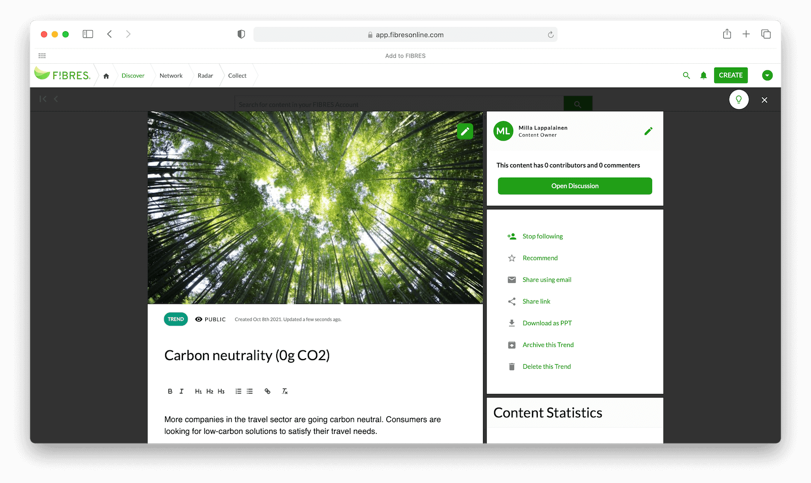

图示说明：Safari 窗口内的 FIBRES 应用。顶栏为 Discover / Network / Radar / Collect，右侧有搜索、通知、绿色 CREATE。主区上方是大图（竹林仰视），其下为绿色 TREND 标签、PUBLIC、创建/更新时间。标题为「Carbon neutrality (0g CO2)」，下方是富文本工具栏与一段关于旅游业碳中和的消费趋势摘要。右栏为 Content Owner（Milla Lappalainen）、Open Discussion，以及推荐、邮件分享、链接分享、导出 PPT、归档、删除等纵向动作列表，底部有 Content Statistics。

一条趋势卡片的行为：类型标签（TREND）、公开范围、负责人、讨论、关注、推荐、邮件分享、复制链接、导出 PPT、归档、删除。正文是人写的判断，不是原文粘贴。原文留在信号上。

自下而上的操作，帮助中心写的是：

1. 用剪藏把新闻收成 Signal。
2. 在来源流里按关键词翻，AI picks 会在已保存的信号旁推荐新的。
3. 在 Findings 里多选信号，点 Link，再 Link with a new finding，建成一条 Trend。
4. 在趋势正文里写「这些信号在说什么」，再用分类打分。
5. 打开趋势，滚到 Radars，从 Add to radar 选雷达，为该雷达的维度选值，Save。预览先出现，不必先跳到雷达页。
6. 同一条趋势可以放上多张雷达。各雷达的评分互不影响。
7. 改位置用 Manage assessment，不靠在图上拖点。灯炮图标会按已定位的相关条目建议位置；没有相关条目时建议为空。
8. 放进 Portfolio，再到 Network 看连线。

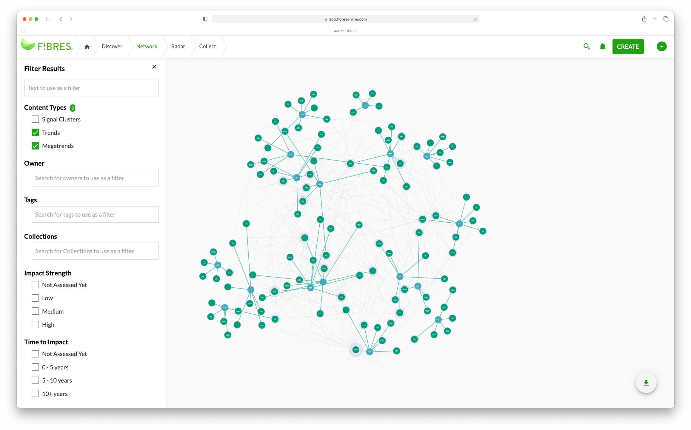

图示说明：Network 视图。左侧 Filter Results 面板含全文检索、Content types（示例勾选 Trends 与 Megatrends）、Owner、Tags、Collections、Impact Strength、Time to Impact 等复选框组。主区为青绿色节点—连线图，大节点带图标、小节点密集分布，右下有绿色下载浮动按钮。顶栏当前页为 Network。

网络图左侧是常驻筛选：正文、内容类型（信号簇、趋势、大趋势）、负责人、标签、集合、影响强度、影响时间。点的大小和颜色区分层级。这是「先筛再看关系」，不是一打开就铺全库。

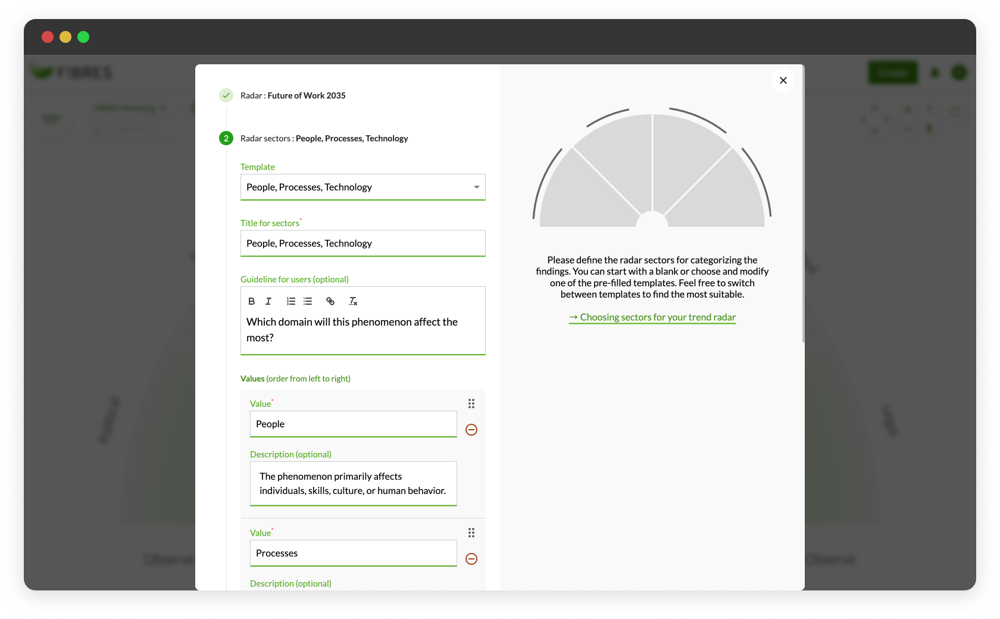

图示说明：模态向导「2. Radar sectors」。左侧 Template 选「People, Processes, Technology」，必填 Title for sectors，Guideline 富文本（示例问「Which domain will this phenomenon affect the most?」），Values 列表（People / Processes…，每项有 Description 与删除把手）。右侧半圆扇区预览与说明文案；背景可见已建雷达的模糊界面。

建雷达是向导，不是空白画布。先选扇区模板（例如 People, Processes, Technology），再写每个扇区的名称和给评分人的问题。右侧半圆只是预览。扇区是分类，时间或成熟度是半径。

代理填充的路径：在空雷达上回答标题、读者、目的、范围，选定扇区和时间轴，审关键词，然后批准。大约一小时后邮件通知。人回到雷达，从发现卡片的 Linked items 核对信号，在 Network 看关系，再手动挪动或改写草稿。

## ITONICS

同一条数据有五种看法：雷达、列表、路线图、看板、网络图。帮助中心把它们写成可切换的视图，而不是五个产品。

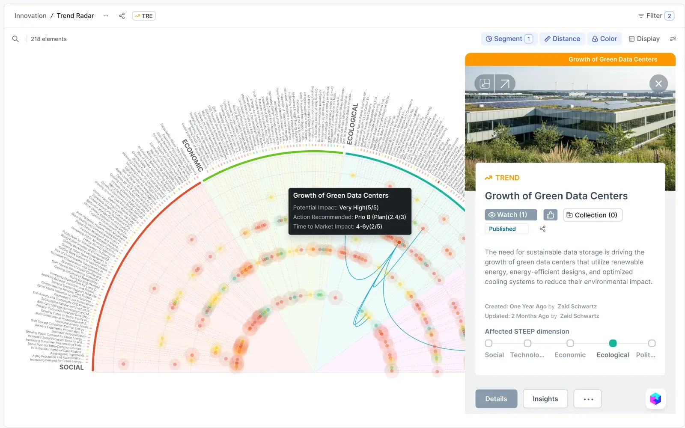

图示说明：面包屑 Innovation / Trend Radar，搜索区显示 218 elements。工具条有 Segment、Distance、Color、Display、Filter(2)。半圆 STEEP 扇区（SOCIAL、ECONOMIC、ECOLOGICAL 等），彩色气泡带外圈标签。悬停气泡出现黑底浮层：Potential Impact、Action Recommended、Time to Market Impact。右侧抽屉为「Growth of Green Data Centers」：头图、TREND 标签、Watch/Like/Collection、正文、作者时间、Affected STEEP 勾选条，底部 Details / Insights 标签。

雷达顶栏显示元素数量（示例为 218），并标明当前用哪些字段画图：Segment、Distance、Color、Display。点一个气泡，浮层只给三行判断（影响、建议动作、上市时间），右侧抽屉才给摘要、STEEP 维度、Details 和 Insights。人先在图上扫，再决定要不要打开抽屉。

列表用来筛选、排序、看负责人和交期。路线图把技术接到项目里程碑，并可做情景推演。看板用拖拽改阶段，列上汇总 KPI。导出是 PPT 或表格。剪藏在浏览网页时完成。

用户帮助里的日常顺序是：搜索和筛选，打开内容卡片，关联、评分、评论、放进集合，再切到雷达或矩阵做比较。

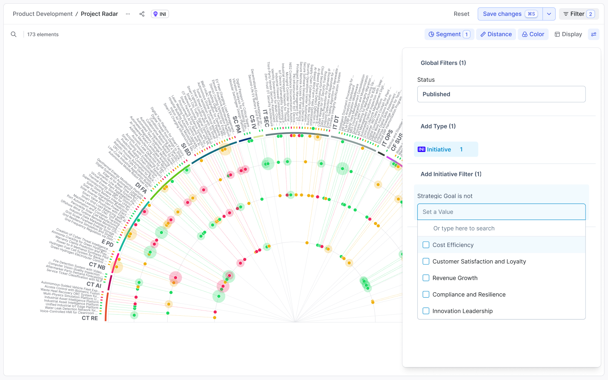

图示说明：Product Development / Project Radar，173 elements。半圆扇区标部门缩写（CT RE、CT AI、E PD、IT SEC 等），点多色且有光晕。右侧 Global Filters：Status=Published，Type=Initiative，下拉「Strategic Goal is not」列出 Cost Efficiency、Customer Satisfaction、Innovation Leadership 等。顶栏 Segment / Distance / Color / Display 与 Save changes。

## HYPE

公开页上能看清的是组合仪表板，不是信号收件箱。

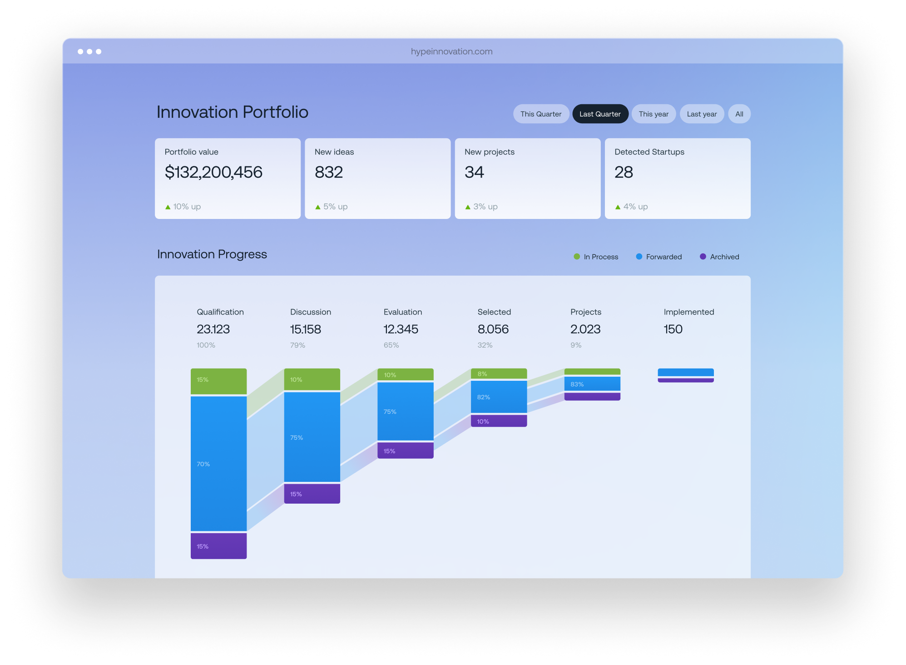

图示说明：hypeinnovation.com 上的 Innovation Portfolio 仪表板。时间芯片：This Quarter / Last Quarter / This year / Last year / All（示例选中 Last Quarter）。四张 KPI 卡：Portfolio value $132,200,456、New ideas 832、New projects 34、Detected Startups 28，均带绿色环比涨幅。下方 Innovation Progress 为六段漏斗柱（Qualification→Implemented），每段显示总量、转化率，柱内堆叠 In Process（绿）、Forwarded（蓝）、Archived（紫），段间有半透明流向带。

顶上是时间范围（本季、上季、今年、去年、全部）。四张计数卡给出组合价值、新想法、新项目、发现的初创企业，每张带相对上一期的涨跌。下面是漏斗：Qualification、Discussion、Evaluation、Selected、Projects、Implemented。每一段同时显示数量、转化率和三种状态（进行中、已转发、已归档）。

产品页写的操作顺序是 Scout、Evaluate、Analyze、Collaborate、Create value。雷达用来比较，评论、投票和关注用来协作。HYPE 12 可以把 FIBRES 扫到的弱信号推进来再协作。也就是说，他们自己把「扫描」和「组合管理」分成两套界面，用交接连起来。

漏斗上的金额和想法数量属于创新执行，不是本平台前六段推导要复制的指标。要学的是：阶段转化和状态要在一张图上同时看见。

## Qmarkets Horizon

公开样例景观会停在主题总览上，并盖一张工作邮箱卡片。本笔记没有代填。总览是产品本身；其余画面取自厂商自己的产品视频，界面与样例是同一套。

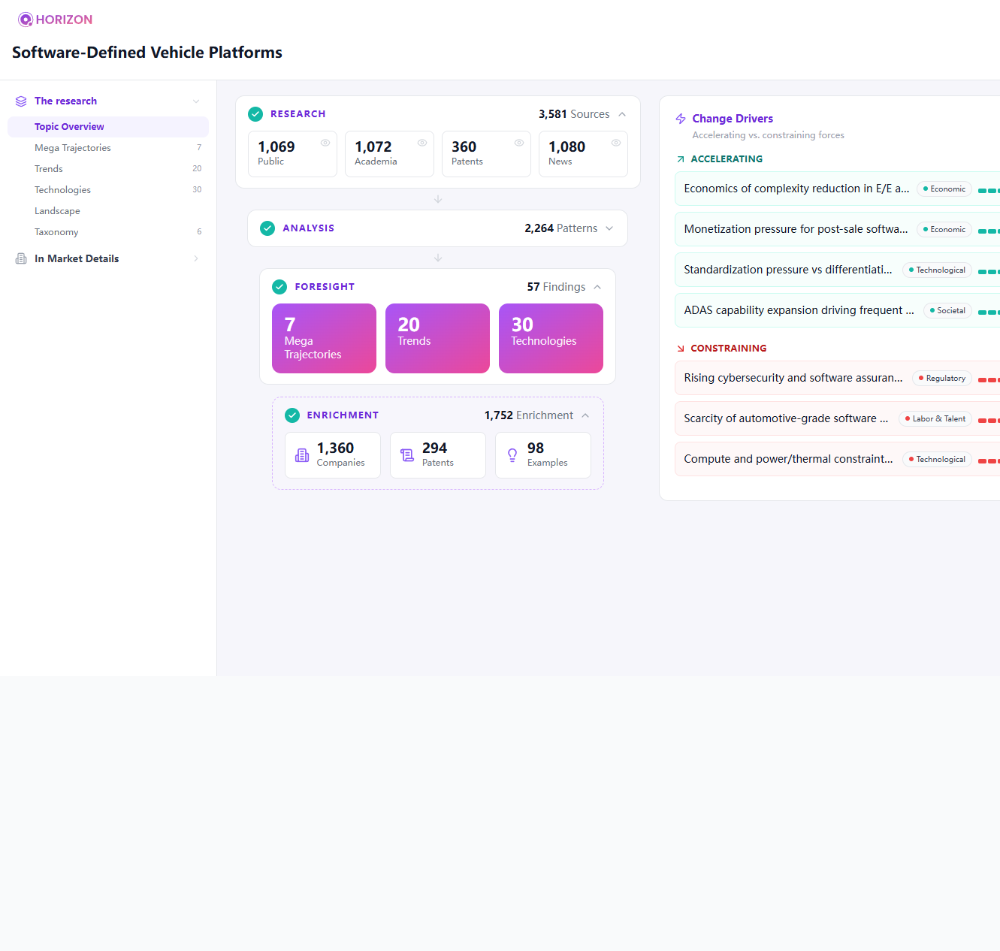

图示说明：公开样例景观 `horizon.qmarkets.cloud`，主题 Software-Defined Vehicle Platforms。左栏 The research 树，Topic Overview 高亮，下列 Mega Trajectories(7)、Trends(20)、Technologies(30) 等。中区纵向漏斗：RESEARCH 3581 源（Public/Academia/Patents/News 四卡）→ ANALYSIS 2264 Patterns → FORESIGHT 57 Findings（7 大轨迹 / 20 趋势 / 30 技术）→ ENRICHMENT 1752（Companies/Patents/Examples）。右栏 Change Drivers 分 ACCELERATING 与 CONSTRAINING，每条有类型标签（Economic、Technological、Regulatory 等）与强度条。

样例「Software-Defined Vehicle Platforms」的总览：左侧是研究树（主题总览、大轨迹、趋势、技术、景观、分类）和市场明细。中间按 Research、Analysis、Foresight、Enrichment 四段计数，来源分成公开、学术、专利、新闻。右侧是变化驱动力，分成加速和约束，每条带类型标签和强度条。

视频里同一套界面还露出这些操作：

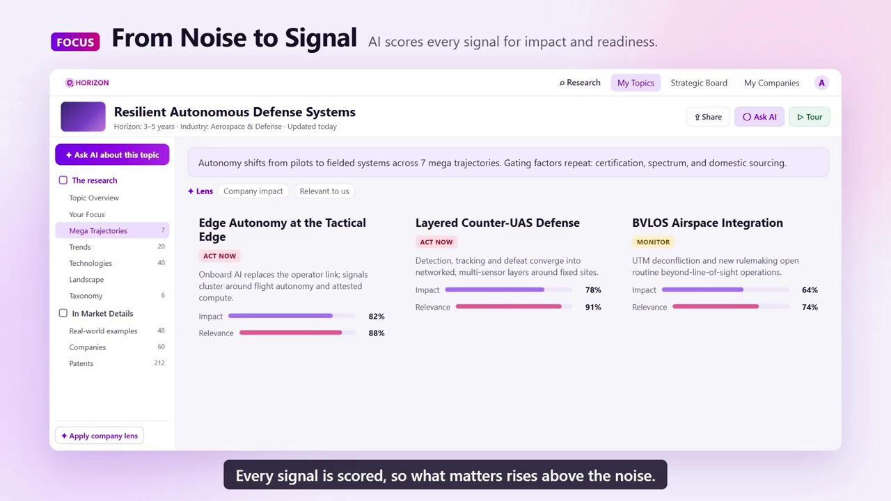

图示说明：产品视频帧。主题 Resilient Autonomous Defense Systems，顶栏 Share / Ask AI / Tour。Your Focus 下三张 Mega Trajectory 卡：Edge Autonomy at the Tactical Edge、Layered Counter-UAS Defense（ACT NOW 粉标）、BVLOS Airspace Integration（MONITOR 黄标）。每卡有简述、Impact 紫条、Relevance 粉条（百分数）。上方有 Lens / Company impact / Relevant to us 芯片。

大轨迹是卡片，不是雷达点。每张卡片有动作（ACT NOW、MONITOR）、Impact 和 Relevance 两条分数。上面可以切换透镜，例如对公司的影响、与我们是否相关。

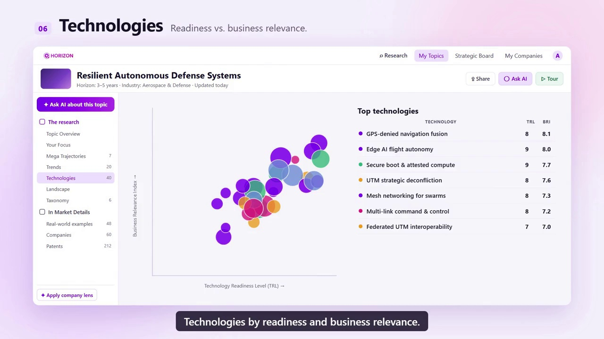

图示说明：Technologies(40) 页。散点图横轴 Technology Readiness Level (TRL)、纵轴 Business Relevance Index；彩色圆点表示不同技术。右侧表 Top technologies 列 TRL 与 BRI，示例含 GPS-denied navigation fusion(8/8.1)、Edge AI flight autonomy(9/8.0) 等。

技术页是散点：横轴技术就绪度，纵轴商业相关度。右边的表列出名称、TRL 和业务相关指数。点的颜色区分技术。

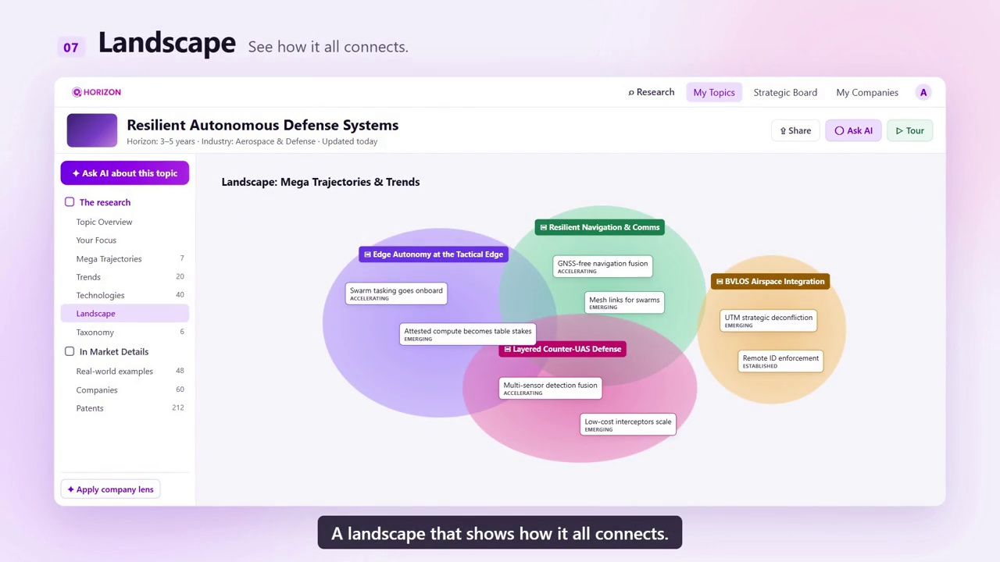

图示说明：Landscape 视图。标题 Landscape: Mega Trajectories & Trends。四个半透明色圆重叠：紫 Edge Autonomy、绿 Resilient Navigation & Comms、粉 Layered Counter-UAS、橙 BVLOS Airspace Integration（独立）。圆内贴小卡，标趋势名与状态（ACCELERATING / EMERGING / ESTABLISHED），如 Swarm tasking goes onboard、GNSS-free navigation fusion。

景观是几块重叠的区域，每块是一条大轨迹。趋势以小卡片落在区域里，并标出加速、新兴或已确立。人在这里看的是谁和谁交叠，不是成熟度半径。

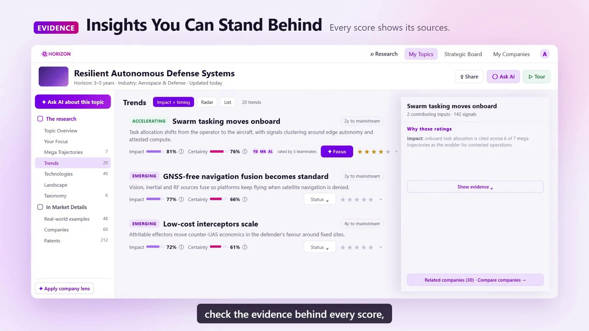

图示说明：Trends 列表 + 右侧证据抽屉。左列趋势卡：状态（ACCELERATING/EMERGING）、「Ny to mainstream」、Impact/Certainty 双色进度条、Status 下拉、五星评分、队友头像。选中「Swarm tasking moves onboard」时，右抽屉标题、contributing inputs 与 signals 计数、「Why these ratings」段落、紫色 Show evidence 按钮，底部 Related companies 链接。页签含 Impact × timing / Radar / List。

趋势列表上，每条有阶段、离主流还有几年、Impact、Certainty、状态下拉和星级。点开一条，右侧抽屉写明分数依据、有多少条信号、以及「Show evidence」。同一批趋势还可以切到 Radar 或 Impact × timing。分类页是环形 taxonomy。市场明细把产品发布、合作、法规和采用分成卡片，每张卡片挂回一条轨迹，并写出来源信号数。

顶栏是 Research、My Topics、Strategic Board、My Companies，以及 Share、Ask AI、Tour。左侧还有「Ask AI about this topic」和「Apply company lens」。

## Trendtracker

下面是产品界面，不是技术侦察宣传页。左侧是图标栏：Discover、已保存、AI Assistant、Research，以及自己的 Board。右上角先选定行业、地区和时间窗，例如 Banking、Globally、1Y。

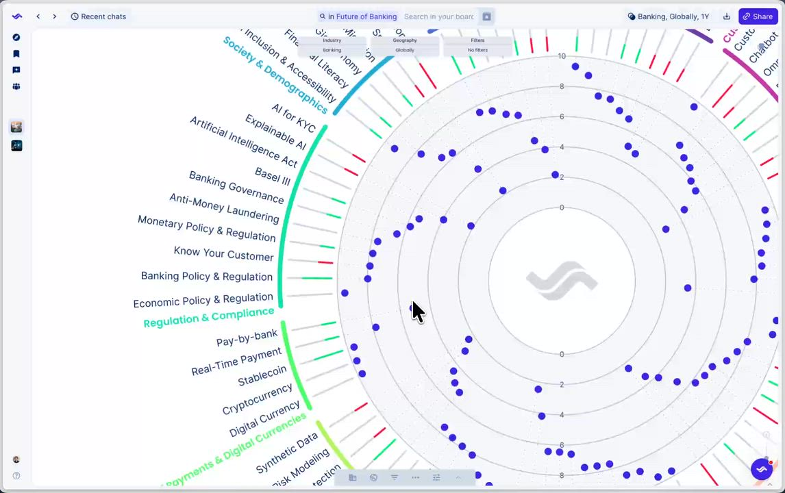

图示说明：Board 视图 Future of Banking。顶栏搜索「in Future of Banking Search in your board」，范围 Banking, Globally, 1Y，紫色 Share。整圈雷达 0–10 同心环，外圈彩色弧分主题（Regulation & Compliance、Payments、Customer Experience 等），蓝点为趋势位置，外缘放射状标签（KYC、AML、Stablecoin、Chatbot 等）。筛选芯片 Industry / Geography / Filters。

雷达是整圈。圈外是领域和趋势名，圈内的点是位置。顶上可以搜索这块板上的趋势，并按行业、地区筛选。另一张电子与光子的雷达把筛选条放在图下方：技术领域、行业、全球，以及已选条件的数量。

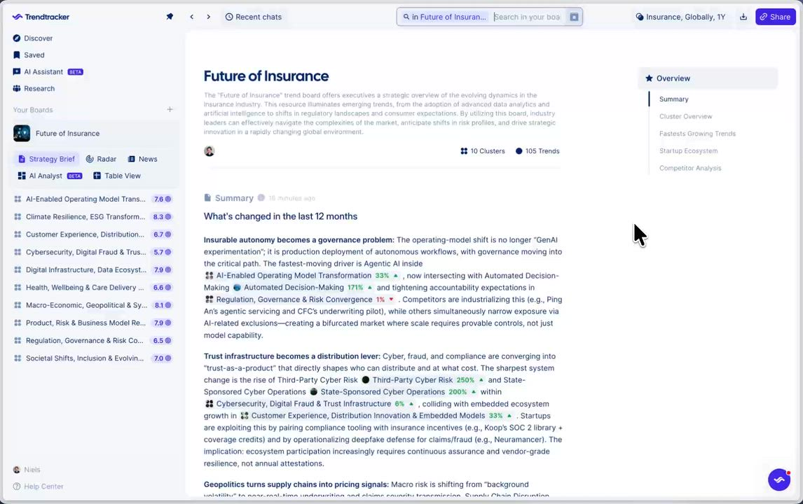

图示说明：左侧 Your Boards 选中 Future of Insurance，子页 Strategy Brief。主文标题 Future of Insurance，摘要段、10 Clusters / 105 Trends。正文「What's changed in the last 12 months」多段，段内链到簇并标涨幅（如 Automated Decision-Making 171%↑）。左栏簇列表带紫色分数徽章。右栏目录：Summary、Cluster Overview、Fastest Growing Trends、Startup Ecosystem、Competitor Analysis。

趋势板才是工作页。左侧是簇，每条带一个分数。中间是「过去 12 个月变了什么」，每段变化写明百分比和相关趋势。右侧目录是摘要、簇总览、增长最快的趋势、初创生态、竞争对手。

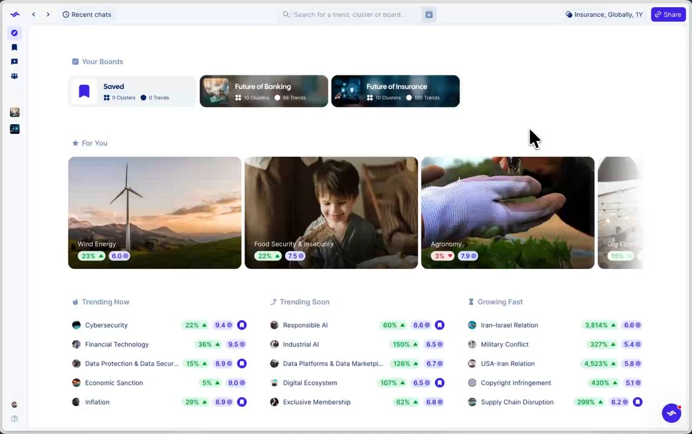

图示说明：Discover 首页。Your Boards 横滑卡（Saved、Future of Banking、Future of Insurance 等，显示 Clusters/Trends 数）。For You 大图卡（Wind Energy、Food Security、Agronomy…）角标涨跌%与紫色强度分。底部分三列列表 Trending Now / Trending Soon / Growing Fast，每行图标、名称、涨幅、分数、书签。

发现页先给已有的板，再给推荐卡片。卡片上同时有涨跌百分比和强度分。下面三列是正在热、即将热、增长快。点进一条趋势后，是强度随时间的曲线、短长期切换、预测峰值、正在发生什么、影响，以及按行业、竞争对手、初创、产品发布过滤的新闻。

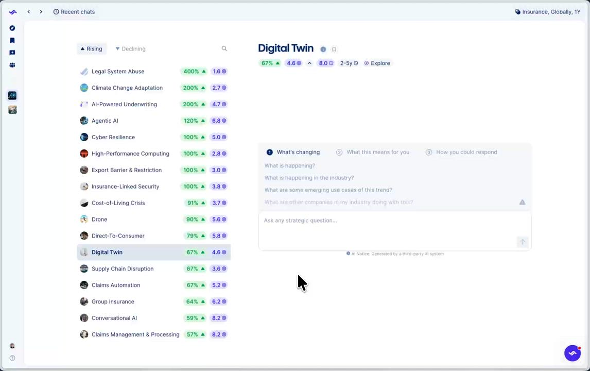

图示说明：AI Analyst。左列 Rising/Declining 切换，趋势行含缩略图、名称、绿色涨幅%、紫色分数（如 Legal System Abuse 400%、Digital Twin 选中）。右侧 Digital Twin 详情：67%↑、4.6/8.0 分、2-5y、Explore。中央三步骤卡 What's changing / What this means for you / How you could respond，预置问题 chips，底部 Ask any strategic question 输入框与 AI Notice。

分析师页左边是按涨跌排的趋势，每行有动量和分数。右边固定三个问题：正在变什么、对你意味着什么、你可以怎么回应。人可以再提一个战略问题。回答底下标出来源数。新闻页则是按板过滤的报道列表，可只看优质来源。

## 值得带到本平台界面的行为

- 顶栏按对象分：信号、归并结果、全景、追溯。不把七个环节做成七个互不相干的网站。
- 列表负责查找和修正。雷达负责给别人看判断结果。网络图负责看谁和谁有关。
- 详情用右侧抽屉。抽屉里同时有判断、评分和回到原文的入口。
- 雷达上的点是需求点或技术落脚点。原始信号只出现在点的证据列表里。
- 点的位置来自已保存的评分。改分用表单，并立刻重画。
- 一条对象可以出现在多张图上，每张图用自己的维度，互不覆盖。
- 筛选条始终留在图的左边或顶上，包括类型、标签、时间和负责人。
- 机器生成的归并和评分先作为草稿。人确认后才算发布。确认前可以改任务，确认后只能改结果。
- 协作动作放在卡片上：负责人、讨论、关注、分享、导出。不另做一套社交产品。
- 战略漏斗用阶段数量和状态构成一张图。金额类指标不放进推导链的前几段。
- 影响和确定度分成两条分数。人另外设状态和星级，不靠拖动图上的点。
- 景观可以是几块交叠的区域，用来看趋势落在哪几条轨迹上。雷达仍用来看成熟度。

## 图片详细说明

正文已嵌入的图在对应小节下有「图示说明」。下列覆盖 `images/enterprise-ui` 目录全部 33 张图（含正文未单独展示的 FIBRES / ITONICS / Horizon 附图）。

### FIBRES

**`fibres-trend-record.png`** — 趋势详情页「Carbon neutrality (0g CO2)」：封面图、TREND/PUBLIC、富文本编辑区、右栏负责人与分享/导出/归档/删除。对应上文 FIBRES 趋势卡片。

**`fibres-network.png`** — Network 全屏关系图与左侧多维筛选。对应上文网络图。

**`fibres-radar-manager.png`** — 建雷达模态第 2 步扇区配置。对应上文建雷达向导。

**`fibres-radar-position.png`** — 单条趋势「Social Intelligence in the AI era」页内 Radars 区：已上雷达「Future of Work 2035」半圆预览（People、Impact time 0–5 years）、Manage assessment、旁侧空雷达「Add to radar」。下方露出 Classifications / Phenomenon certainty。说明评分在趋势页完成，而非在雷达画布拖点。

**`fibres-radar-share.png`** — 雷达浏览页：顶栏雷达选择 Future of Work 2035、Manage、Hide filtered；半圆扇区 People / Processes / Technology，时间环 0–5 / 5–10 / 10+ years；橙点「Social Intelligence in the AI era」在 People 近环。右侧滑出趋势摘要抽屉（头图、Trend 标签、Definition、View in full）。左上有缩放、平移、导出、全屏控件。

**`fibres-radar-class.png`** — 雷达全屏：左筛 Phenomenon certainty（示例勾选 Wildcard）、Affected Activities 等；主图 Social / Technological 扇区；选中趋势「Non-aging cells」右侧预览卡。展示分类维度与雷达点联动筛选。

**`fibres-classification.png`** — 全屏 Classification 模态：左列 Phenomenon certainty 单选（Wildcard 选中），右列 Affected Activities 多选（Finance and Controlling、IT 等）。与雷达分类字段一致。

**`fibres-scenarios.png`** — Collect 内搜索「privacy」结果列表（文件名 scenarios，画面为集合检索）：四条 Collection 卡片，标题括号内标注 privacy concerns / need to connect 的 +/- 组合，带缩略图与更新时间。用于展示用关键词回收已命名集合，而非情景画布。

**`fibres-signal-or-trend.png`** — 雷达「Future of sustainability」：扇区 Circular Economy、Sustainable Mobility、Climate Change Mitigation 等，成熟度环 Low–High；多点标注；选中「Regenerative agriculture」右侧详情抽屉（农业头图、Trend 标签、摘要与 Definition）。顶栏 Manage、Hide filtered。

**`fibres-trend-text.png`** — 趋势正文编辑全屏：「Social Intelligence in the AI era」大图、Trend/Public、富文本工具栏、右侧 Owner Erica Example、Discuss、推荐/分享/PPT/CSV/Archive。背景可见雷达 Processes 扇区，表示编辑正文时仍停在雷达上下文。

### ITONICS

**`itonics-radar-criteria.png`** — 见正文 ITONICS 趋势雷达图示说明。

**`itonics-radar-zoom.png`** — 全圆 Trend Radar，150 elements；Filter / Segments / Distance / Color / Display；STEEP 外圈标签；右侧 +/- 缩放；悬停「Advancement in Quantum Communication」黑底三指标浮层。强调可缩放与字段映射。

**`itonics-radar-trends.png`** — Project Radar：扇区 CT RE、E PD 等；高亮 E PD 楔形；绿点「Grid Frequency Regulation via Distributed Storage」；黑底 Health/Phase 浮层；右侧大抽屉含头图、INITIATIVE、Watch、项目阶段与 Health Status 条。展示项目雷达与趋势雷达同一套交互。

**`itonics-list.png`** — Trend list 表格：Title、STEEP dimension、Priority 条、Potential Impact、Time to Impact 滑条；多行橙底高亮；右侧 Global Filters（Published、TRE、Responsible BU、Trend 字段下拉）。列表是修正与排序的主战场。

**`itonics-roadmap.png`** — Strategic Roadmap 甘特：Team CA1/CB-X 等泳道，Research/Testing/Ramp Up 行；彩色项目块与依赖虚线；顶里程碑芯片；右侧 Scenario List 模态（New roadmap v.1、Merge scenario）；底栏 Update / Save Scenario / Reset。

**`itonics-kanban.png`** — Strategic Initiative Board：列 1-Research / 2-Concept，泳道 Cost Efficiency、Customer Satisfaction；INITIATIVE 卡含 PM、TRL、MRL、Cost；中央 Row color rules 弹窗按 Health Status 着色（On Track/Challenging/Critical）。

**`itonics-views.png`** — 见正文 ITONICS 视图切换图示说明（Project Radar + Strategic Goal 筛选）。

### HYPE

**`hype-portfolio.png`** — 见正文 HYPE 创新组合图示说明。

### Qmarkets Horizon

**`qmarkets-horizon-topic-overview.png`** — 见正文 Horizon 主题总览。

**`qmarkets-horizon-trajectories.jpg`** — 见正文大轨迹卡。

**`qmarkets-horizon-technologies.jpg`** — 见正文技术散点。

**`qmarkets-horizon-landscape.jpg`** — 见正文景观重叠图。

**`qmarkets-horizon-taxonomy.jpg`** — Taxonomy 页：Overview/Explore 切换；中心「Taxonomy」旭日图，内环 Operations / Industrial / Airspace / Navigation / Counter-UAS / Autonomy，外环子域（BVLOS、GNSS-free nav、Detection、Edge autonomy 等）。用于领域词典，不是时间雷达。

**`qmarkets-horizon-trends.jpg`** — Trends 列表 Impact × timing 视图：三条示例趋势（Swarm tasking、GNSS-free navigation、Low-cost interceptors），含 ACCELERATING/EMERGING、年限、Impact/Certainty 条、Status 与五星。无右侧抽屉。

**`qmarkets-horizon-evidence.jpg`** — 见正文趋势列表与证据。

**`qmarkets-horizon-examples.jpg`** — Real-world examples：筛选 All / Product Launch / Partnership / Regulatory / Adoption；四卡示例（拦截无人机发布、软件商与机体厂合作、BVLOS 规则、网状无人机试点），每卡挂 Trajectory 名、年份、signals 数，左侧色条区分类型。

### Trendtracker

**`tt-radar-hero.png`** — 见正文 Trendtracker 雷达（Banking 板）。

**`tt-radar-siemens.png`** — Siemens 客户故事配图：Electronics & Photonics、1Y；整圈雷达，外弧 Generative AI、Advanced Connectivity、Disruptive Materials、Immersive Technologies、Value 等；底栏 Technological / 行业 / Global 筛选 (3)。与 hero 相比强调底部筛选条。

**`tt-board-hero.png`** — 见正文趋势板 Strategy Brief。

**`tt-discover-hero.png`** — 见正文发现页。

**`tt-discover-siemens.png`** — 单趋势「Edge AI」页：强度 6.3、长短期切换、2022–2026 曲线与预测带、峰值 7.7@0–2y；右侧 Opportunities/Risks 占位卡；底栏 Newsfeed 分 Industry/Competitor/Startup/Product Launch。展示从发现进入单条技术的深度页。

**`tt-news-hero.png`** — Trend News：范围 Future of Banking；Industry 下拉、Only premium sources 开关、Trends/Sources/Regions；列表卡含缩略图、主题标签（Cybersecurity、Digital Banking 等）、标题、来源与时间（Bank of Baroda hackathon、FIS core、Zand DWTC 等）。

**`tt-analyst-hero.png`** — 见正文分析师页。

## 来源

- https://help.fibresonline.com/article/58-working-up-from-signals
- https://help.fibresonline.com/article/30-using-radars
- https://help.fibresonline.com/article/140-foresight-agents
- https://www.fibresonline.com/features
- https://www.fibresonline.com/features/trend-radar
- https://www.itonics-innovation.com/views
- https://www.itonics-innovation.com/knowledge/all-you-need-to-know-as-a-user
- https://help.itonics-innovation.com/enabling-and-configuring-an-itonics-visualization
- https://www.hypeinnovation.com/products/tech-and-trend-management
- https://www.hypeinnovation.com/news/introducing-hype-12-a-unified-intelligent-and-modular-platform-for-enterprise-innovation
- https://qmarkets.net/products/horizon/
- https://horizon.qmarkets.cloud/shared/l_5rS07PoszuRoMSh0LApsxw0Q2-TKfi
- https://qmarkets.wistia.com/medias/x4jcu76fct/
- https://www.trendtracker.ai/platform/features/trend-radar
- https://www.trendtracker.ai/platform/features/trend-board
- https://www.trendtracker.ai/platform/features/discover
- https://www.trendtracker.ai/platform/features/ai-analyst
- https://www.trendtracker.ai/platform/features/trend-news
- https://www.trendtracker.ai/customer-stories/siemens
