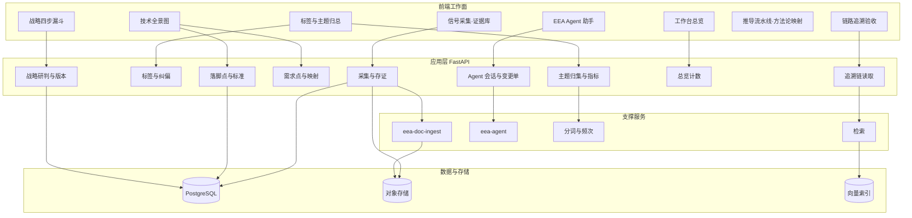
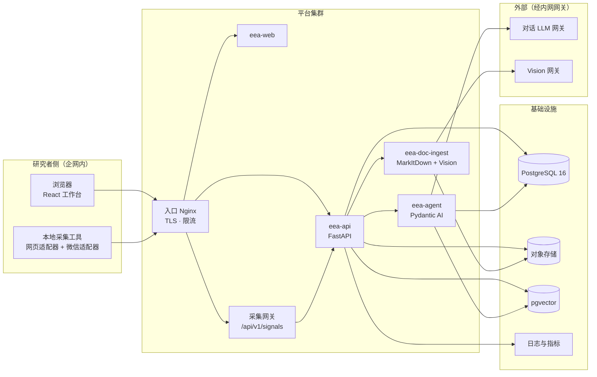
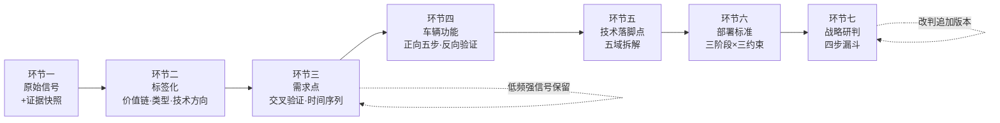
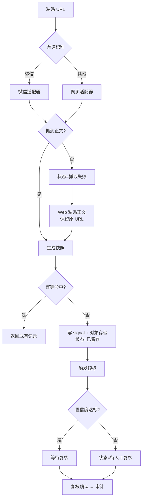
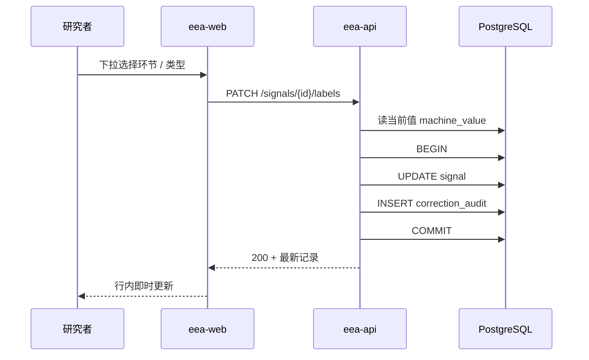
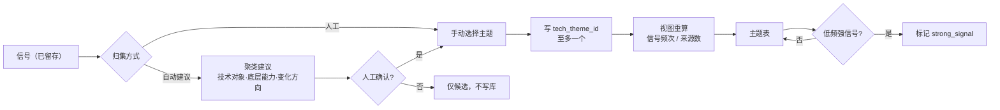
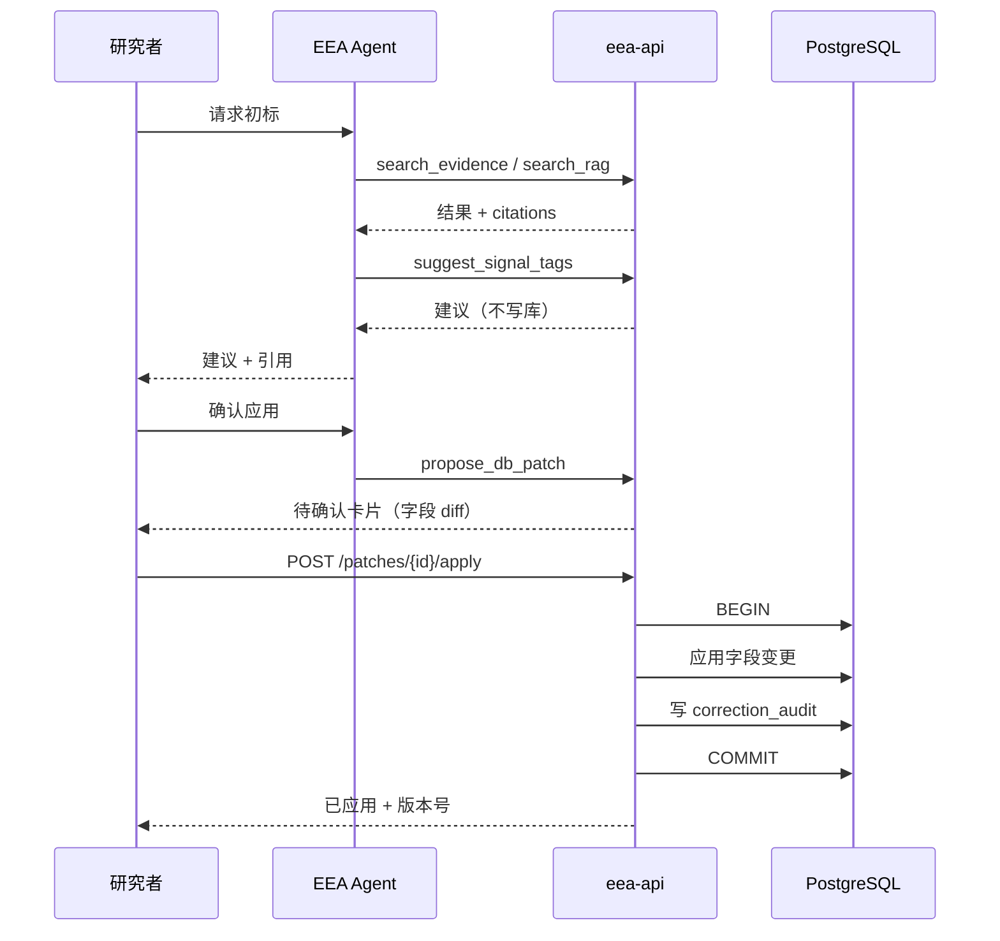
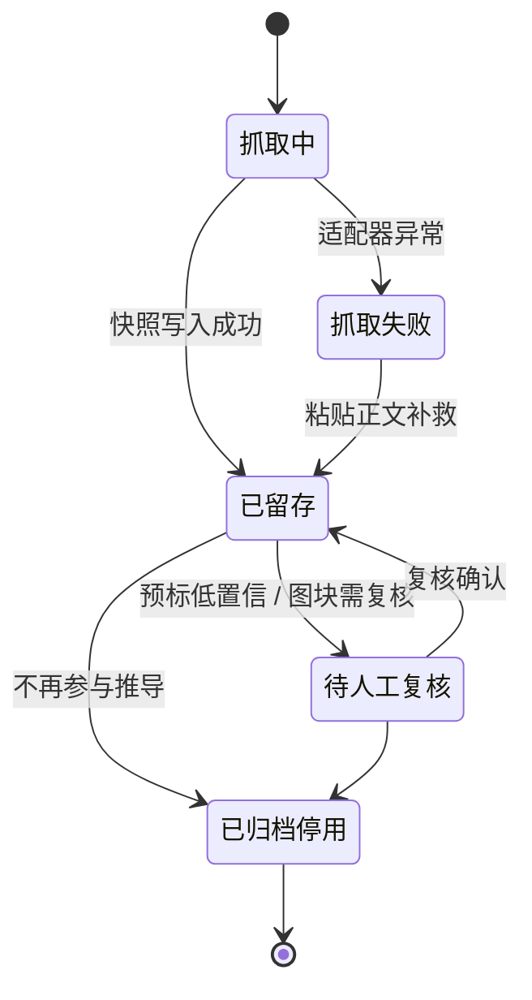
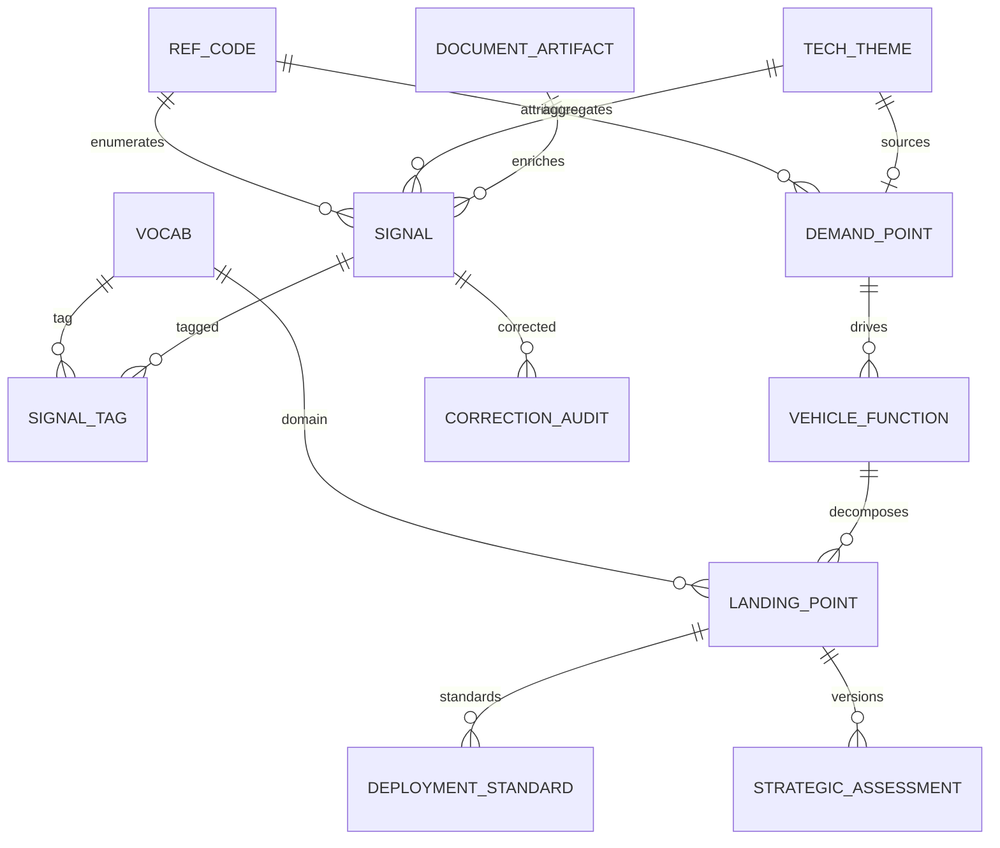
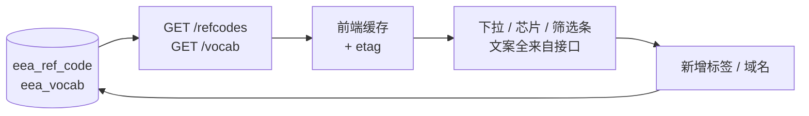

# 报告图源：EEA 平台图集

本文件是报告用图的**唯一图源**。所有图以 mermaid 维护，用 `mmdc` 导出 PNG 贴进报告。**禁止在 PPT 里手绘第二版**——这是降低维护量的硬规则（WBS §9.1 R4）。

导出命令：

```bash
npx -y @mermaid-js/mermaid-cli -i docs/figures.md -o docs/images/mermaid/ -w 1600
```

---

## 图1 功能框图

用途：讲清楚「有哪些工作面、每个工作面靠哪个服务、数据落在哪」。



---

## 图2 系统架构图

用途：讲清楚企网边界、四个镜像、依赖关系。



---

## 图3 链路主流程图（七环节）

用途：报告开篇一张图说明业务主线。



---

## 图4 信号采集与存证流程



---

## 图5 纠偏与留痕时序



---

## 图6 主题归集与指标流程



---

## 图7 Agent 建议到写库



---

## 图8 证据状态机



---

## 图9 数据模型（ER）



---

## 图10 词表驱动 UI



---

## 图11 排期甘特

```mermaid
gantt
    title EEA 平台六周排期
    dateFormat YYYY-MM-DD
    axisFormat %m/%d

    section W1 底座
    选型与Schema与图     :w1a, 2026-10-19, 7d
    M0 基线              :milestone, m0, 2026-10-25

    section W2 采集
    壳层与通用组件       :w2a, 2026-10-26, 4d
    采集与存证与摄取     :w2b, 2026-10-26, 7d
    M1 壳层与采集        :milestone, m1, 2026-11-01

    section W3 智能管线
    词表驱动与初判       :w3a, 2026-11-02, 5d
    归集与指标           :w3b, 2026-11-04, 5d
    Agent 框架与工具面   :w3c, 2026-11-03, 7d
    M2 智能管线          :milestone, m2, 2026-11-08

    section W4 闭环
    需求点与映射         :w4a, 2026-11-09, 7d
    落脚点与标准         :w4b, 2026-11-11, 7d
    Agent 写库与报告     :w4c, 2026-11-10, 6d
    M3 个性化闭环        :milestone, m3, 2026-11-15

    section W5 稳定
    复盘与缺陷修复       :w5a, 2026-11-16, 7d
    harness 全链路       :w5b, 2026-11-18, 4d
    漏斗与追溯收口       :w5c, 2026-11-17, 6d
    M4 稳定化            :milestone, m4, 2026-11-22

    section W6 交付
    性能与Demo           :w6a, 2026-11-23, 7d
    交接与运营规则       :w6b, 2026-11-25, 5d
    M5 交付展示          :milestone, m5, 2026-11-29
```
