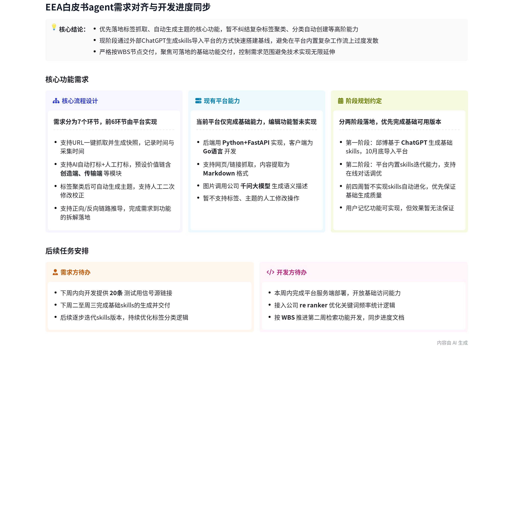
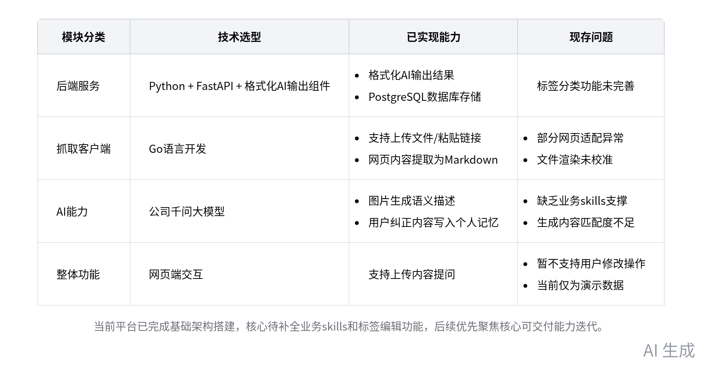
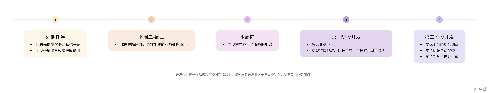

# 智能纪要：EEA白皮书agent需求（2026-10-29）

| 项目 | 内容 |
| --- | --- |
| 会议主题 | EEA白皮书agent需求 |
| 会议时间 | 2026-10-29（周四）14:16 – 15:08（GMT+08） |
| 参会人 | 张鹏、邓桂辉、丁见齐、刘鹏、邱志光 |
| 来源 | <https://yesv-desaysv.feishu.cn/docx/OsmrdUAepo6nm6xDJKhcM1VNn0g> |
| 导出时间 | 2026-10-29，`lark-cli docs +fetch`（markdown） |
| 说明 | 原文为飞书 AI 智能会议纪要，可能不准确，请谨慎甄别后使用 |

> 智能会议纪要由 AI 生成，可能不准确，请谨慎甄别后使用

## 总结

本次会议围绕 AI 信息处理平台的功能需求、当前开发进度及后续落地安排展开对齐，明确各方任务节点，内容如下：

- **平台功能需求说明**

  - **核心流程设计**

    - 环节分工：前 6 个环节由徐扬平台开发，第 7 环节由邱志光深度参与定制。
    - 基础功能：支持 URL 一键抓取并生成快照，记录采集时间。
    - 标签处理：支持 AI + 人工打标，按价值链、信号类型分类，AI 初版输出后人工校正。
    - 主题生成：标签经聚类后自动生成主题，支持人工修改标签与主题。
    - 链路推导：支持需求到功能的正向、反向推导，完成功能拆解与技术匹配。

  - **分类规则要求**

    - 技术方向标签优先通过 AI 词频提取生成初版，后续由邱志光补充、修改校正。
    - 分类规则、标签推导逻辑将由邱志光整理后提供给开发方。

- **当前平台开发进度**

  - **现有架构情况**

    - 后端基于 Python 实现，采用 FastAPI 与格式化 AI 输出组件，数据库使用 PostgreSQL。
    - 客户端为 Go 语言编写，支持上传文件、粘贴链接，可抓取网页内容并提取为 Markdown 格式。
    - 图片通过公司千问大模型生成语义描述，用户纠正内容会写入个人记忆作为后续参考。

  - **现存问题说明**

    - 部分网页适配存在问题，文件渲染尚未校准，标签、分类功能未完善，暂不支持用户修改操作。
    - 当前仅为演示数据，缺乏符合业务规则的 skills 支撑，生成内容与实际业务匹配度不足。

- **后续落地安排**

  - **各方任务节点**

    - 邱志光：近期提供 20 条测试信号源，下周二、周三前输出 ChatGPT 生成的业务处理 skills。
    - 丁见齐：按现有 WBS 推进开发，本周争取将平台部署到服务器，同步输出各模块进度说明。

  - **阶段开发规划**

    - 第一阶段：导入邱志光提供的 skills，实现链接抓取、标签生成、主题输出基础能力。
    - 第二阶段：逐步实现平台内对话调优、标签自动聚类、新分类自动生成等进阶功能。

  - **核心原则提示**：优先保障可交付的核心功能落地，避免发散开发非必要的摆设类功能，聚焦实际痛点需求。

### 图 1：当前平台开发现状汇总

| 模块分类 | 技术选型 | 已实现能力 | 现存问题 |
| --- | --- | --- | --- |
| 后端服务 | Python + FastAPI + 格式化 AI 输出组件 | 格式化 AI 输出结果；PostgreSQL 数据库存储 | 标签分类功能未完善 |
| 抓取客户端 | Go 语言开发 | 支持上传文件 / 粘贴链接；网页内容提取为 Markdown | 部分网页适配异常；文件渲染未校准 |
| AI 能力 | 公司千问大模型 | 图片生成语义描述；用户纠正内容写入个人记忆 | 缺乏业务 skills 支撑；生成内容匹配度不足 |
| 整体功能 | 网页端交互 | 支持上传内容提问 | 暂不支持用户修改操作；当前仅为演示数据 |

> 当前平台已完成基础架构搭建，核心待补全业务 skills 和标签编辑功能，后续优先聚焦核心可交付能力迭代。

### 图 2：平台后续落地推进时序

| 节点 | 内容 |
| --- | --- |
| 1 近期任务 | 邱志光提供 20 条测试信号源；丁见齐出各模块进度说明 |
| 2 下周二–周三 | 邱志光输出 ChatGPT 生成的业务处理 skills |
| 3 本周内 | 丁见齐完成平台服务器部署 |
| 4 第一阶段开发 | 导入业务 skills；实现链接抓取、标签生成、主题输出基础能力 |
| 5 第二阶段开发 | 实现平台内对话调优；支持标签自动聚类；支持新分类自动生成 |

> 开发过程优先保障核心可交付功能落地，避免发散开发非必要摆设类功能，聚焦实际业务痛点。

## 待办

| # | 待办 | 负责人 | 说明 |
| --- | --- | --- | --- |
| 1 | 输出任务总结 | 丁见齐 | 整理当前平台项目各模块的进展情况，输出一段总结内容提交（来自邱志光） |
| 2 | 提供 20 条信号源 | 邱志光 | 整理 20 条相关信号源链接及对应标签推导逻辑，后续提供给丁见齐 |
| 3 | 同步项目进度 | 丁见齐 | 梳理当前项目 WBS 中前四周的各项任务完成进度，整理后同步给邱志光（来自邱志光） |
| 4 | 生成并交付 AI 技能 | 邱志光 | 通过 ChatGPT 基于现有七八个业务案例交互生成对应的业务处理 skills，下周二、周三前交付给丁见齐 |
| 5 | 部署平台到服务器 | 丁见齐 | 本周内尝试将当前开发的平台部署到服务器上，方便后续调整修改 |

## 相关链接

- 文字记录：[EEA白皮书agent需求 2026年10月29日](https://yesv-desaysv.feishu.cn/docx/VdsyduYIXolct5xameGc71mcnVn)
- 相关会议纪要：[智能纪要：EEA白皮书agent需求 2026年10月15日](https://yesv-desaysv.feishu.cn/docx/NSX7dAXiVoceE2xlDFRcTJTqn7d)
