# 德赛西威 EEA 前瞻技术扫描平台实施计划

本文是**平台实施计划与 EEA Agent 六周开发排期**的合一文档：不写应用代码，也不部署。建设对象是「德赛西威 EEA 前瞻技术扫描平台」及支撑其工作的智能代理：研究者从产业信号走到一项技术的战略落地判断。第 11 节的 harness用来验收这条链路能否跑通。第 9 节为 Agent 实现甘特与交付节奏。harness 里的文章、器件、分数和标准条文不是平台需求。

第 7 节的软件栈是提案。来源文档没有指定语言、框架或数据库。

## 1. 目的与边界

平台要支持一条可复用的推导链路：

原始信号 → 需求点 → 车辆功能 → 技术落脚点 → 部署标准 → 战略研判

研究者把网页或微信公众号文章收进证据库，给信号打上封闭分类和可扩展的技术方向标签，把多条信号归成需求点，把需求点映射成车辆功能，再把功能拆成若干域上的技术落脚点，为落脚点登记可验证的部署标准，最后用四步漏斗做战略分类。

验收 harness 是硬件域落脚点「智能保险丝（eFuse）」。这个名称出现在第 8 节的验收检查、第 11 节，以及第 2 节的来源文件名里。需求条文不把它当作平台功能。换一项技术时，链路、词表规则和页面职责不变。

本文件不做的事：

- 不生成应用源码、依赖清单或基础设施配置。
- 不补写来源故意留空的标准格。
- 不把《洞悉EEA技术变革》里未提供的章节补写进本文。

## 2. 需求来源

| 来源 | 用途 |
| --- | --- |
| [案例说明 Word](reference/德赛西威EEA关键技术落脚点推导链路逐环节图文对照说明-以「智能保险丝（eFuse）」为案例-1009.docx) | 七个环节、四张表、业务规则的原文 |
| `docs/images/` 下七张 PNG | 页面职责与字段。词表的完整取值以图为准 |
| 《洞悉EEA技术变革》§1.2、§1.4 | 来源标明的方法论出处。业务确认不向本项目提供；本文不按节号补写，追溯标签仅作来源引用 |

来源文末写明：案例数据与截图取自该平台，平台数据随扫描滚动更新，「最新状态以平台实时界面为准」。因此截图上的存量数字不是验收基线。

软件技术栈不在上述来源里。

图号按画面绑定，不按 Word 里的插入顺序。包内有七个 PNG、八次插入：`image1` 插入了两次。XML 把抽屉图放在图2-1-1 的题注行上，画面本身是抽屉，故改绑到图2-1-2。没有第八张图。

| 文件 | 图号 | 画面 |
| --- | --- | --- |
| `images/fig-2-1-1.png` | 图2-1-1，并复用于图2-2 | 信号采集·证据库列表 |
| `images/fig-2-1-2.png` | 图2-1-2 | 信号证据抽屉 |
| `images/fig-2-3.png` | 图2-3 | 标签与主题归总 |
| `images/fig-2-4.png` | 图2-4 | 链路追溯上半：需求点到车辆功能 |
| `images/fig-2-5.png` | 图2-5 | 技术全景图 |
| `images/fig-2-6.png` | 图2-6 | 链路追溯下半：功能与技术落脚点。同一帧还可见部署标准，以及一条战略摘要 |
| `images/fig-2-7.png` | 图2-7 | 战略四步漏斗 |

图2-3 筛选条读出的词面如下。散文只点名了「创造端（供应链）」「战略」「技术」，其余取值来自这张图，不是从 harness 故事外推的。若日后补齐的方法论文档用词不同，以文档复核后的词面替换。

- 价值链环节（4）：创造端（供应链）、传递端（主机厂）、兑现端（消费者）、规制端（行业标准/规定）
- 信号类型（5）：战略、技术、人才、资本、标准

## 3. 领域主链路

节号 1.2.1–1.2.5 与 1.4 是来源使用的追溯标签，对应尚未入库的方法论章节。


每条需求都有编号。编号后面的「来源」指向环节、表或图。

### 环节一：原始信息采集与证据留存

进入条件：研究者持有一篇网页或微信公众号文章的 URL。

退出产物：一条原始信号，渠道已识别，证据快照已留存，并带有机器预标（预标规则在环节二）。

- **REQ-SIG-01** 证据库接受粘贴的文章 URL，一键抓取并存证。URL 覆盖网页与微信公众号链接。来源：环节一。
- **REQ-SIG-02** 抓取时自动识别渠道。来源：环节一。
- **REQ-SIG-03** 每条信号记录标题、链接、渠道、发布主体、价值链环节、信号类型、技术方向标签、演进节点、证据状态。来源：环节一、图2-1-1。
- **REQ-SIG-04** 列表可按关键词检索，并可按价值链环节、来源筛选。来源：环节一、图2-1-1。
- **REQ-SIG-05** 点击一条信号打开证据抽屉。来源：环节一、图2-1-2。
- **REQ-SIG-06** 抽屉上部是链接、发布主体、发布时间；中部是技术方向标签与向上归集；下部是证据快照。来源：环节一、图2-1-2。
- **REQ-SIG-07** 证据快照留存采集到的原始数据，至少包括标题、来源、链接、发布时间，以及快照中的摘要或正文。来源：环节一、图2-1-2。
- **REQ-SIG-08** 信号按链路与标签自动向上归集到技术主题；研究者也可以手动归集或移出。来源：图2-1-1 页眉说明、图2-1-2。
- **REQ-SIG-09** 演进节点是封闭词表，只有「发布」「定点/验证」。信号界面不能新建节点。来源：第 10.1 节已决（业务确认）。
- **REQ-SIG-10** 证据状态是封闭工作流词表，只有「抓取中」「抓取失败」「已留存」「待人工复核」「已归档/停用」。信号界面不能新建状态。语义：「已留存」表示抓取成功且证据快照已写入；「待人工复核」表示快照已留存，但价值链环节、信号类型、技术方向标签或向上归集尚未经人工确认；「已归档/停用」表示该信号不再参与归集与推导，历史链路只读保留。来源：第 10.1 节已决（业务确认）。
- **REQ-SIG-11** 主路径仍是 REQ-SIG-01：粘贴 URL 后通过本地采ai集工具一键抓取并存证。当微信公众号经本地采集工具仍失败时，允许研究者在平台 Web 将已采集正文粘贴写入证据快照，并保留原始 URL；不为此增设证据状态取值。补全快照后按业务规则转入「已留存」或「待人工复核」。该补救不替代一键抓取，不改变 REQ-SIG-01 条文。来源：第 10.1 节已决（业务确认）；微信公网采集稳定性见实施风险登记。

本文出现的渠道是「网页」「微信公众号」。是否还有别的渠道，未在本文给出。harness 截图上的证据状态为「已留存」，属于 REQ-SIG-10 五值之一。

### 环节二：信号标签化

进入条件：一条已入库、已有证据快照的信号。

退出产物：价值链环节、信号类型、技术方向标签均已标注的信号。机器初判可以被人纠偏。

原文：「仅可选择既有类目（4个价值链环节、5种信号类型），不可手动新增，以保证分类体系的稳定性。」

- **REQ-TAG-01** 价值链环节是封闭词表，只有第 2 节列出的 4 个取值（词面以图2-3 为准）。信号界面不能新建环节。来源文档表1 等处的「供应链（创造端）」等写法视为同一环节的 harness 别名，界面存储与筛选以图2-3 主词面为准，别名仅作展示或导入映射。来源：环节二、图2-3；第 10.1 节已决（业务确认）。
- **REQ-TAG-02** 信号类型是封闭词表，只有第 2 节列出的 5 个取值。信号界面不能新建类型。来源：环节二、图2-3。
- **REQ-TAG-03** 列表中用下拉修正价值链环节和信号类型，下拉只有既有类目。来源：环节二。
- **REQ-TAG-04** 价值链环节由平台根据文章标题和证据快照初判。人工复核可以纠偏。来源：环节二。
- **REQ-TAG-05** 信号入库时，平台用证据快照里的关键词和关键内容做高频汇总，生成出现频次较高的技术方向标签。条数不固定，随内容丰富度和篇幅调整。来源：环节二。
- **REQ-TAG-06** 技术方向标签可以人工补标，也可以动态新增。新标签立即进入全局标签体系，供其他信号复用。来源：环节二。

### 环节三：需求点提取、交叉验证与时间序列核验

进入条件：已标注的多条信号。

退出产物：一个已命名的需求点，附交叉验证结论和时间序列说明。此结果仍是初判，须人工复核后才能当作后续推导的输入。

本环节要回答两件事：多条原始信号是否共同证明了一项真实的技术变化；这些信号是否共同指向一个具有产业代表性的新增需求。

方法上先有「技术主题」（可追溯索引），完成归因和命名之后才是「需求点」。图2-3 把二者放在同一张主题表里，行题带「主题归集」。实施时仍然分开：归集阶段只有索引，没有合并，也没有优先级。

原文：「是否归入同一技术主题并不单纯依据关键词一致，而进一步校验技术对象、底层能力和变化方向是否具有共同性。」命名发生在「多源信号识别—频率共识判断—相似性聚类—利益相关方归因」之后。

- **REQ-DEM-01** 需求点提取必须同时回答「是不是一项真实的技术变化」和「是不是一项有产业代表性的新增需求」。来源：环节三。
- **REQ-DEM-02** 主题归集只建立可追溯索引，不做需求合并，不做优先级判断。来源：环节三。
- **REQ-DEM-15** 技术主题与需求点为两张表。技术主题表承载归集索引与图2-3 主题表展示；完成环节三命名、交叉验证等步骤后，写入或关联独立需求点记录。归集阶段只在技术主题上增删信号，不合并主题、不对主题或需求点做优先级排序。来源：环节三；第 10.1 节已决（业务确认）。
- **REQ-DEM-03** 归入同一技术主题的依据是技术对象、底层能力和变化方向具有共同性，而不是关键词相同。来源：环节三。
- **REQ-DEM-04** 频率与跨来源共识要求：不同主体、不同技术对象、不同渠道的独立信号持续指向同一变化。单一企业发布或孤立事件不构成产业共识。来源：环节三。
- **REQ-DEM-05** 相似性聚类不要求各信号讨论同一种器件，而判断底层诉求是否一致。来源：环节三。
- **REQ-DEM-06** 利益相关方归因回溯主要推动主体和驱动逻辑，结果落在一个价值链环节。技术对象相近，不得因此把不同环节合并成一条需求。后续若出现其他环节的明确诉求，另建该环节的需求。来源：环节三。
- **REQ-DEM-07** 只有走完多源信号识别、频率共识判断、相似性聚类、利益相关方归因，才给需求点命名。名称是系统级抽象，不是具体技术方案，也不是「用一种方案替换另一种方案」这种器件级表述。来源：环节三。
- **REQ-DEM-08** 需求点记录三项属性：利益相关方归因（价值链环节）、信号频次、已映射的车辆功能数；主题表还展示来源数（REQ-DEM-14）。来源：表1、图2-3。
- **REQ-DEM-14** 图2-3 主题表两列计数口径：「信号频次」= 当前归入该技术主题（或对应需求点）的原始信号记录条数，每条信号计 1，「已归档/停用」信号是否计入由实现统一规定并在界面说明。「来源数」= 与该主题关联的去重 URL 个数（URL 规范化后去重）；当仅统计各信号主链接且无重复 URL 时，来源数等于信号频次。harness 「低压系统智能化」以图2-3 读数验收：信号频次 8、来源数 16。来源：第 10.1 节已决（业务确认）。
- **REQ-DEM-09** 交叉验证检查同一需求能否得到不同主体、不同证据类型、不同产业视角的独立支持。来源：环节三。
- **REQ-DEM-10** 交叉验证未通过的需求不得进入功能推导。单一企业宣传、单一产品迭代或短期热点形成的伪需求停在本环节。来源：环节三。
- **REQ-DEM-11** 时间序列按事件实际发生时间串联节点，用来看证据是否持续，以及需求所对应的技术与产业生态处于哪个演进阶段。来源：环节三。
- **REQ-DEM-12** 时间序列不表示被归入同一需求的各条技术路线已经同时达到成熟量产。来源：环节三。
- **REQ-DEM-13** 技术成熟、商业化和标准化不是线性关系。平台给出的归集、交叉验证和时间序列是初判。原文：「平台流程仅作为初判辅助，后续仍需人工复核。」来源：环节三。

图2-3 的主题表除信号频次外还有一列「来源数」。两列计数口径见 REQ-DEM-14。

### 环节四：需求与功能映射

进入条件：已通过交叉验证、并经人工复核确认的需求点。

退出产物：一条已发布的「需求点 → 车辆功能」映射。正向推导和反向验证不一致时，不发布。

本环节要回答：这一抽象需求要求车辆新增哪些能力，这些能力解决什么现有瓶颈，作用于哪条车端关键流，最终落成什么可执行、可验证的车辆功能。

- **REQ-MAP-01** 映射从已确认的需求点出发，产出一项可执行、可验证的车辆功能，并写明能力、缺口和所作用的车端关键流。来源：环节四。
- **REQ-MAP-02** 正向推导固定五步：拆解核心诉求；识别现有能力与目标诉求的缺口；定位能力所作用的车端关键流；由缺口推导必要的系统行为；把系统行为收敛为一项车辆功能。来源：环节四。
- **REQ-MAP-03** 必要性校验从反方向问：若没有这项车辆功能，需求点是否仍能完整实现。不能完整实现，必要性才成立。来源：环节四。
- **REQ-MAP-04** 反向验证要求车辆功能覆盖该需求的全部核心诉求。只覆盖其中一段能力的候选功能，不得发布为这条映射。来源：环节四。
- **REQ-MAP-05** 只有正向推导和反向验证收敛一致，才正式建立需求—功能映射。来源：环节四。
- **REQ-MAP-06** 车辆功能记录它来自哪一个需求点，以及归因的价值链环节。映射关系由需求点双向校验得出。来源：表1、环节四。

核心诉求是五步推导的输出，不是平台预置的能力枚举。

### 环节五：功能与关键技术拆解

进入条件：已发布的车辆功能。

退出产物：该功能下的一组技术落脚点。每个落脚点有所属域、在功能中的角色，并可以挂上部署标准。

- **REQ-TECH-01** 车辆功能拆解为技术落脚点。来源：环节五、图2-5。
- **REQ-TECH-02** 一项功能可以同时拥有多个域上的落脚点。散文把 harness 落脚点标为硬件域；图2-5 在同一功能下还显示了其他域。域词表不封闭：为落脚点指定所属域时可选用全局已有域，也可新建域名并立即供其他落脚点复用（与技术方向标签类似，区别于价值链环节等封闭词表）。来源：环节五、图2-5；第 10.1 节已决（业务确认）。
- **REQ-TECH-03** 每个技术落脚点记录它在该功能中的角色，并可以关联零条或多条部署标准。来源：环节五、表1。
- **REQ-TECH-04** 技术全景图按价值链环节展开需求点，再展开车辆功能及其落脚点。来源：图2-5。

### 环节六：EEA 部署标准构建

进入条件：一个技术落脚点。

退出产物：该落脚点的部署标准矩阵。没有实质内容的格子保持空白。

原文：「不为凑齐三阶段而虚构条目」。技术可行不等于可量产。标准定义的是可验证的部署边界。

- **REQ-STD-01** 部署标准按阶段与约束类型登记。阶段是设计、制造、运营。约束类型是工程化、经济性、安全合规。第一期三类约束均可录入正文；无实质内容时该格留空（REQ-STD-02）。来源：环节六；第 10.1 节已决（业务确认）。
- **REQ-STD-02** 某个阶段或某类约束没有实质内容时，该格留空。系统不得为凑齐三阶段或三类约束自动补写条目。来源：环节六。
- **REQ-STD-03** 部署标准判断的是可验证的部署边界。技术上说得通，不自动生成标准条目。来源：环节六。

### 环节七：战略四步漏斗研判

进入条件：已有部署边界记录的技术落脚点，进入筛选池。第一步面向行业全集，不从单条技术起步。

退出产物：分类、五维分数、总分和策略备注；或在第二步被滤除，不进入评分。

四步原文的取向：

1. 行业级全景扫描，求广，不遗漏颠覆性方向。
2. Tier1 业务场景与战略适配过滤，求准，剔除长尾偏离技术。
3. 多维价值与可行性综合研判，求实。
4. 落地策略分类，导向行动，差异化配置资源。

第二步的判断句：「这项技术与公司现在/未来业务有什么关系，公司能否在其中承担有价值的角色」。

第三步的判断句：「是否值得投入、何时投入、以什么方式投入」。

- **REQ-STR-01** 战略研判按上面四步执行，顺序不跳。求广先于求准，求准先于评分，评分先于分类。来源：环节七。
- **REQ-STR-02** 第二步使用上面的判断句，把行业技术与德赛西威的当前业务和未来业务对齐。来源：环节七。
- **REQ-STR-03** 公司按 Tier1 参与研判。不把德赛西威写成功率半导体器件的供给方。原文给出的直接参与基础是智能配电架构定义、区域控制器集成和电源系统方案。来源：环节七。
- **REQ-STR-04** 通过第二步的技术才进入第三步。五维各按 5 分计，合计 25 分。五个维度是：业务匹配度、技术成熟度窗口、差异化护城河、供应链生态位、可落地性。每一维只允许录入 1–5 的整数，不允许小数或 0 分。综合分由五维整数相加得出。来源：环节七、表C 的表头；第 10.1 节已决（业务确认）。
- **REQ-STR-05** 第四步把技术分入三类之一：前瞻布局、短期可落地、产业投资/生态合作。分类用来差异化配置资源。来源：环节七。
- **REQ-STR-06** 进入筛选池的技术记录分类、综合评分和策略备注。分数与分类结论要互相印证。来源：表1、环节七。
- **REQ-STR-07** 同一技术落脚点的战略研判改判时追加新版本，保留历史记录（五维分、综合分、分类、策略备注、操作者与时间）；界面默认展示当前最新版本，并可查看版本时间线。来源：第 10.1 节已决（业务确认）。

## 4. 领域模型

只记录来源已经说出的属性。图上读到、散文没写的字段，在属性后标明「读图」。

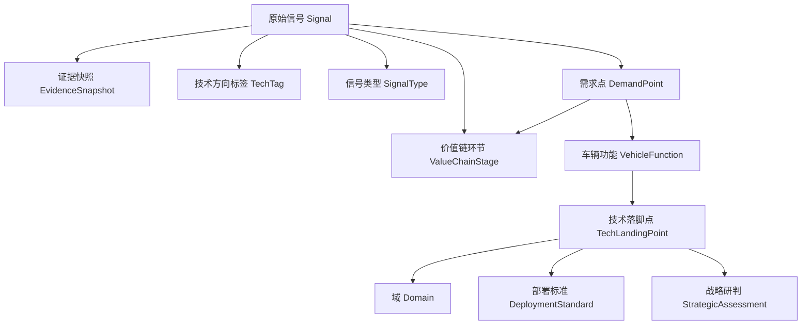

### 原始信号（Signal）

- 标题、链接、渠道、发布主体、发布时间
- 价值链环节：多选一，封闭 4 值
- 信号类型：多选一，封闭 5 值
- 技术方向标签：多值，来自全局词表
- 演进节点：多选一，封闭 2 值——「发布」「定点/验证」（REQ-SIG-09）
- 证据状态：多选一，封闭 5 值——「抓取中」「抓取失败」「已留存」「待人工复核」「已归档/停用」（REQ-SIG-10）
- 一条信号有一份证据快照
- 一条信号当前归集到至多一个技术主题；可以从该主题移出后再归到另一个。图2-1-2 的归集区是单一需求点，不是多选

### 证据快照（EvidenceSnapshot）

- 链接、发布主体、发布时间
- 采集原始数据：标题、来源、摘要或正文
- 本文没有规定快照必须是整页截图。图2-1-2 的快照区是文字

### 价值链环节（ValueChainStage）

封闭 4 值，见第 2 节。信号上的取值和需求点的利益相关方归因用同一套环节。

### 信号类型（SignalType）

封闭 5 值，见第 2 节。

### 技术方向标签（TechTag）

全局词表。机器按频次生成，人工可增。新增后供其他信号复用。不是封闭词表。

### 技术主题（TechTheme）

- 归集用索引名称（命名前可为系统暂名或工作名）
- 价值链环节（归因前可为空或初判）
- 信号频次、来源数（REQ-DEM-14），由归入本主题的信号与 URL 汇总
- 技术方向标签（展示用）
- 与多条信号的多对多或一对多归集关系（信号至多归属一个主题，REQ-SIG-08）
- 图2-3 主题表主要展示本表；不合并、不排序（REQ-DEM-02、REQ-DEM-15）

### 需求点（DemandPoint）

- 名称：系统级抽象（环节三命名后）
- 利益相关方归因：一个价值链环节
- 信号频次（REQ-DEM-14），可与来源技术主题同步或自算，验收以图2-3/表1 为准
- 来源数（REQ-DEM-14）
- 已映射车辆功能数
- 来源技术主题：外键，一条需求点追溯一个或多个主题时以实现为准；harness 为单一主题「低压系统智能化」
- 交叉验证结论
- 时间序列：按事件实际发生时间排列的节点
- 人工复核状态。原文要求复核，没有规定状态名

一个需求点对应多条信号。一个需求点可以映射多项车辆功能；表1 的「映射功能数」是计数，不是恒为 1。

### 车辆功能（VehicleFunction）

- 名称
- 来源需求点
- 归因的价值链环节
- 正向五步的记录
- 必要性校验的记录
- 反向验证的记录
- 未同时通过正向与反向时，不得标记为已发布

### 技术落脚点（TechLandingPoint）

- 名称
- 所属域
- 在所属车辆功能中的角色
- 关联的部署标准，零条或多条

一项车辆功能有多个落脚点。

### 域（Domain）

- 名称：全局可扩展词表（REQ-TECH-02）
- 图2-5 harness 读到的域芯片示例：硬件、软件、工具链、电源。散文「硬件域」与芯片「硬件」视为同一域，不另造名字

### 部署标准（DeploymentStandard）

- 阶段：设计、制造、运营
- 约束类型：工程化、经济性、安全合规
- 标准要求：文本，允许空
- 空格必须能与「尚未填写」区分开，呈现为留空，而不是缺一行

### 战略研判（StrategicAssessment）

- 四步中的当前步
- 五维分数，每维 1–5 的整数（REQ-STR-04）
- 综合分，五维之和，最高 25 分
- 分类：前瞻布局、短期可落地、产业投资/生态合作，三选一
- 策略备注
- 所研判的技术落脚点
- 版本：改判追加，保留历史（REQ-STR-07）

一条落脚点在筛选池中有当前研判；历史版本可查阅，不覆盖删除。

### 4.1 逻辑关系模型（PostgreSQL，范式对照）

本节是第 7 节选用 PostgreSQL 时的**提案级**物理模型，服务于第 4 节实体与 REQ-RULE-02、REQ-RULE-03。类型以 PostgreSQL 14+ 为准；主键默认 `uuid`，时间戳用 `timestamptz`。

#### 设计结论：实际用到第几范式？

| 层级 | 是否作为验收目标 | 说明 |
| --- | --- | --- |
| **1NF** | 是（底线） | 所有业务表列值原子；多标签、多 URL、多主题追溯一律用关联表，不用「唯一合法存法」的数组列。 |
| **2NF** | 是 | 所有复合主键表（`signal_tech_tag` 等）仅含外键，不在关联行上挂描述性字段。 |
| **3NF** | 是 | 事实表只存封闭词表 `code` / 开放词表 `id`；中文展示名在词表或 join 得到，不跟外键并行冗余一列「标签文案」。 |
| **BCNF** | **是（主目标）** | 每张**基表**上，非平凡 FD 的决定因素都是超键。封闭枚举、标签名、域名、`(tech_landing_point_id, version)` 等按此设计。 |
| **4NF** | **是（多值处）** | 信号—标签、主题—标签、主题—URL 等**彼此独立的多值事实**分表存放，避免混在一行产生 MVD 交叉积。 |
| **5NF** | 否 | 无证据表明存在需按连接依赖再拆的「三元以上」关系；追溯链用外键即可。 |

**一句话**：物理模型按 **BCNF 建表**；多标签仍用一张关联表（4NF 要点）。**第一期推荐精简 schema（10 基表 + 1 视图）**，见下文「精简表关系总览」；封闭枚举合并为一张 `eea_ref_code`，不再为每种枚举单独建表。

表名前缀：业务表用 `eea_` 避免与 SQL 保留字混淆。

#### 相较 22 表版：删了什么、需求是否仍满足

| 删减 | 理由 | 需求 |
| --- | --- | --- |
| 5 张封闭枚举表 → `eea_ref_code` 一张 | 结构相同，仅 `domain` 不同 | REQ-TAG-01/02、REQ-SIG-09/10 仍由种子行 + CHECK/FK 保证 |
| `eea_evidence_snapshot` 并入 `eea_signal` | 始终 1:1 | REQ-SIG-07 |
| `eea_theme_url` | 来源数对「主题下信号主链 URL」去重即可；harness 若需额外 URL，用 `eea_signal` 归入该主题或二期再加列 | REQ-DEM-14（口径在视图注释中固定） |
| `eea_tech_theme_tag` | 图2-3 主题行标签由该主题下信号标签聚合（视图） | REQ-TAG-05/06 |
| `eea_demand_point_theme` | 需求点加 `source_tech_theme_id`；多主题时再启用关联表 | REQ-DEM-15（主题与需求仍为两表） |
| `eea_demand_function` | `eea_vehicle_function.demand_point_id` | REQ-MAP-* |
| `eea_platform_user` | 审计/研判存 `operator_subject` 文本（对接 SSO 前足够） | REQ-RULE-02 |
| `eea_tech_tag` + `eea_domain` → `eea_vocab` | 同为「可扩展名称词表」，用 `kind` 区分 | REQ-TAG-06、REQ-TECH-02 |

#### 术语与范式（检索摘要）

| 中文常用名 | 英文 | 要点（与本平台的关系） |
| --- | --- | --- |
| 第一范式 1NF | First NF | 属性原子、无重复组；列内不塞「标签列表」「多 URL」等可变数组作为唯一存法。 |
| 第二范式 2NF | Second NF | 在 1NF 上，非主属性**完全**依赖于**整个**主键；组合主键的关联表不得出现仅依赖主键一部分的属性。 |
| 第三范式 3NF | Third NF | 在 2NF 上，消除非主属性对主键的**传递依赖**；封闭词表、域、标签等独立成表，信号行只存外键。 |
| 巴斯范式 BCNF | Boyce-Codd NF | 比 3NF 更严：凡非平凡函数依赖 `X → A`，`X` 须为超键。封闭枚举表以 `code` 为主键可满足。 |
| 第四范式 4NF | Fourth NF | 消除**非平凡多值依赖**；同一实体上彼此独立的多值事实（如「多标签」与「多 URL」）拆成不同关联表，避免交叉积冗余。 |
| 第五范式 5NF | Fifth NF | 针对连接依赖的进一步分解；本链路以外键追溯为主，**不强制**做到 5NF。 |

说明：口语里的「巴斯范式」即 **BCNF（Boyce-Codd）**；「遵行范式」在教材体系中通常对应 **第四范式（4NF，多值依赖）**——下文按 1NF→BCNF→4NF 对照本 schema。范式定义参见 Elmasri/Navathe 关系数据库设计章节与 [第四范式（维基）](https://zh.wikipedia.org/zh-hans/%E7%AC%AC%E5%9B%9B%E6%AD%A3%E8%A6%8F%E5%8C%96)。

#### 反模式 → 分解（为何这样建表）

| 若写成一张宽表 | 违反 | 本平台做法 |
| --- | --- | --- |
| `signal` 行内 `tech_tags text[]` 作为唯一存法 | 1NF/4NF | `eea_signal_tag` 关联表 |
| `signal_tech_tag(signal_id, tag_id, tag_display_name)` | 2NF（`tag_display_name` 只依赖 `tag_id`） | 标签名只在 `tech_tag.name` |
| `signal` 上冗余 `value_chain_label` 且与 `value_chain_stage_id` 可不一致 | 3NF | 只存 `value_chain_stage_id`，展示时 join |
| `demand_point` 上冗余主题名称 | 3NF | `source_tech_theme_id` 外键，名称以 `eea_tech_theme` 为准 |
| `strategic_assessment` 改判覆盖旧分 | 非范式问题，违背 REQ-STR-07 | 同落脚点 `version` 递增，多行历史 + `is_current` |

#### 精简表清单（推荐）

| 表名 | 职责 |
| --- | --- |
| `eea_ref_code` | 全部封闭枚举：`domain` + `code` → `label`（及可选 `fixture_alias`） |
| `eea_vocab` | 可扩展词表：`kind` = `tech_tag` \| `domain` |
| `eea_tech_theme` | 归集索引（REQ-DEM-02） |
| `eea_demand_point` | 命名需求 + `source_tech_theme_id` |
| `eea_signal` | 原始信号 + 证据快照列（同表） |
| `eea_signal_tag` | 信号 ↔ 技术方向标签（4NF） |
| `eea_correction_audit` | 纠偏审计 |
| `eea_vehicle_function` | 车辆功能 + `demand_point_id` |
| `eea_tech_landing_point` | 落脚点 + `domain_vocab_id` |
| `eea_deployment_standard` | 标准九宫格 |
| `eea_strategic_assessment` | 研判版本链 |

信号频次 / 来源数：视图 `eea_v_tech_theme_metrics`（只读聚合，不写回主题表）。

约束摘要：`eea_signal.tech_theme_id` 至多一个主题；`eea_strategic_assessment (tech_landing_point_id, version)` UNIQUE；当前研判部分唯一索引 `is_current`。

#### UML（逻辑 ER，Mermaid）

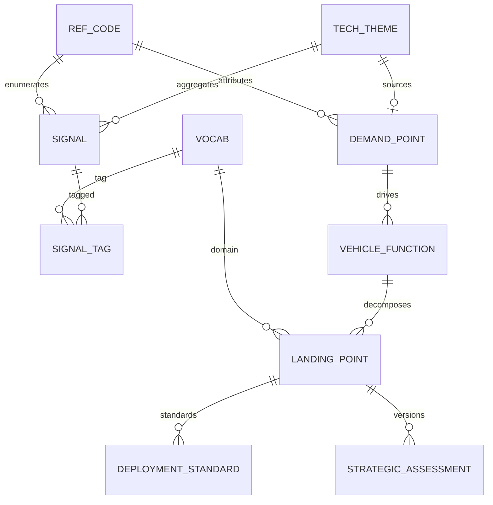

#### 范式自检（本 schema 目标）

| 范式 | 本平台如何满足 |
| --- | --- |
| 1NF | 标量列 + 关联表；长正文进对象存储，库内 `excerpt`/`body_object_key`。 |
| 2NF | 凡组合键关联表（`signal_tech_tag`、`demand_function` 等）无仅依赖键一部分的非键属性。 |
| 3NF | 信号/需求/功能只存环节 `code` 外键，不重复存环节中文标签（别名在 `fixture_alias` 或 UI 映射）。 |
| BCNF | 封闭词表、标签名、域名均以候选键决定其余属性。 |
| 4NF | 信号↔标签用 `eea_signal_tag`；主题行标签用视图聚合，不单独存「主题×标签」交叉表。 |

实现阶段用 SQL migration 生成下表；计数用视图，不写回主题表。

#### 全表字段结构（DDL 草案，精简版）

```sql
-- 1. 封闭枚举（一张表，种子按 domain 插入）
CREATE TABLE eea_ref_code (
  domain         text NOT NULL,  -- value_chain_stage | signal_type | evolution_node | evidence_status | channel
  code           text NOT NULL,
  label          text NOT NULL,
  fixture_alias  text,
  PRIMARY KEY (domain, code)
);

-- 2. 可扩展词表：技术方向标签 + 域
CREATE TABLE eea_vocab (
  id         uuid PRIMARY KEY DEFAULT gen_random_uuid(),
  kind       text NOT NULL CHECK (kind IN ('tech_tag', 'domain')),
  name       text NOT NULL,
  created_at timestamptz NOT NULL DEFAULT now(),
  UNIQUE (kind, name)
);

-- 3. 主题与需求（两表，REQ-DEM-15）
CREATE TABLE eea_tech_theme (
  id                        uuid PRIMARY KEY DEFAULT gen_random_uuid(),
  working_name              text NOT NULL,
  value_chain_stage_code    text,
  created_at                timestamptz NOT NULL DEFAULT now()
);
-- 环节 code 与 eea_ref_code(domain='value_chain_stage') 对齐；FK 可用复合列 (stage_domain, stage_code) 或应用层校验。

CREATE TABLE eea_demand_point (
  id                      uuid PRIMARY KEY DEFAULT gen_random_uuid(),
  name                    text NOT NULL,
  source_tech_theme_id    uuid REFERENCES eea_tech_theme(id),
  value_chain_stage_code  text NOT NULL,
  cross_validation        jsonb,
  time_series             jsonb,
  review_status           text,
  created_at              timestamptz NOT NULL DEFAULT now()
);

-- 4. 信号 + 证据快照（同表，REQ-SIG-07）
CREATE TABLE eea_signal (
  id                      uuid PRIMARY KEY DEFAULT gen_random_uuid(),
  title                   text NOT NULL,
  url                     text NOT NULL,
  url_normalized          text NOT NULL,
  channel_code            text NOT NULL,
  publisher               text,
  published_at            timestamptz,
  value_chain_stage_code  text,
  signal_type_code        text,
  evolution_node_code     text,
  evidence_status_code    text NOT NULL,
  tech_theme_id           uuid REFERENCES eea_tech_theme(id),
  source_label            text,
  excerpt                 text,
  body_object_key         text,
  body_sha256             char(64),
  captured_at             timestamptz,
  created_at              timestamptz NOT NULL DEFAULT now(),
  updated_at              timestamptz NOT NULL DEFAULT now()
);
CREATE INDEX eea_signal_theme_idx ON eea_signal (tech_theme_id);
CREATE INDEX eea_signal_url_norm_idx ON eea_signal (url_normalized);

CREATE TABLE eea_signal_tag (
  signal_id uuid NOT NULL REFERENCES eea_signal(id) ON DELETE CASCADE,
  vocab_id  uuid NOT NULL REFERENCES eea_vocab(id),
  PRIMARY KEY (signal_id, vocab_id)
);

CREATE TABLE eea_correction_audit (
  id                uuid PRIMARY KEY DEFAULT gen_random_uuid(),
  entity_type       text NOT NULL,
  entity_id         uuid NOT NULL,
  field_name        text NOT NULL,
  machine_value     jsonb,
  human_value       jsonb,
  operator_subject  text NOT NULL,
  operator_role     text NOT NULL,
  corrected_at      timestamptz NOT NULL DEFAULT now()
);

-- 5. 功能链
CREATE TABLE eea_vehicle_function (
  id                      uuid PRIMARY KEY DEFAULT gen_random_uuid(),
  demand_point_id         uuid NOT NULL REFERENCES eea_demand_point(id),
  name                    text NOT NULL,
  value_chain_stage_code  text,
  forward_trace           jsonb,
  reverse_trace           jsonb,
  published               boolean NOT NULL DEFAULT false,
  created_at              timestamptz NOT NULL DEFAULT now()
);

CREATE TABLE eea_tech_landing_point (
  id                   uuid PRIMARY KEY DEFAULT gen_random_uuid(),
  vehicle_function_id  uuid NOT NULL REFERENCES eea_vehicle_function(id) ON DELETE CASCADE,
  domain_vocab_id      uuid NOT NULL REFERENCES eea_vocab(id),
  name                 text NOT NULL,
  role_description     text,
  created_at           timestamptz NOT NULL DEFAULT now()
);

CREATE TABLE eea_deployment_standard (
  id                    uuid PRIMARY KEY DEFAULT gen_random_uuid(),
  tech_landing_point_id uuid NOT NULL REFERENCES eea_tech_landing_point(id) ON DELETE CASCADE,
  phase                 text NOT NULL CHECK (phase IN ('设计', '制造', '运营')),
  constraint_type       text NOT NULL CHECK (constraint_type IN ('工程化', '经济性', '安全合规')),
  requirement_text      text,
  UNIQUE (tech_landing_point_id, phase, constraint_type)
);

CREATE TABLE eea_strategic_assessment (
  id                    uuid PRIMARY KEY DEFAULT gen_random_uuid(),
  tech_landing_point_id uuid NOT NULL REFERENCES eea_tech_landing_point(id) ON DELETE CASCADE,
  version               int NOT NULL CHECK (version >= 1),
  funnel_step           smallint NOT NULL CHECK (funnel_step BETWEEN 1 AND 4),
  score_business        smallint NOT NULL CHECK (score_business BETWEEN 1 AND 5),
  score_maturity        smallint NOT NULL CHECK (score_maturity BETWEEN 1 AND 5),
  score_moat            smallint NOT NULL CHECK (score_moat BETWEEN 1 AND 5),
  score_supply_chain    smallint NOT NULL CHECK (score_supply_chain BETWEEN 1 AND 5),
  score_feasibility     smallint NOT NULL CHECK (score_feasibility BETWEEN 1 AND 5),
  score_total           smallint GENERATED ALWAYS AS (
    score_business + score_maturity + score_moat + score_supply_chain + score_feasibility
  ) STORED,
  classification        text NOT NULL,
  strategy_note         text,
  operator_subject      text,
  assessed_at           timestamptz NOT NULL DEFAULT now(),
  is_current            boolean NOT NULL DEFAULT true,
  UNIQUE (tech_landing_point_id, version)
);
CREATE UNIQUE INDEX eea_strategic_assessment_current_idx
  ON eea_strategic_assessment (tech_landing_point_id) WHERE is_current;

-- 6. 指标与主题展示标签（视图）
CREATE VIEW eea_v_tech_theme_metrics AS
SELECT
  t.id AS tech_theme_id,
  count(s.id) FILTER (WHERE s.evidence_status_code IS DISTINCT FROM 'archived') AS signal_frequency,
  count(DISTINCT s.url_normalized) FILTER (WHERE s.id IS NOT NULL) AS source_count
FROM eea_tech_theme t
LEFT JOIN eea_signal s ON s.tech_theme_id = t.id
GROUP BY t.id;

CREATE VIEW eea_v_tech_theme_display_tags AS
SELECT t.id AS tech_theme_id, v.name AS tag_name, count(*) AS tag_hits
FROM eea_tech_theme t
JOIN eea_signal s ON s.tech_theme_id = t.id
JOIN eea_signal_tag st ON st.signal_id = s.id
JOIN eea_vocab v ON v.id = st.vocab_id AND v.kind = 'tech_tag'
GROUP BY t.id, v.name;
```

**实现说明**：`eea_ref_code` 负责种子与界面文案；各事实表上的 `*_code` 列在 migration 里用 `CHECK (... IN (SELECT code FROM eea_ref_code WHERE domain = ...))` 的子查询约束（PostgreSQL 15+ 不支持子查询 CHECK 时需用触发器或省略 FK、由 API 校验）。若要数据库级硬 FK，为每类枚举增加 `text` 常量列 `channel_domain DEFAULT 'channel'` 并与 `code` 组成复合外键指向 `eea_ref_code`。

`source_count` 与 harness 8/16 不一致时，优先核对是否需「非信号登记 URL」；二期可加 `eea_tech_theme.supplemental_urls jsonb` 或恢复 URL 关联表，而不必回到 22 表方案。

#### 表关系总览（10 基表 + 2 视图）

| # | 表 / 视图 | 行含义 | 范式 |
| --- | --- | --- | --- |
| 1 | `eea_ref_code` | 全部封闭枚举 | BCNF |
| 2 | `eea_vocab` | 技术标签 + 域 | BCNF |
| 3 | `eea_tech_theme` | 归集索引 | BCNF |
| 4 | `eea_demand_point` | 需求点 | BCNF |
| 5 | `eea_signal` | 信号 + 快照 | BCNF |
| 6 | `eea_signal_tag` | 信号多标签 | 4NF |
| 7 | `eea_correction_audit` | 纠偏 | BCNF |
| 8 | `eea_vehicle_function` | 功能（含需求外键） | BCNF |
| 9 | `eea_tech_landing_point` | 落脚点 | BCNF |
| 10 | `eea_deployment_standard` | 标准格 | BCNF |
| 11 | `eea_strategic_assessment` | 研判版本 | BCNF |
| — | `eea_v_tech_theme_metrics` | 频次 / 来源数 | 视图 |
| — | `eea_v_tech_theme_display_tags` | 主题表标签列 | 视图 |

## 5. 业务规则

- **REQ-RULE-01** 价值链环节和信号类型只能从既有类目里选择。技术方向标签例外，允许新增并进入全局词表。来源：环节二。
- **REQ-RULE-02** 人工对价值链环节、信号类型、技术方向标签和归集结果的纠偏必须留下记录。机器初判不得被无痕迹替换。操作者记录为执行复核的平台用户身份，第一期角色为「方法论/词表管理员」（专职复核分类与归集，与采集入库的研究者角色区分）。来源：环节二、环节三；第 10.1 节已决（业务确认）。
- **REQ-RULE-03** 从技术落脚点能追溯到车辆功能、需求点、归集索引和原始信号。追溯页按这条链分段展示。来源：图2-4、图2-6、表1。
- **REQ-RULE-04** 平台数据随持续扫描滚动更新。写进 harness的界面不是永久快照。原文：「最新状态以平台实时界面为准。」来源：文末。
- **REQ-RULE-05** 技术方向标签一经写入全局词表，即可被其他信号复用。来源：环节二。
- **REQ-UI-01** 工作面至少包括：信号采集·证据库、标签与主题归总、技术全景图、链路追溯验收、战略漏斗。左侧导航里还可见工作台总览、推导流水线、方法论映射。来源：各图左侧导航。
- **REQ-UI-02** 上述三页第一期交付最小可用能力，无单独截图，行为如下（第 10.1 节已决）：**工作台总览**——展示链路关键计数（如信号、技术主题、需求点、车辆功能、落脚点、漏斗池条目等）与待办提示（如待人工复核信号数），卡片可跳转到对应工作面。**推导流水线**——按第 3 节七环节只读展示各环节进入/退出产物说明与 harness 样例链接，不替代各工作面的编辑能力。**方法论映射**——展示来源 docx 使用的追溯节号标签（1.2.1–1.2.5、1.4）与平台环节/页面的对照表；不补写《洞悉EEA技术变革》§1.2、§1.4 正文。

## 6. 界面清单

下列页面描述职责、可见字段和动作。图是证据，不是像素规范。导航见 REQ-UI-01、REQ-UI-02。截图底部的存量计数不作为需求。

### 工作台总览、推导流水线、方法论映射（无独立图号）

三页见 REQ-UI-02。导航与各图左侧一致，第一期无像素级截图验收，以功能验收为准。

### 图2-1-1 信号采集·证据库

证据库首页。研究者在此粘贴 URL、检索已收录信号、查看预标结果。

可见字段：标题、链接、渠道、发布主体、价值链环节、信号类型、技术方向标签、演进节点、证据状态。筛选：价值链环节、来源、关键词。

动作：抓取并存证（REQ-SIG-01、REQ-SIG-02）；筛选与关键词检索（REQ-SIG-04）；点击行打开抽屉（REQ-SIG-05）。页眉说明抓取后自动预标，并按链路与标签向上归集，也允许手动归集（REQ-SIG-08、REQ-TAG-04、REQ-TAG-05）。

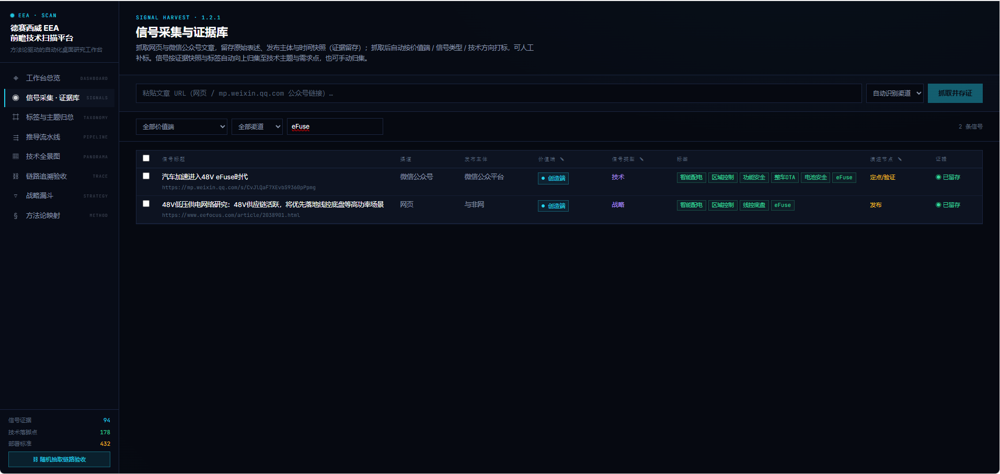

### 图2-1-2 信号证据抽屉

同一证据库上打开的抽屉，用来核对一条信号的原始采集和归集位置。

可见字段：链接、发布主体、发布时间；技术方向标签；向上归集到的需求点；证据快照中的标题、来源、链接、发布时间与摘要文字。

动作：人工补齐技术方向并确认（REQ-TAG-06）；自动归集、改选技术主题、归集、移出（REQ-SIG-08）。

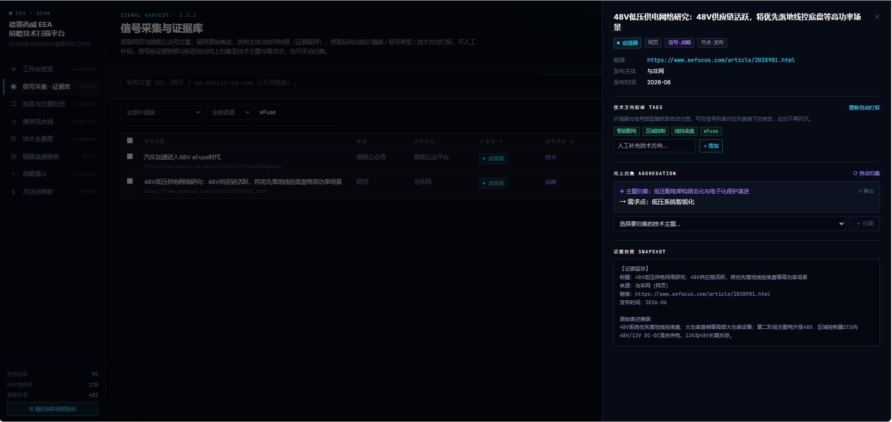

### 图2-2 信号采集·证据库（与图2-1-1 同一张图）

来源把这张列表又用作环节二的图，用来看一条信号当前的价值链环节、信号类型和技术方向标签。Word 里对应同一次导出的 `image1`，没有第二张位图。动作与图2-1-1 相同，另加列表内下拉修正环节和类型（REQ-TAG-03）。


### 图2-3 标签与主题归总

管理全局技术方向标签，并浏览已归集的技术主题。

可见内容：全部技术方向标签及频次；自定义标签的添加入口（REQ-TAG-06）；价值链环节与信号类型的筛选芯片，芯片文字即第 2 节的封闭词表。主题表列：技术主题、价值链、信号频次、来源数（来源数为读图）、技术方向标签。

本页不提供合并或优先级排序（REQ-DEM-02）。

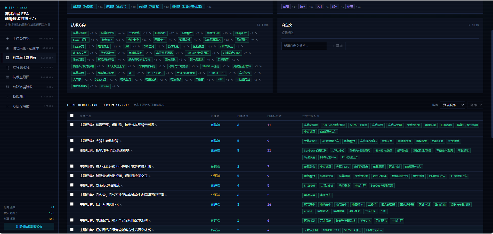

### 图2-4 链路追溯验收（需求点到车辆功能）

按链路分段展示一条需求如何变成车辆功能。上半是主题归集，含交叉验证与时间序列核验；接着是需求—功能映射。散文已规定这些步骤（REQ-DEM-09 至 REQ-DEM-13，REQ-MAP-02 至 REQ-MAP-05）。按钮上的逐字文案未再单独复核的，不写入本计划。

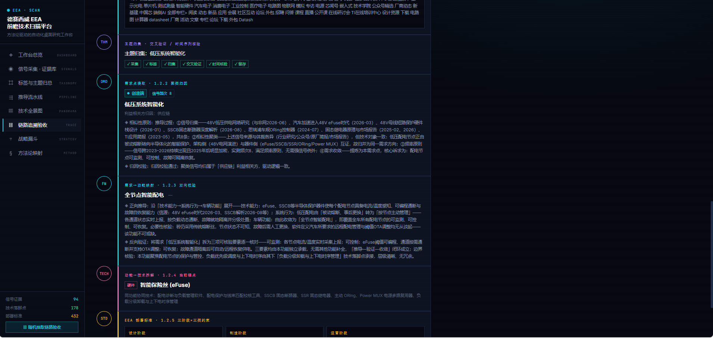

### 图2-5 技术全景图

按价值链环节列出需求点。展开一个需求点后看见车辆功能，功能下是带域芯片的技术落脚点，并带有关联标准的数量（REQ-TECH-04、REQ-TECH-02）。环节行上有需求数、功能数、技术落脚点数。

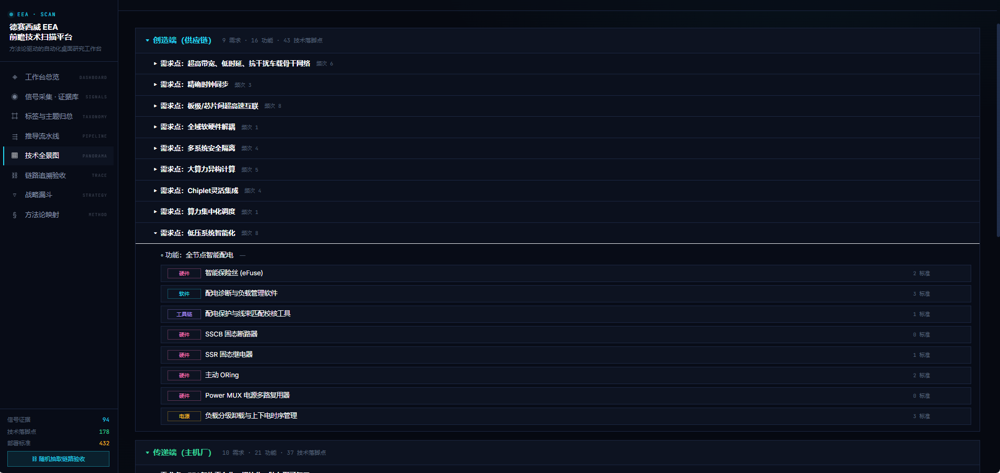

### 图2-6 链路追溯验收（至技术落脚点）

与图2-4 同一类追溯页的下半：车辆功能、技术落脚点、部署标准。标准区按设计、制造、运营分卡，卡上有约束类型；没有实质内容的阶段显示留空（REQ-STD-01、REQ-STD-02）。这一帧的再下方还有一条战略分类摘要，正式的漏斗页是图2-7。

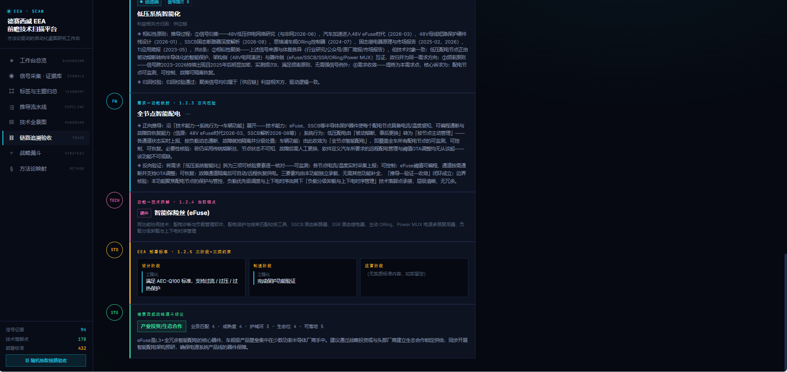

### 图2-7 战略四步漏斗

四步横条的文字：

1. 行业级全景扫描。求广：不遗漏颠覆性方向。
2. 业务场景适配过滤。求准：剔除长尾偏离技术。
3. 多维价值综合研判。求实：五维交叉定性评估。
4. 落地策略分类。行动：差异化配置资源。

每步显示当前通过数量。数量随扫描变化，不写入需求（REQ-RULE-04）。

其下按三类分列。产业投资/生态合作类的列提示，读图为「壁垒高 · 战略投资 / 并购 · 生态绑定」。前瞻布局、短期可落地两列也各有一行提示，本次读图没有逐字核定，不转写。卡片展示落脚点名称、五维条、总分（/25）和策略备注（REQ-STR-04、REQ-STR-05、REQ-STR-06）。

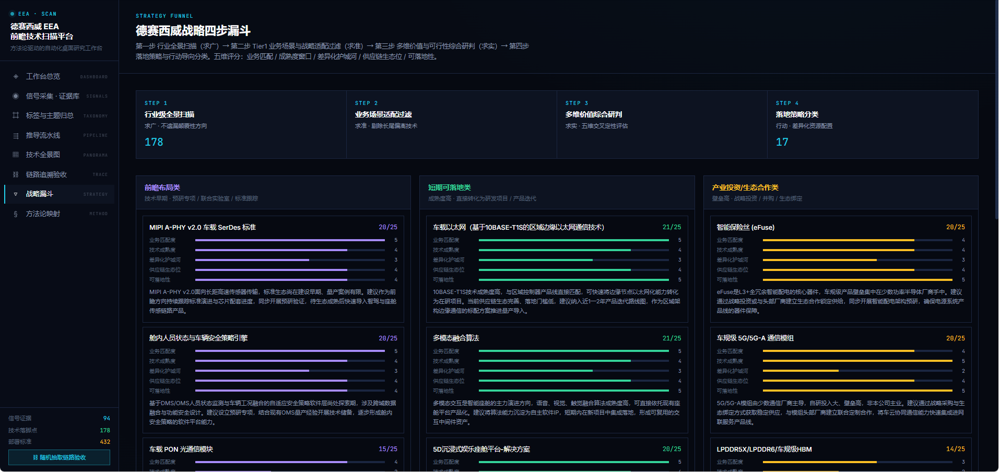

## 7. 技术栈（提案，非原文）

本节是提案。docx 和截图都没有指定软件栈。不要把本节写成「来源要求使用某某框架」。版本用各项目当时的稳定发布，本计划不锁补丁号。

推荐这一套，因为页面是密集的中文研究工作台，后台是抓取、分词和可追溯的关系数据。

| 选择                                                                                                  | 它服务的需求                                                                                                                                                                                         |
| --------------------------------------------------------------------------------------------------- | ---------------------------------------------------------------------------------------------------------------------------------------------------------------------------------------------- |
| 浏览器端：TypeScript、React、Vite                                                                          | 第 6 节的列表、抽屉、主题表、全景展开、追溯分段、漏斗卡片。REQ-SIG-04、REQ-SIG-05、REQ-UI-01、REQ-TECH-04、REQ-STR-06                                                                                                          |
| 服务端：Python、FastAPI                                                                                  | 接收采集提交、渠道识别（可复核）、中文高频标签。REQ-SIG-01、REQ-SIG-02、REQ-TAG-05                                                                                                                                       |
| 中文分词：jieba，跑在服务端进程内                                                                                 | 技术方向标签的高频汇总。REQ-TAG-05。不用英文全文检索配置充当中文分词                                                                                                                                                        |
| 数据库：PostgreSQL                                                                                      | 第 4 节的外键追溯、两套封闭词表、五维分数、纠偏记录。REQ-RULE-02、REQ-RULE-03、REQ-TAG-01、REQ-TAG-02、REQ-STR-04                                                                                                           |
| 快照正文：开发时用本地目录，部署时用 S3 兼容对象存储                                                                        | 证据快照的正文与原始采集。数据库保存索引和摘录字段。REQ-SIG-07                                                                                                                                                           |
| 研究者侧本地采集工具 + 两个渠道适配器，对上同一个「粘贴 URL」入口                                                                | 企网部署时服务端无公网出网，网页与微信公众号的 HTTP 抓取在研究者本机（或具备出网的采集节点）执行，再将 URL、渠道、元数据与正文快照提交平台 API。普通网页与微信公众号各走单独适配器。REQ-SIG-01 的「一键抓取并存证」指研究者一次操作完成，不限定抓取进程必须在服务端。本地已采集页面/正文优先作为提交输入。微信仍失败时的 Web 粘贴补救见 REQ-SIG-11 |
| **自研文档摄取服务** `eea-doc-ingest`（FastAPI + **本项目自部署的 Microsoft MarkItDown**；仓内 `services/doc-ingest/`） | 方法论 Word/PDF/PPT 等「图文对照」材料、研究者上传的附件：MarkItDown 出正文/表格，Vision 补图块语义。见 **§7.1**                                                                                                                  |
| **视觉模型（Vision LLM）**：经企网合规网关调用，API Key 仅配置在摄取服务与 Agent 网关环境变量                                       | 对文档内嵌图、截图、流程图做 OCR/描述，写入图块记录供 RAG 与抽屉展示。见 **REQ-DOC-03**                                                                                                                                       |
| **产品内 EEA Agent**：`pydantic-ai` + `eea-agent` 模块（嵌入 FastAPI）                                        | 研究者侧栏/单页多会话助手；类型化 Tool、`Conversation` 持久化、SSE 流式。见 **§7.2**；实施选型见 **§10.1 已决 #15**                                                                                                             |

不引入图数据库。第 4 节的链路是带分支的有向关系，用外键表即可满足 REQ-RULE-03。

### 7.1 文档摄取：自有 MarkItDown + Vision LLM（内嵌图）

**定位**：`eea-doc-ingest` 是 EEA 平台自有组件，与信号 URL 采集并列。它**不是** RAG 替代品，而是 RAG 与 Agent 的**上游规范化层**：输出带结构的 Markdown、图块清单与元数据，再进入分块、向量化与检索。

**采用 Microsoft MarkItDown（库）**：正文与表格转换使用官方 Python 包 `markitdown`（建议 `pip install 'markitdown[all]'`，版本在项目 `requirements.txt` / 镜像中**锁定**）。由本项目构建并运维**自有转换服务**（薄 FastAPI 封装），与主 API 同发布节奏。

**部署要点**（`services/doc-ingest/`，随 EEA 仓库交付）：

| 项 | 约定 |
| --- | --- |
| 镜像 | 多阶段 Dockerfile：Python 3.12+，系统依赖按 MarkItDown 文档（如 PDF 用 poppler、可选 tesseract） |
| 接口 | `GET /healthz` → `{ status, markitdown_version, converters }`；`POST /ingest` multipart 字段 `file` → `{ body_md, figure_records, canonical_md, source_name, mime, ingest_steps[] }` |
| 配置 | `EEA_VISION_API_KEY`、`EEA_VISION_BASE_URL`、`EEA_VISION_MODEL`；可选 `EEA_INGEST_MAX_MB`、`EEA_VISION_MAX_CONCURRENCY` |
| 密钥 | 仅 K8s Secret / 企网配置中心注入，**不进 Git、不进前端** |
| 调用方 | 主 API 或 Agent 仅通过内网调用本项目 ingest URL（如 `http://eea-doc-ingest:8080`） |

**正文与图的分工**：MarkItDown 对 docx 内嵌图常输出 `` **占位**；摄取管线在合并前**解析 OOXML/PDF 抽出真实图块**，用 Vision 生成文字，再**替换**占位符写入 `canonical_md`（满足 REQ-DOC-03）。

**处理流水线（单文件）**：

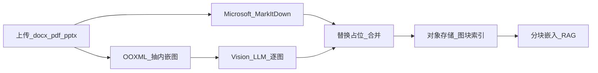

| 步骤 | 做法 | 产出 |
| --- | --- | --- |
| 正文（MarkItDown） | 调用**本项目容器内** `MarkItDown().convert_local(path)`（或等价 API）；得到标题、段落、表格的 GFM | `body_md`；记录 `markitdown_version` |
| 结构解析（并行） | DOCX：`word/media/*`；PDF：嵌入图或按页栅格；PPT：按 slide 抽图；与 MarkItDown 输出顺序对齐锚点 | `figure_index`、二进制图块 |
| 内嵌图识别 | 每张图 Vision LLM：JSON schema（`caption_zh`、`ocr_text`、`ui_elements[]`、`confidence`）；可选 tesseract 仅作 Vision 不可用时的回退 | `figure_records[]` |
| 合并 | 将 `body_md` 中 base64 占位替换为 `### 图 {n}` + 摘要 + 对象存储签名 URL | `canonical_md` |
| 索引 | 对 `canonical_md` 与图块文本分块；元数据 `source_file_id`、`figure_index` | 向量库 / 全文检索 |

**与证据库关系**：

- **网页/公众号信号**：仍以 REQ-SIG-07 文字快照为主；正文内远程图片可选异步拉取后走同一 Vision 步骤（第二期）。
- **方法论/附件文档**（如来源 docx、汇报材料）：上传即触发 `eea-doc-ingest`；生成物挂到 `EvidenceSnapshot` 扩展或 `eea_document_artifact`（见 §4.1 增补说明），抽屉可展示「正文 + 图块摘要」。

**需求条文（新增，实施期）**：

- **REQ-DOC-01** 平台提供**本项目自部署**的文档摄取服务（含 MarkItDown），支持至少 `.docx`、`.pdf`；输出 `canonical_md` 与元数据（页数、图块数、`markitdown_version`、Vision 模型 id）。
- **REQ-DOC-02** 摄取结果持久化到对象存储；数据库保存索引、摘录与图块 JSON；可追溯至原始文件哈希。
- **REQ-DOC-03** 每个内嵌图块须经 Vision LLM 或经审计批准的本地 OCR 回退生成可读文本；禁止仅以 `data:image/...` 占位符入库。
- **REQ-DOC-04** 图块识别失败或 `needs_review` 时，证据状态可为「待人工复核」，不阻塞文字部分入库（对齐 REQ-SIG-10）。
- **REQ-DOC-05** RAG 检索可命中图块字段；引用须带 `figure_index` 与源文件，满足 REQ-RULE-03 追溯。

**分期**：W2 最小路径（DOCX 抽图 + Vision + 存对象存储）；W3 接 RAG 分块；W4 报告模板引用图块摘要；PDF 多栏与 PPT 动效列为二期。

**验收 harness**：对来源 docx（eFuse 案例说明）重跑摄取后，图2-1-1～图2-7 对应图块至少各有非空 `caption_zh` 或 `ocr_text`，且 `canonical_md` 中无未解释的 `base64...` 占位。

### 7.2 产品内 EEA Agent（运行时，非终端编程代理）

**定义**：「EEA Agent」指**嵌入平台**、供研究者在 React 工作台内使用的智能助手（侧栏或独立「助手」面），帮助完成环节二～七的**建议、检索与草稿**，并在人工确认后**写回 PostgreSQL**。它不是终端里的通用编程代理（不负责改仓库源码、不开放 shell/任意文件系统）。

**已定运行时：Pydantic AI**。在 FastAPI 内实现 `eea-agent` 包（`pip install pydantic-ai`，版本在 `requirements.txt` 锁定），以 **[Pydantic AI](https://ai.pydantic.dev/)** `Agent` 为唯一编排层（本期不引入 LangGraph 等第二套 Agent 框架）。

| 能力 | 实现要点 |
| --- | --- |
| 依赖注入 | `AgentDeps`：`user_id`、Async DB session、`page_context`（可选 `signal_id` / `theme_id`） |
| 工具 | `@agent.tool` 注册下表；入参/出参 Pydantic 模型，与 API 契约一致 |
| 多轮 | `agent.run(..., conversation=...)` / `result.conversation` 写回 `eea_agent_session` |
| 多会话 | 每线程一条 `conversation_id`；`GET/POST /api/v1/agent/sessions` |
| 流式 | `run_stream` + FastAPI SSE → React 聊天 UI |
| 确认写库 | `apply_confirmed_patch` 走 `requires_approval=True` 或变更单 + `DeferredToolResults` 续跑 |

对话模型经企网 LLM 网关（OpenAI 兼容或 Pydantic AI 已支持 provider 字符串）。Vision 仅在 `eea-doc-ingest`；Agent 只读已入库正文与图块摘要。

**参考实现**：[FastAPI chat 示例](https://ai.pydantic.dev/examples/conversational-agents/chat-app/)；人工审批可参考 Pydantic AI deferred-tool / `requires_approval` 文档。

**边界（安全与领域）**：

| 允许 | 禁止 |
| --- | --- |
| 调用平台定义的 **Tool**（见下表），参数经 Pydantic 校验 | 直接执行 SQL、访问宿主机 shell、读写对象存储路径 |
| 读取当前用户有权见的信号、主题、需求点、RAG 分块 | 绕过 RBAC 读取他人私有「记忆」 |
| 生成 Markdown 报告草稿、初标 JSON 建议 | 无审计地覆盖已人工确认的标签/归集（REQ-RULE-02） |

**工具面（第一期最小集，均可映射 REQ）**：

| Tool | 作用 | 写库 |
| --- | --- | --- |
| `search_evidence` | 关键词/筛选检索信号与快照摘录 | 否 |
| `search_rag` | 向量+元数据检索（含 `canonical_md`、图块 `ocr_text`） | 否 |
| `suggest_signal_tags` | 环节/类型/技术方向初标建议 | 否（仅返回建议） |
| `suggest_theme_membership` | 信号归入技术主题建议 | 否 |
| `propose_db_patch` | 结构化变更单（标签、归集、备注字段） | 否，直至用户确认 |
| `apply_confirmed_patch` | 在事务中执行已确认变更 | 是，并写 `eea_correction_audit` |
| `draft_trace_report` | 按需求点/落脚点生成追溯摘要 Markdown | 否（导出或粘贴到报告流） |

**交互形态**：

- API：`POST /api/v1/agent/sessions`、`POST .../messages`（支持 SSE 流式）；每轮携带 `citations[]`（信号 id、图块 `figure_index`、RAG chunk id）。
- UI：助手面板展示「建议 / 待确认变更 / 已应用」；封闭词表字段以**下拉候选**呈现，不把自由文本写入 `eea_ref_code` 枚举。
- 记忆：用户级或项目级短记忆（偏好、常用筛选、澄清结论）入向量库或 JSON 侧表；与平台主数据分离，可删除。

**需求条文（新增，实施期）**：

- **REQ-AGT-01** 产品内提供 EEA Agent 对话入口；支持**多会话**（每用户多条 `conversation_id`）；会话与 `Conversation` 持久化，操作者绑定平台用户身份。
- **REQ-AGT-02** Agent 只能通过注册 Tool 读写业务数据；任何写库须经 `apply_confirmed_patch` 或等价「确认后提交」路径，并满足 REQ-RULE-02。
- **REQ-AGT-03** 回答与建议须附带可追溯引用（信号、主题、需求点或 RAG 来源），满足 REQ-RULE-03 的引用粒度（至少到信号或文档块）。
- **REQ-AGT-04** 对已人工确认的价值链环节、信号类型、技术方向标签与归集结果，Agent 不得自动覆盖；仅可提示差异并生成变更单。
- **REQ-AGT-05** LLM 调用（含重试、限流、脱敏日志）经统一网关；密钥不进前端。
- **REQ-AGT-06** 产品内 Agent 实现基于 **Pydantic AI**；工具与结构化输出须用 Pydantic 模型定义，会话状态以 `Conversation`（或等价序列化）持久化。

**与第 9 节排期**：W3 接入 `suggest_`* 与初标 Prompt；W4 接入 RAG + `propose_db_patch` / `apply_confirmed_patch` + 报告草稿；W5 用 eFuse harness 走通「建议 → 确认 → 追溯可读」。

物理表、字段类型与范式对照见 **§4.1**（精简版 **10 基表 + 2 视图**）。逻辑上仍覆盖：信号与快照、标签词表、主题、需求点、功能、落脚点、标准、研判版本与纠偏审计。复核操作者角色见 REQ-RULE-02。

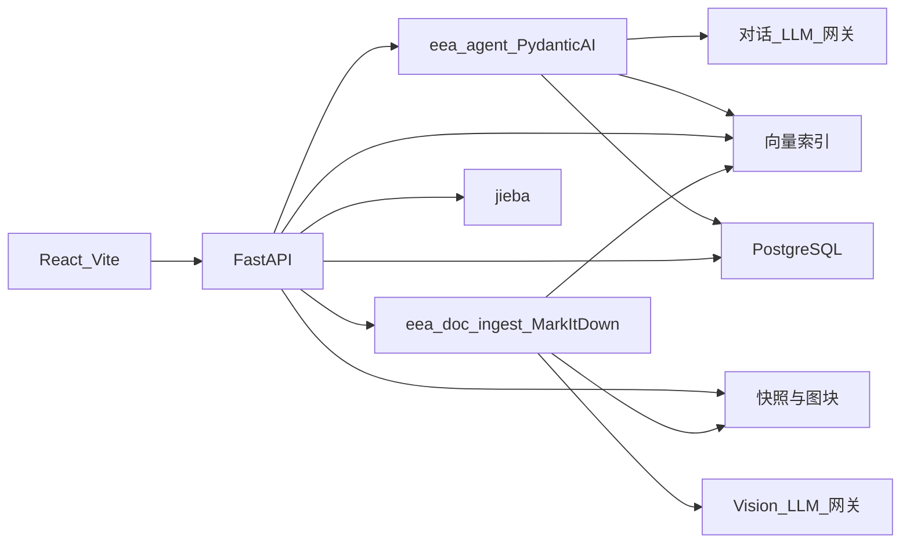

## 8. 后续实现分期

分期是以后写代码时的顺序。本步不创建应用代码。每一期用第 11 节的 harness 验收，harness 行不是种子需求。与 **第 9 节**六周 Agent 排期的对应关系见 §9.5。

### 阶段 A：证据库

关闭 REQ-SIG-01 至 REQ-SIG-08、REQ-UI-01；**REQ-DOC-01、REQ-DOC-02**（文档上传与 `eea-doc-ingest` 最小 DOCX 路径）。

harness 检查：附录 A 的两条信号能按关键词检索到；渠道分别是网页和微信公众号；证据状态为已留存；打开抽屉能看到链接、发布主体、发布时间和快照。对照图2-1-1、图2-1-2。可选：来源 docx 经摄取后可在方法论映射或附件区打开 `canonical_md` 摘要。

### 阶段 B：标签与需求点

关闭 REQ-TAG-01 至 REQ-TAG-06、REQ-DEM-01 至 REQ-DEM-15、REQ-RULE-01、REQ-RULE-05；**REQ-DOC-03、REQ-DOC-04**（Vision 图块入库与复核状态）。

harness 检查：两条直接相关信号归入需求点「低压系统智能化」；归因是创造端（供应链）；信号频次按表1 可复核为 8；图2-3 的主题表能找到该行；交叉验证和时间序列有记录；价值链环节的下拉只有 4 个既有值。

### 阶段 C：功能与技术图谱

关闭 REQ-MAP-01 至 REQ-MAP-06、REQ-TECH-01 至 REQ-TECH-04、REQ-RULE-03。

harness 检查：该需求点映射到车辆功能「全节点智能配电」；映射在正向与反向都有记录之后才出现在追溯页；功能下同时存在多个域的落脚点，其中包括硬件域落脚点「智能保险丝（eFuse）」。对照图2-4、图2-5。

### 阶段 D：部署标准

关闭 REQ-STD-01 至 REQ-STD-03。

harness 检查：表 B 的三行都在；设计与制造各有一条工程化要求；运营阶段是明示留空，而不是被删掉的行；系统没有补写经济性或安全合规的虚构条文。对照图2-6。

### 阶段 E：战略漏斗

关闭 REQ-STR-01 至 REQ-STR-07、REQ-RULE-02、REQ-RULE-04。

harness 检查：该落脚点在筛选池中的分类是「产业投资/生态合作」；五维与表 C 一致；总分 20/25；策略备注在。对照图2-7。滚动更新规则下，harness 分数代表案例写定当时的记录，不代表平台以后不能改判。

## 9. EEA Agent 开发计划

**周期**：6 周（2026-10-19 — 2026-11-29）。**关联**：[企业同类 UI 调研](./enterprise-ui-study.md)。

### 9.1 项目目标

在 6 周内交付 **EEA（电子电气架构）智能代理** 的核心能力，支撑德赛西威前瞻技术扫描工作流：

1. **文档与网页数据处理**：与 REQ-SIG-01/11 一致——企网场景下本地采集 + 平台存证；支持网页/公众号正文进入证据库；**自有** `eea-doc-ingest`**（Microsoft MarkItDown + Vision LLM）** 处理上传 docx/pdf 与内嵌图（§7.1）。
2. **智能分析**：封闭标签体系（价值链、信号类型等）+ 可扩展技术方向标签；主题归集与聚类汇总（对齐 REQ-DEM-02/03、REQ-TAG-05）。
3. **用户定制化交互**：产品内 **EEA Agent**（Pydantic AI，§7.2）+ 记忆增强 RAG、对话式/手动编辑，且**写回数据库**并保持链路映射（REQ-RULE-02、REQ-RULE-03、REQ-AGT-01～06）。

本节为 **产品内 Agent + 功能实现排期**；需求条文与验收 harness 以本文第 1–8 节及第 11 节为准。

### 9.2 范围与里程碑

| 里程碑        | 目标周  | 可演示结果                                                                                     |
| ---------- | ---- | ----------------------------------------------------------------------------------------- |
| M0 基线      | W1 末 | 技术栈定稿、LLM 账号可用、PostgreSQL 精简 Schema（§4.1）migration 草案、调研结论摘要                              |
| M1 壳层 + 采集 | W2 末 | React 工作台导航与五工作面路由；本地/插件式 URL 提取可提交一条信号；`eea-doc-ingest` **可部署**，DOCX 上传返回 `canonical_md` |
| M2 智能管线    | W3 末 | 产品内 Agent 初标工具（`suggest_signal_tags`）；主题侧聚类汇总可出图2-3 同类列表                                  |
| M3 个性化与闭环  | W4 末 | Agent + RAG；`propose_db_patch` / 确认后写库；可导出/生成分析报告                                         |
| M4 稳定化     | W5 末 | 复盘清单关闭、P0/P1 缺陷修复、eFuse harness 链路可走通                                                     |
| M5 交付展示    | W6 末 | 性能与体验优化、汇报 Demo 与已知限制说明                                                                   |

### 9.3 六周排期（工作内容）

#### Week 1（10/19 — 10/25）基础与数据底座

- 技术栈选型：React + Vite + FastAPI + PostgreSQL；对象存储与本地采集工具边界（见第 7 节）。
- 大模型 API：账号采购、企网出网/网关策略、模型选型（中文长文、结构化 JSON 输出）；**单独申请 Vision 模型 Key**（`EEA_VISION_`*），与对话模型分流计费与限流。
- `eea-doc-ingest` 服务骨架：`markitdown[all]` 锁定版本、Dockerfile、健康检查（含 `markitdown_version`）、Vision Secret 注入约定（§7.1）。
- 数据库：落实 **10 基表 + 2 视图**（§4.1）；种子 `eea_ref_code`、范式自检说明。
- 调研：吸收 `enterprise-ui-study.md`，明确列表/抽屉/主题表/漏斗等交互参照。

#### Week 2（10/26 — 11/01）前端骨架与内容提取

- 前端：布局、左侧导航（五工作面 + 总览/流水线/方法论最小页 REQ-UI-02）、路由与空状态页。
- 文档/网页提取：浏览器扩展或本地采集 CLI（网页 + 微信适配器）；对接 `eea_signal` 创建 API。
- **文档摄取**：实现 `eea-doc-ingest` v0——**自有 MarkItDown 容器**跑通 docx/pdf → `body_md`；并行抽图 → Vision → 合并 `canonical_md`；compose 内与主 API 联调。运维通过环境变量与 `/healthz`、`/docs`。
- 证据抽屉只读展示（标题、链接、快照摘录）；附件类证据可增加「图块摘要」折叠区（只读）。

#### Week 3（11/02 — 11/08）大模型与标签/聚类

- LLM 接入：统一网关（重试、限流、审计日志）；`eea-agent` 骨架（Pydantic AI、`Conversation` 落库、SSE）（REQ-AGT-01/05）；Prompt 与 `suggest_signal_tags`（REQ-TAG-04/05、REQ-AGT-02）。
- 标签体系：封闭下拉 + `eea_vocab` / `eea_signal_tag`；方法论管理员纠偏入口预留（REQ-RULE-02）。
- 聚类汇总：主题归集索引（`eea_tech_theme`）、相似信号建议分组；**不**在归集阶段合并需求或排序（REQ-DEM-02）。
- 将 `canonical_md` 与图块文本纳入 RAG 分块；初标 Prompt 可引用图块 `ocr_text`（REQ-DOC-05）。

#### Week 4（11/09 — 11/15）记忆、编辑闭环与报告

- 个性化 RAG：用户/项目级记忆库（向量或关键词+元数据）；`search_rag` 注入 Agent 上下文（REQ-AGT-03）。
- 编辑同步：手动改标签/环节/主题归属；Agent `propose_db_patch` → 用户确认 → `apply_confirmed_patch` + `eea_correction_audit`（REQ-AGT-02/04）。
- 分析报告：按需求点/主题/落脚点模板生成 Markdown 或 PDF（含追溯链摘要）。

#### Week 5（11/16 — 11/22）复盘与缺陷修复

- 阶段性复盘：对照 REQ 清单与 eFuse harness（第 11 节）。
- 集中调试：采集失败、微信粘贴补救（REQ-SIG-11）、视图指标 8/16、研判版本（REQ-STR-07）。
- 安全与合规：密钥不进库、操作者字段、日志脱敏。

#### Week 6（11/23 — 11/29）优化与汇报

- 全面 Debug、关键路径性能（列表分页、快照加载、LLM 批处理）。
- 汇报展示：端到端 Demo（采集 → 主题 → 需求 → 功能 → 落脚点 → 漏斗）。
- 文档：部署说明、已知限制、二期 backlog（如 supplemental_urls、SSO 用户表）。

### 9.4 甘特图（时间轴）

起算日：**2026-10-19（周一）**。周末不排强制交付，但允许联调。

```mermaid
gantt
    title "EEA Agent 开发计划（6周）"
    dateFormat YYYY-MM-DD
    axisFormat %m/%d

    section W1
    技术栈与LLM账号采购 :w1_stack, 2026-10-19, 4d
    数据库Schema与范式规划 :w1_db, 2026-10-19, 5d
    同类平台调研结论 :w1_research, 2026-10-21, 4d
    M0基线 :milestone, m0, 2026-10-25

    section W2
    前端布局与路由 :w2_fe, 2026-10-26, 5d
    网页提取与eea-doc-ingest :w2_extract, 2026-10-26, 6d
    信号入库API联调 :w2_api, 2026-10-30, 2d
    M1壳层与采集 :milestone, m1, 2026-11-01

    section W3
    大模型接口接入 :w3_llm, 2026-11-02, 3d
    标签体系与初标 :w3_tags, 2026-11-03, 3d
    主题聚类与汇总 :w3_cluster, 2026-11-05, 3d
    M2智能管线 :milestone, m2, 2026-11-08

    section W4
    记忆增强RAG含图块 :w4_rag, 2026-11-09, 4d
    手动与对话编辑同步库 :w4_edit, 2026-11-10, 4d
    分析报告生成 :w4_report, 2026-11-12, 3d
    M3个性化闭环 :milestone, m3, 2026-11-15

    section W5
    阶段性复盘 :w5_review, 2026-11-16, 2d
    功能调试与缺陷修复 :w5_fix, 2026-11-18, 4d
    M4稳定化 :milestone, m4, 2026-11-22

    section W6
    全面Debug与性能优化 :w6_perf, 2026-11-23, 4d
    汇报展示与文档 :w6_demo, 2026-11-26, 3d
    M5交付展示 :milestone, m5, 2026-11-29
```

| 周次 | 日历 | 主题 |
| --- | --- | --- |
| W1 | 10/19 — 10/25 | 选型、Schema、调研 |
| W2 | 10/26 — 11/01 | 前端 + 提取插件 |
| W3 | 11/02 — 11/08 | LLM + 标签 + 聚类 |
| W4 | 11/09 — 11/15 | RAG + 编辑闭环 + 报告 |
| W5 | 11/16 — 11/22 | 复盘 + 修缺陷 |
| W6 | 11/23 — 11/29 | 优化 + 汇报 |

### 9.5 与第 8 节实现分期映射

| Agent 周次 | 第 8 节阶段 | 说明 |
| --- | --- | --- |
| W1–W2 | 阶段 A 证据库 | 信号、快照、检索、抽屉 |
| W3 | 阶段 B 标签与需求点 | 封闭词表、主题表、REQ-DEM-02 |
| W4 | 阶段 C–E 部分 | 追溯、全景、漏斗、报告可先做只读+Agent 草稿 |
| W5 | harness 验收 | 第 11 节 eFuse 全链路 |
| W6 | 非功能 | 性能、演示、文档 |

### 9.6 风险与依赖

| 风险 | 缓解 |
| --- | --- |
| 企网无公网 | 本地采集工具 + LLM/Vision 内网网关或合规代理（W1 必须闭合） |
| Vision 成本高、大图多页 docx 慢 | 图块去重（ perceptual hash）、并发上限、仅对宽>阈值或正文引用的图调用 Vision；失败走 REQ-DOC-04 复核队列 |
| 微信抓取失败 | REQ-SIG-11 粘贴补救；W2/W5 专项测试 |
| LLM 初标不稳定 | 方法论管理员纠偏 + 审计表；关键字段不自动覆盖已人工确认值 |
| 6 周满链路压力大 | W4 起报告与漏斗可「只读+半自动」；W5 只保证 harness 闭环 |

### 9.7 交付物清单

- 可运行前后端与 migration（含 `eea_ref_code` 种子）
- 本地/浏览器采集组件
- `eea-doc-ingest` **服务**（含 Microsoft MarkItDown 的 Docker 镜像、`docker-compose` 片段、环境变量与 Vision Key 轮换指引）
- 产品内 **EEA Agent**（`eea-agent` + `pydantic-ai`、Tool 清单、多会话 API、SSE、确认后写库说明）
- eFuse harness 数据集导入脚本
- 汇报 Demo 脚本与《已知限制》一页纸

## 10. 待确认与已决

### 10.1 已决

| 编号 | 结论 | 对计划的影响 |
| --- | --- | --- |
| 1 | 演进节点为封闭词表，仅「发布」「定点/验证」。无第三取值，界面不可新建。 | 新增 REQ-SIG-09；第 4 节 Signal 字段已更新。 |
| 2 | 证据状态为封闭工作流词表，五值：抓取中、抓取失败、已留存、待人工复核、已归档/停用。不设「人工粘贴正文」独立状态。 | 新增 REQ-SIG-10；第 4 节 Signal 字段已更新。 |
| 3 | 战略漏斗五维评分每维仅允许整数 1–5；综合分为五维之和。 | REQ-STR-04 已收紧；第 4 节 StrategicAssessment 已更新。 |
| 4 | 企网服务端无公网访问。网页/公众号采集由研究者侧本地采集工具执行并提交存证；本地已采集内容优先。REQ-SIG-01 验收口径不变。 | 第 7 节采集架构已更新。 |
| 5 | 微信公众号经本地工具仍失败时，允许在平台 Web 粘贴正文写入快照（保留 URL）；不设独立证据状态。 | 新增 REQ-SIG-11。 |
| 6 | 《洞悉EEA技术变革》§1.2、§1.4 不向本项目提供。 | 第 2 节来源表已更新；追溯节号标签保留为来源引用，不据此扩写方法条文。 |
| 7 | 人工复核由「方法论/词表管理员」执行；纠偏记录的操作者绑定该角色（平台用户身份）。 | REQ-RULE-02、第 7 节纠偏记录说明已更新。 |
| 8 | 部署标准中「经济性」「安全合规」第一期即可录入，与「工程化」同等；无内容时留空。 | REQ-STD-01 已明确。 |
| 9 | 信号频次 = 归入主题的信号条数；来源数 = 主题关联去重 URL 数。 | 新增 REQ-DEM-14；环节三、第 4 节、图2-3 说明已更新。 |
| 10 | 技术主题与需求点为两张表；图2-3 展示主题表，命名后写入需求点。 | 新增 REQ-DEM-15；第 4 节 TechTheme 已补充。 |
| 11 | 战略研判改判追加版本，保留历史并可查看时间线。 | 新增 REQ-STR-07；第 4 节 StrategicAssessment 已更新。 |
| 12 | 域词表不封闭；新建域名即时进入全局。 | REQ-TECH-02 已明确；第 4 节 Domain 已更新。 |
| 13 | 三导航页最小可用：总览计数+待办、流水线七环节只读、方法论节号对照表。 | 新增 REQ-UI-02；第 6 节已补充。 |
| 14 | 价值链四环节词表以图2-3 词面为准；表1「供应链（创造端）」等为 harness 别名，不另建词条。 | REQ-TAG-01 已明确。 |
| 15 | 产品内 EEA Agent 采用 **Pydantic AI**（`pydantic-ai`）作为唯一 Agent 编排框架，嵌入 FastAPI `eea-agent` 模块。 | §7.2、REQ-AGT-06；W3 起实现 Tool 与会话 API。 |

**实施风险（不改动 REQ-SIG-01）**：微信公众号反爬与登录态导致本地适配器成功率波动；REQ-SIG-11 为补救路径。

### 10.2 待确认

（暂无。原开放问题已全部收口至 §10.1。）

## 11. 附录：eFuse 验收 harness

本节的文章标题、器件名、厂商、分数和标准条文是测试数据，用来检查第 3 节的链路能否原样走通。它们不是平台要内置的需求，也不作为种子主数据的规格。

来源标题：德赛西威 EEA 关键技术落脚点推导链路逐环节图文对照说明——以硬件技术落脚点「智能保险丝（eFuse）」为案例。

harness 对象是平台技术全景图里硬件域的一项技术落脚点。它由需求点「低压系统智能化」经车辆功能「全节点智能配电」正向推导得出，是该功能当前拆出的硬件域核心执行器件。

### 表1 案例技术落脚点在推导链路中的位置

| 链路层级 | 对象 | 关键属性 |
| --- | --- | --- |
| 原始信号（1.2.1） | 2 条产业信号 | 微信公众号文章 1 条、网页行业研究 1 条；详见附录 A |
| 需求点（1.2.2） | 低压系统智能化 | 利益相关方归因：供应链（创造端）；信号频次 8；映射功能 1 项 |
| 车辆功能（1.2.3） | 全节点智能配电 | 创造端（供应链）；由需求点双向校验映射得出 |
| 技术落脚点（1.2.4） | 智能保险丝（eFuse） | 硬件域；关联部署标准 2 项 |
| 部署标准（1.2.5） | 设计/制造阶段工程化标准各 1 项 | 运营阶段暂无实质标准内容，平台如实留空；详见附录 B |
| 战略研判（1.4） | 本技术已进入战略漏斗筛选池 | 分类：产业投资/生态合作；综合评分 20/25；详见附录 C |

「关联部署标准 2 项」指有实质条文的两行。表 B 仍保留运营阶段的空行。表1 原文把需求点归因写成「供应链（创造端）」；正文和图2-3 的词面是「创造端（供应链）」。harness 保留表1 原文，验收时视为同一个价值链环节，不另建词条。

### 表A 与「智能保险丝（eFuse）」直接关联的 2 条原始信号

|  | 信号标题 | 渠道 | 发布主体 | 价值链环节/类型 | 技术方向标签 | 演进节点 | 发布时间 |
| --- | --- | --- | --- | --- | --- | --- | --- |
| 1 | 48V低压供电网络研究：48V供应链活跃，将优先落地线控底盘等高功率场景 | 网页 | 与非网 | 创造端（供应链）/战略 | 智能配电、区域控制、线控底盘、eFuse | 发布 | 2026-06 |
| 2 | 汽车加速进入48V eFuse时代 | 微信公众号 | 微信公众平台 | 创造端（供应链）/技术 | 智能配电、区域控制、功能安全、整车OTA、电池安全、eFuse | 定点/验证 | 2026-03 |

图2-3 主题表中「低压系统智能化」一行的信号频次读数为 8，与表1 一致。同行另一计数读图为 16，对应「来源数」；若与原图像素不一致，以原图为准。

### 表B 「智能保险丝（eFuse）」部署标准（三阶段 × 三类约束）

| 阶段 | 约束类型 | 标准要求 |
| --- | --- | --- |
| 设计阶段 | 工程化 | 满足AEC-Q100标准，支持过流/过压/过热保护 |
| 制造阶段 | 工程化 | 完成保护功能验证 |
| 运营阶段 | 工程化 | （无实质标准内容，如实留空） |

经济性、安全合规在本 harness中没有行。这不表示这两类约束不存在，只表示本 harness没有内容。

### 表C 战略漏斗条目「智能保险丝（eFuse）」五维评分

| 评估维度 | 评分（/5） | 说明 |
| --- | --- | --- |
| 业务匹配度 | 4 | 与区域控制器、电源系统产品线直接相关，是全节点智能配电架构的核心执行器件 |
| 技术成熟度窗口 | 4 | 车规级eFuse已有量产导入案例，AEC-Q100认证体系成熟，供应链配套相对完善 |
| 差异化护城河 | 3 | 器件级壁垒集中在少数功率半导体厂商手中；公司差异化主要体现在智能配电架构与系统集成层面 |
| 供应链生态位 | 4 | 头部厂商供给集中但合作通道明确，具备联合定义与定制合作空间 |
| 可落地性 | 5 | 无需自研器件，通过战略投资或生态合作即可锁定供给，投入门槛低、路径清晰 |
| 综合 | 20/25 | 分类：产业投资/生态合作；策略备注：建议通过战略投资或与头部厂商建立生态合作锁定供给，同步开展智能配电架构预研，确保电源系统产品线的器件保障 |

### harness 在七个环节中的走法

环节一。证据库以关键词检索与本落脚点直接相关的信号，完整清单是表 A 的 2 条。图2-1-1 是列表。图2-1-2 是信号「48V低压供电网络研究」的证据抽屉：上部为链接、发布主体与发布时间；中部为技术方向标签与向上归集；下部为证据快照。

环节二。图2-2 与图2-1-1 是同一张位图。以「48V低压供电网络研究」为例，标注结果是价值链环节「创造端（供应链）」、信号类型「战略」，技术方向标签「智能配电、区域控制、线控底盘、eFuse」。另一条信号的类型是「技术」。环节由标题和快照初判：标题已点明文章围绕48V供应链展开，快照文字中可识别多家供应商名称，故初判为创造端（供应链），之后允许人工纠偏。

环节三。归集不按器件名是否相同来并题。harness 信号覆盖的对象包括 48V 低压供电、eFuse、SSCB、固态继电器、理想二极管/ORing。共同诉求被抽象为需求点「低压系统智能化」，归因创造端（供应链），不是「48V 替代 12V」，也不是某一种器件需求。交叉验证从架构变化、器件供给、产业化发展三个角度支持该需求，通过后才进入功能推导。时间序列按事件实际发生时间串联，不表示 eFuse、SSCB、SSR 已经同时量产成熟。

环节四。需求点映射为车辆功能「全节点智能配电」。「全节点」指能力下沉到关键支路和用电节点；「智能配电」指监测、控制、保护、诊断和恢复的闭环。必要性校验：若仍以传统保险丝和机械继电器为主体，节点级状态感知、软件定义通断、快速故障隔离和自动恢复不能完整实现。反向验证：只做远程开关、只采集电流或只做电子熔断，都不足以承接该需求。正向与反向一致后，映射才发布。

环节五。功能拆出硬件域落脚点「智能保险丝（eFuse）」，关联 2 项有实质内容的部署标准。其角色是全节点智能配电的执行层硬件：每个配电支路有一个能被软件定义和驱动的保护器件。没有它，功能只能停在监测，不能做毫秒级主动保护与故障自恢复。来源对这一角色的证据呼应是：48V/12V混合供电格局扩大了低压配电网络的节点规模与功率等级，而「48V+eFuse」在特斯拉Cybertruck量产后的标配化趋势、MPS/Vishay/ST/Infineon/TI/onsemi等功率半导体厂商的集体入场与国内厂商的跟进布局，共同放大了对器件级智能保护的需求。图2-5 在同一功能下还展示了其他落脚点，域芯片包括硬件、软件、工具链、电源。画面中与本功能同时出现的名称有：配电诊断与负载管理软件、配电保护与线束匹配校核工具、SSCB固态断路器、SSR固态继电器、主动ORing、Power MUX电源多路复用器、负载分级卸载与上下电时序管理。这些名称是harness 画面，不是平台必须预置的目录。

环节六。设计阶段满足 AEC-Q100，并支持过流、过压、过热保护；制造阶段完成保护功能验证；运营阶段留空。见表 B。

环节七。该落脚点进入筛选池，分类为产业投资/生态合作，综合 20/25。第二步的业务关联是：公司不是功率半导体器件的主要供给方，但在智能配电架构定义、区域控制器集成和电源系统方案上具备直接参与基础，因此通过适配过滤。五维说明见表 C。分类理由是器件壁垒高、自研不经济，但供给锁定对产品线重要，所以走投资与合作。分数与分类互相印证。

来源声明：本案例说明的数据与截图取自德赛西威 EEA 前瞻技术扫描平台，方法论条目引自《洞悉EEA技术变革》工作流文档第 1.2、1.4 节。平台数据随持续扫描滚动更新，最新状态以平台实时界面为准。

### 图2-1-1 信号采集·证据库：与本案例技术落脚点直接相关的原始信号


### 图2-1-2 信号证据抽屉：采集原始数据、技术方向标签、向上归集与证据快照


### 图2-2 信号采集·证据库：以「48V低压供电网络研究」为主要展示对象

与图2-1-1 同一文件。


### 图2-3 标签与主题归总：创造端（供应链）需求点看板，含「低压系统智能化」卡片


### 图2-4 链路追溯验收（部分环节）：需求点（提取原则）→ 车辆功能


### 图2-5 EEA 创新技术全景图：需求点「低压系统智能化」展开视图——功能「全节点智能配电」及其多域技术拆解


### 图2-6 链路追溯验收：原始信号 → 主题归集 → 需求点（提取原则）→ 车辆功能 → 技术落脚点

画面下半同时含部署标准卡，以及一条战略摘要。


### 图2-7 德赛西威战略四步漏斗：智能保险丝（eFuse）位于产业投资/生态合作类


