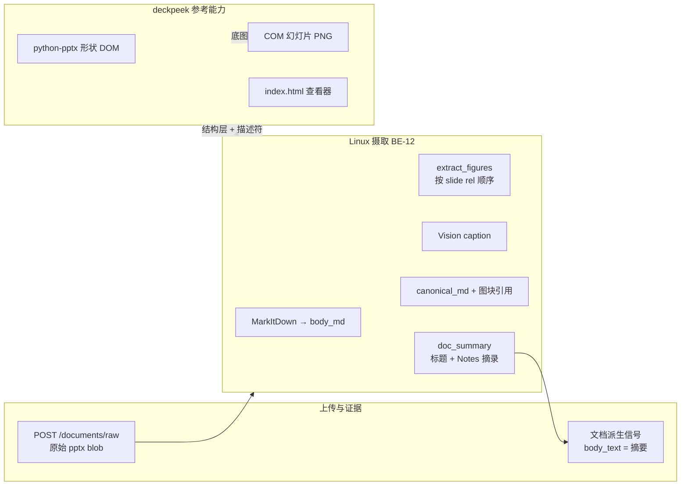

# deckpeek → EEA PowerPoint 处理与预览参考

**日期**：2026-11-10  
**参考物**：[`reference-will-deleted/deckpeek-src/src/deckpeek.py`](../../reference-will-deleted/deckpeek-src/src/deckpeek.py)（自 [`deckpeek-src-20261028.zip`](../../reference-will-deleted/deckpeek-src-20261028.zip) 解压）  
**关联需求**：REQ-DOC-01…05、BE-12、FE-11  
**EEA 现状入口**：[`backend/app/services/doc_ingest.py`](../../backend/app/services/doc_ingest.py)、[`backend/app/services/doc_summary.py`](../../backend/app/services/doc_summary.py)、证据详情「解析快照」[`frontend/views/dashboard/workspace.tsx`](../../frontend/views/dashboard/workspace.tsx)

---

## 1. deckpeek 做什么

单文件 Python 工具，把 `.pptx` 变成**可翻页、可点选形状、可复制一行描述符**的 HTML 查看器：

| 输出 | 作用 |
| --- | --- |
| `index.html` + 内联 CSS/JS | 底图/结构双模式、胶片条、`#sNN` 深链接、属性面板 |
| `slides/sNN.png` | 本机 **PowerPoint COM** 导出的幻灯片底图（视觉基准） |
| `media/*` | 从 OOXML 抽出的嵌入图，供结构层 `` |
| `deck.json` | 源文件 mtime、构建时间、`slide_versions`（防浏览器缓存旧底图） |

核心算法在 `export()` / `render_shape()`：用 **python-pptx** 遍历每页 `slide.shapes`，生成带 `data-slide` / `data-z` / `data-name` / `data-type` / 几何（英寸）/ `data-desc` 的 DOM；描述符一行格式例如：

```text
SLIDE 43 | z=4 | name="Table 7" | id=132 | TABLE | L=1.20in T=2.05in W=11.30in H=2.40in | rot=0 | fill=- | line=- | text="统计口径与样本分层"
```

底图导出在 `render_slides()`（`win32com` + `Slides(n).Export`），可用 `--no-render` **只生成结构层**（缺底图时仍可用「结构」模式）。

详见参考包 [`README.md`](../../reference-will-deleted/deckpeek-src/src/README.md) §7–8（交互、已知近似）。

---

## 2. 与 EEA 现有 PPT 管线的关系



| 维度 | EEA 今天 | deckpeek |
| --- | --- | --- |
| 文本入库 | MarkItDown + 图块替换；**不全文**进 `body_text` | 不面向 RAG；面向人工点选结构 |
| 图块顺序 | `ppt/slides/_rels/*.rels`，跳过 master/layout 装饰 | 按 `slide.shapes` z 序 + 嵌入 `media/` |
| 讲稿/Notes | `doc_summary` 从 MarkItDown 的 `### Notes:` 摘 | 结构层可读 `notes_slide`（未单独强调） |
| 预览 UI | canonical.md + 信号图块 data URL | 双模式查看器、框选、复制描述符 |
| 运行环境 | **Linux 内网生产 API** | Windows + 本机 PowerPoint（底图） |

**对齐原则（处理）**

- 继续以 [`doc_ingest.extract_figures`](../../backend/app/services/doc_ingest.py) 的 **slide rel 顺序**为图块 `figure_index` 与 Vision 顺序的权威来源（与 deckpeek 的「按页形状 walk」互补：前者管**证据图块**，后者管**可选结构预览**）。
- 幻灯片标题/Notes 摘要逻辑保持 [`doc_summary.py`](../../backend/app/services/doc_summary.py)；deckpeek 的 `data-desc` 可作为 **Agent 引用形状** 的远期格式（REQ-AGT-03），不替代 canonical。

**对齐原则（预览）**

- **生产 Linux**：默认仅 **结构模式**（`--no-render` 等价物）+ 已有图块缩略图充当胶片条占位；不依赖 COM。
- **Windows Capture 工作站**（可选）：复用 deckpeek 的 `render_slides()` 思路，导出 `sNN.png` 上传对象存储，供内网查看器「底图」模式（与 Go 客户端职责一致，不入公网 API 进程）。

---

## 3. 建议分期实现

### M1 — 契约与占位 UI（FE-11 / BE-12）

| 项 | 说明 |
| --- | --- |
| API | `GET /documents/{id}/deck-preview` → `text/html` 或 404（非 pptx / 未生成） |
| 存储 | 可选字段 `deck_preview_object_key`（与 `canonical_md_object_key` 并列）；ingest 后异步生成 |
| 前端 | 证据详情：`.pptx` 文档信号增加「幻灯片预览」Tab；`iframe` + `sandbox` 加载同源预览 URL |
| 失败 | `ingest_status=partial` 时仍可打开结构预览；底图缺失显示与 deckpeek 相同的提示条 |

### M2 — 结构 HTML 生成（从 deckpeek 抽取）

| 项 | 说明 |
| --- | --- |
| 代码 | 将 `deckpeek.py` 中 `export()` / `render_shape()` / `render_page()` **拆为** `backend/app/services/pptx_deck_viewer/`（经许可审查后 vendoring） |
| 依赖 | 已有测试依赖 `python-pptx`；**不**引入 `pywin32` 到 Linux 镜像 |
| 生成 | `ingest_document` 在 `.pptx` 分支末尾 `run_in_threadpool(build_structure_preview, bytes)`；HTML 写入 object store |
| 安全 | 预览 HTML 仅服务同源；内联 JS 保持 deckpeek 子集，禁外部 URL |

### M3 — 底图与 Windows 侧车

| 项 | 说明 |
| --- | --- |
| 导出 | Capture 客户端或运维脚本：对本机 pptx 跑 COM 导出 → `POST` 幻灯片 PNG 批次（按 `document_id` + slide index） |
| 版本 | 复用 `deck.json` 的 `slide_versions` 语义，API 返回每页 `?v=` |
| 验收 | 与方法论 Word 七图场景：结构层可选中形状，`figure_index` 与结构 z 序可人工对照 |

---

## 4. 前端交互取材清单（源自 deckpeek）

实现 M1+ 时优先复刻这些行为（不必一次做完）：

- 胶片条 + `←/→` / `#sNN` 路由
- 「底图 / 结构」分段（Linux 可先只开放结构）
- 选中形状 → 右侧属性；**复制描述符**（Agent 训练/复核用）
- 未读底图页顶栏提示（对应 `missing` 列表）

样式应对齐 EEA shell（`--eea-*`、`panel-card`），**不要**原样粘贴 deckpeek 默认色板到 `globals.css`。

---

## 5. 本地试跑参考（开发机）

仅供理解产物结构，**不作为生产路径**：

```bash
cd reference-will-deleted/deckpeek-src/src
pip install -r requirements.txt   # python-pptx；底图还需 Windows + pywin32 + PowerPoint
python deckpeek.py your.pptx -o /tmp/deckpeek-out --no-render
open /tmp/deckpeek-out/index.html
```

macOS 上可验证 **结构 HTML**；底图导出需在 Windows 复现。

---

## 6. 风险与约束

- **许可**：参考包无 LICENSE，vendoring 前需法务确认。
- **安全**：deckpeek `--serve` 本地导入服务器**不**并入 EEA API；EEA 只提供已认证文档的只读预览。
- **精确度**：deckpeek README §8 列出的渐变/项目符号/阴影近似同样适用于产品预期管理。
- **删除目录**：`reference-will-deleted/` 可能在合并前移除；实现落地后把必需算法迁入 `backend/` 并在此文保留「来源」脚注即可。

---

## 7. 追踪

| 任务 | 更新 |
| --- | --- |
| BE-12 | 增加「pptx 结构预览 HTML + slide/figure 对齐」验收项 |
| FE-11 | 增加「文档 pptx deck 预览 Tab（同源 iframe）」 |
| CC-02 / Capture | 可选 COM 底图上传契约（M3） |
